<div align="center">

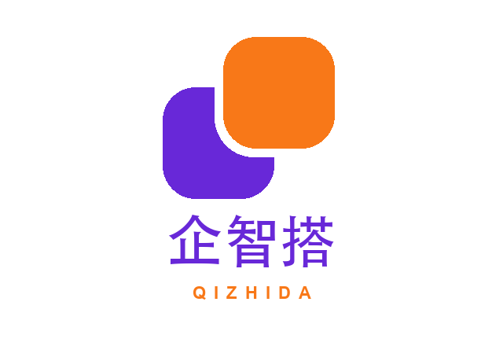

# 企智搭 · 智能体平台

**QiZhiDa Agent Platform (QIZHIDA)** — 企业级智能体中台

让每个员工都有一个数字伙伴，让每个流程都装进办公开箱。

---

[](#-快速开始)
[](#-功能模块)
[](#-许可证)
[](#-验证与常见问题)
[](#-验证与常见问题)

[项目介绍](#-项目介绍) · [产品价值](#-产品价值) · [重点产品](#-重点产品讲解) · [快速开始](#-快速开始) · [控制台](#-控制台一览) · [功能模块](#-功能模块) · [技术架构](#-技术架构) · [本地部署](#-本地部署) · [文档索引](#-文档索引) · [贡献](#-贡献)

</div>

---

##  项目介绍

**企智搭 (QIZHIDA)** 是一套面向企业的智能体中台。把智能体、知识、技能、工具、记忆、工作流、模型、额度、审计这些碎片能力统一成可治理的"目录 + 工作台",让管理员专注于能力建设与质量把控,让业务成员专注于用对话与流程把事情做完。

| 我们不是 | 我们是 |
| --- | --- |
|  一个聊天机器人 |  一个**企业级智能体中台** |
|  一个 prompt playground |  一个**可治理的能力目录 + 工作台** |
|  一个孤立的 Agent 框架 |  一个**多智能体协同 + 工具编排 + 知识检索 + 记忆**的完整平台 |
|  一个 demo-only 项目 |  一个**支持多租户 / 多工作区 / 审计 / 额度**的生产系统 |

>  **冷启动办公开箱** — 部署当天就能给全员用。预置数字伙伴 (Copilot)、办公技能 (Skill)、企业知识 (Knowledge)、审批流 (Workflow),管理员只需按企业情况微调即可,不必从 0 搭建。

后端 **Python 3.12 + FastAPI 模块化单体** (15 个能力域 + 10 个共享内核,六边形分层 + import-linter 守护边界),前端 **React 18 + Vite** 双侧工作台 (用户侧 + 管理侧)。

---

##  产品价值

| 支柱 | 价值 | 落地方式 |
| --- | --- | --- |
|  **安全零信任** | 默认所有调用都可疑,全程审计 | JWT + 多租户隔离 · gVisor 沙箱 · 网络出站白名单 · Vault 密钥 · 工具调用 100% 审计 |
|  **先进生产力** | 每个员工配一个数字伙伴 | 8 种 SSE chunk 流式可见 · 多智能体协同 (嵌套深度 3) · 知识+记忆双引擎 · 渠道即插即用 |
|  **成本新范式** | 按需购买,按量计费 | 工作区粒度额度 · 部门用量看板 · 告警阈值 · 成本可追溯到具体 turn |

### 价值流转

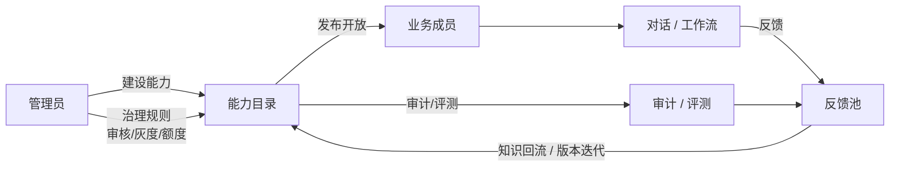

---

##  重点产品讲解

### 1.  数字伙伴 (Copilot)

每个员工都有,登录即用。

- 流式 SSE 对话,8 种事件实时可见
- LLM 自动从工作区可见的知识 + 长期记忆里拉上下文
- 可调工具 / 查知识 / 走工作流 / 派给子智能体
- 多智能体协同:父 agent 调 `delegate_to_agent` → 后端同步派给目标 agent → final_response 喂回父 LLM

### 2.  办公开箱 (Out-of-the-Box)

部署当天就能给全员用。

- 预置智能体模板 (行政 / HR / IT / 销售 / 客服)
- 预置技能 (日程 / 审批 / 报销 / 查询)
- 预置知识库 (公司制度 / 流程文档)
- 预置工作流 (请假 / 报销 / 用印)
- 管理员只需按企业情况微调,不必从 0 搭建

### 3.  专家协作 (Multi-Agent)

复杂任务自动拆分,多个 agent 协同完成。

- 父 agent 派子 agent,嵌套深度上限 3 层
- 跨租户 / 跨工作区派发直接拒绝
- 子 agent 结果作为工具结果喂回父 LLM,父 turn 继续生成
- 可视化调用链路,每一步都能追溯

### 4.  信任治理三件套

- **额度管理** — 预算 · 部门用量 · 告警阈值
- **审计中心** — 工具调用 100% 留痕,越权 / 风险规则实时告警
- **合规开关** — 数据驻留 · 脱敏 · 撤回 · 一键关停

### 5.  五中心 (运营总览)

一个屏幕看清整个平台的健康度。

- **调用中心** — 调用量 / 可用率 / 延迟 / Token / 成本
- **质量中心** — 评测套件 / 回归追踪 / 反馈池 / 规则分诊
- **能力中心** — 智能体 / 知识 / 技能 / 工作流的发布与开放
- **模型中心** — 供应商接入 / 模型拉取 / 路由策略 / 用量
- **组织中心** — 租户 / 工作区 / 成员 / 角色 / 邀请

### 6.  运营总览

- 平台健康监控 + 告警
- 热门智能体 / 热门工具 / 热门知识
- 用户活跃 / 部门用量
- 成本趋势 / 预算告警
- 质量趋势 / 评测达标率

---

##  快速开始

### 2 分钟跑通

```bash
# 1. 准备 (后端依赖 + 前端依赖)
cd backend && make sync && cp .env.example .env && make db-upgrade
cd ../frontend && pnpm install

# 2. 一键启动 (Vite + 网关 + qzdap-app + Postgres)
cd .. && make qzdap-up

# 3. 打开浏览器
open http://127.0.0.1:9152
```

### 验收清单

打开 [http://127.0.0.1:9152](http://127.0.0.1:9152),使用种子账号登录:

| 步骤 | 期望结果 | 状态 |
| --- | --- | --- |
| ① 用 `admin@acme.com` 登录 | 跳到 `/admin/*` 管理侧 |  |
| ② 用 `user@acme.com` 登录 | 跳到 `/copilot/*` 用户侧 |  |
| ③ 在用户侧发起一次对话 | 流式 SSE 输出,8 种事件可见 |  |
| ④ 调一个工具 (如 `web_search`) | 工具调用走审计 |  |
| ⑤ 派给子智能体 (`delegate_to_agent`) | 子 agent 同步跑完,父 turn 继续 |  |
| ⑥ 回到管理侧看调用链路 | 完整还原会话全过程 |  |
| ⑦ 切到演示模式 `VITE_USE_DEMO=true` | 不连后端,全界面可浏览 |  |

---

##  控制台一览

> 以下截图来自 `pnpm --filter web dev:demo` (前端内存演示数据,无需后端)。

| | |
| --- | --- |
| 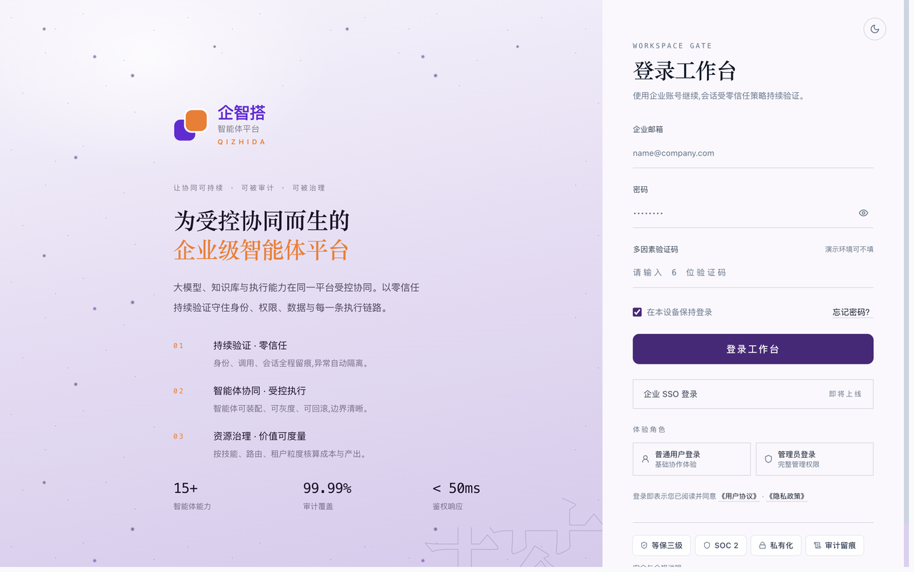 | 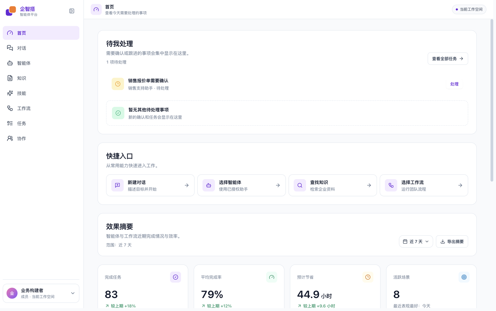 |
| **登录** — 管理员与成员从同一登录页进入,角色分流 | **用户首页** — 今日待办 / 通知 / 收藏 |
| 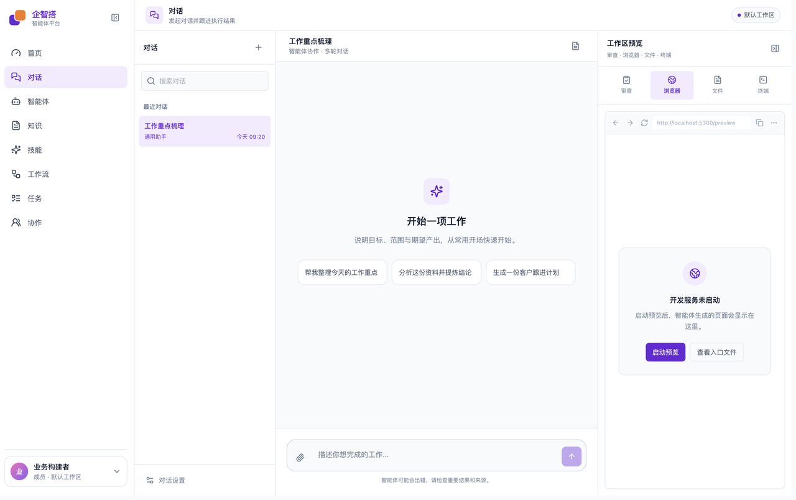 | 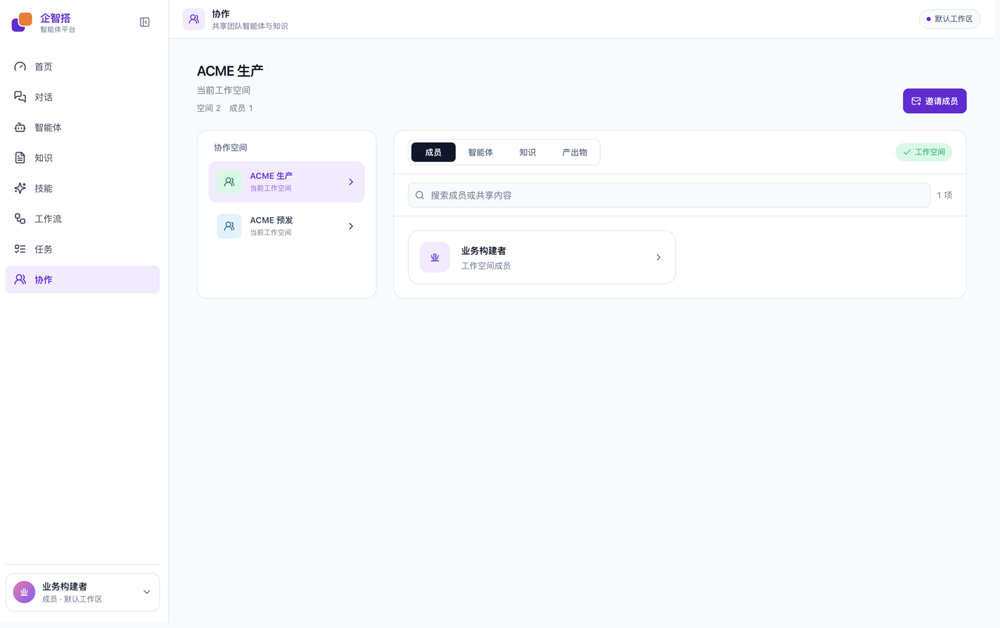 |
| **Copilot 对话** — 流式 SSE · 工具可视 · 多智能体协同 | **团队协作** — 工作区成员 / 团队目录 |
| 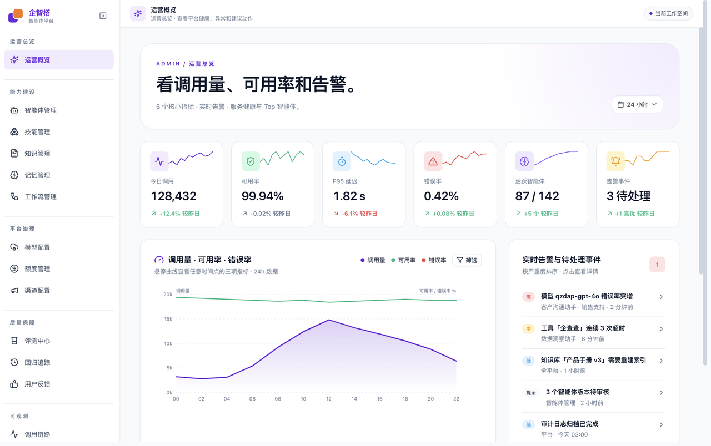 | 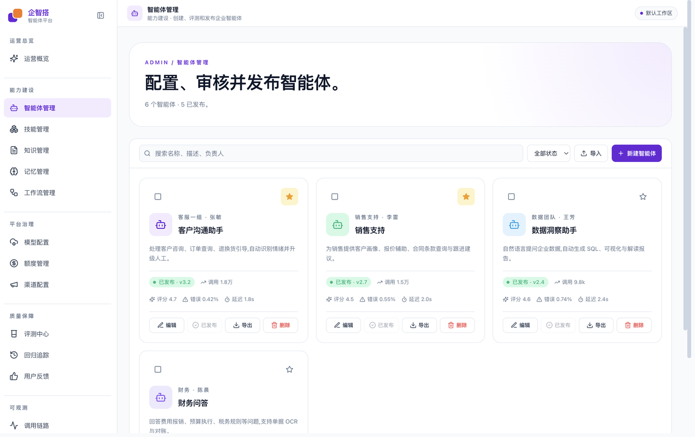 |
| **运营总览** — 平台健康 / 调用量 / 告警 | **智能体管理** — 创建 / 配置 / 审核 / 发布 |
| 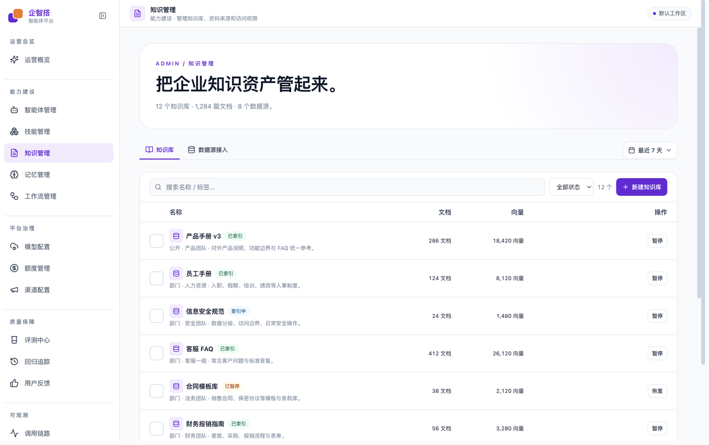 | 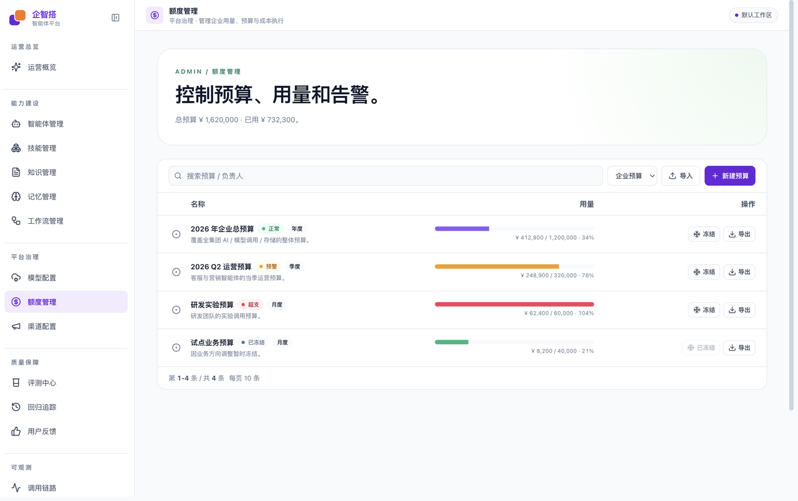 |
| **知识管理** — 知识库 / 资料来源 / 访问权限 | **额度管理** — 预算 / 部门用量 / 告警阈值 |
| 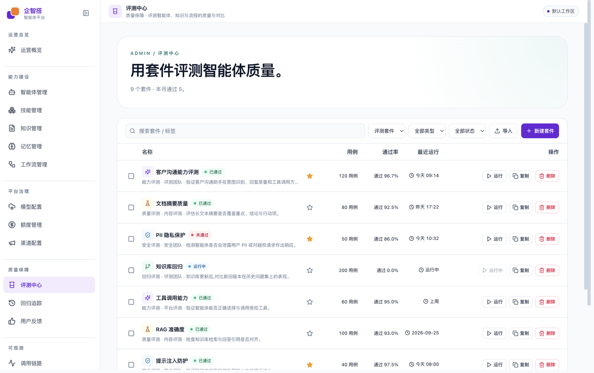 | 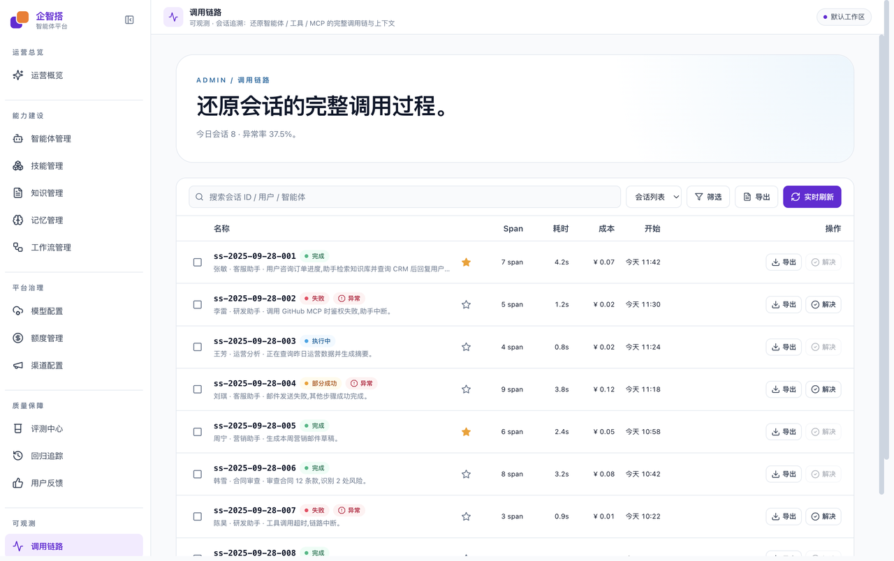 |
| **评测中心** — 套件评测 / 回归追踪 | **调用链路** — 还原会话全过程 |

---

##  功能模块

### 信息架构

QIZHIDA 平台按 **展示层 / 能力层 / 基础设施层** 三层架构组织:

- **展示层** — 3 个用户入口 (成员 / 管理员 / 集成方)
- **能力层** — 15 个能力域,按业务核心 / 能力增强 / 模型层 / 横切治理 4 组分类
- **基础设施层** — 存储 (Postgres + Redis + MinIO) + 沙箱 (gVisor) + LLM 供应商

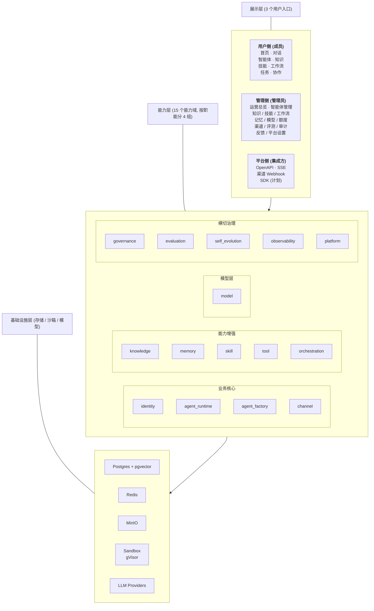

### 15 个能力域总表

| # | 域 | 职责 | 状态 |
| --- | --- | --- | --- |
| 1 | `identity` | 租户 / 用户 / 工作区 / 成员 / JWT 鉴权 |  |
| 2 | `agent_runtime` | 流式对话引擎 · 工具调用 · 多智能体协同 |  |
| 3 | `agent_factory` | 智能体创建 / 版本化 / 模板 |  |
| 4 | `skill` | Skill 注册 / 编排 / 沙箱执行 |  |
| 5 | `tool` | Tool 注册 / 调用 / 审计 |  |
| 6 | `knowledge` | 知识库 · RAG · pgvector |  |
| 7 | `memory` | 短期 / 长期 / 知识层记忆 |  |
| 8 | `model` | 模型供应商 / 路由 / 用量 |  |
| 9 | `channel` | 飞书 / 企微 / 钉钉 / Web 渠道 |  |
| 10 | `orchestration` | 工作流编排 / 发布 |  |
| 11 | `governance` | 额度 / 灰度 / 合规开关 |  |
| 12 | `evaluation` | 评测套件 / 回归追踪 |  |
| 13 | `self_evolution` | 反馈池 / 规则分诊 / 知识回流 |  |
| 14 | `observability` | 调用链路 / 指标 / 告警 |  |
| 15 | `platform` | 平台设置 / 品牌 / 成员管理 |  |

### 5 个重点模块详解

#### ① agent_runtime — 流式对话引擎

- `POST /v1/sessions/{id}/turns` — 同步阻塞,返回完整 turn
- `POST /v1/sessions/{id}/turn/stream` — SSE 流式,8 种 chunk
- 内部用 `RunTurnUseCase` (生成器) + `RunTurnCompletionUseCase` (排空到终结 chunk)
- 工具调用走 `_finish_pending` 通路,支持高风险工具审批 (ApprovalRequiredChunk)
- 多智能体协同:父 agent 调 `delegate_to_agent` → `DelegateSubagentUseCase` 创建 sub_session + 嵌套深度校验 + 同步跑

#### ② tool — Tool 注册 / 调用 / 审计

- 30+ 内置工具 (Claude Code 能力对标): `web_search` / `http_fetch` / `bash` / `read_file` / `write_file` / `edit_file` / `ls` / `glob` / `grep` / `apply_patch` / `diff` / `image_view` / `pdf_read` / `json_query` / `csv_query` / `git_status` / `git_diff` / `git_log` / `code_search` / `convert_format` / `fetch_url_with_auth` / `calculator` / `ask_user_question` / `notify_user` / `plan_submit` / `todo_write` / `delegate_to_agent`
- 所有工具调用 100% 写 `audit_log` (actor_id / workspace_id / duration_ms / risk_level)
- 沙箱工具走 gVisor (runsc),网络出站默认 `NetworkDisabled`

#### ③ knowledge — 知识库 + RAG

- pgvector 嵌入存储
- LLM 自动从工作区可见的知识里拉上下文 (RAG)
- 来源追溯:每个召回片段都带原文链接
- 权限隔离:知识库按工作区授权

#### ④ memory — 三层记忆

- L1 短期会话 — 当前 session 的消息历史
- L2 长期事实 — 用户偏好 / 角色 / 部门
- L3 知识层 — 跨 session 共享的领域知识
- 用户可一键关闭 / 清除记忆,符合企业合规

#### ⑤ observability — 调用链路

- 完整还原会话中智能体 / 工具 / MCP / 知识召回 / 记忆写入的全过程
- OpenTelemetry 兼容
- Prometheus 指标 / Grafana 看板
- 调用超时 / 失败重试 / 死信队列

---

##  技术架构

### 设计原则

1. **模块化单体** — 一个部署产物 (`composition/qzdap_app`),15 个能力域独立发布
2. **六边形 Ports & Adapters** — 应用层只依赖 Port 接口,具体实现在 adapter 层
3. **import-linter 守护边界** — 防止跨层引用,违反即 CI 红
4. **流式优先** — 所有 LLM 交互都走 SSE chunk,前端无需轮询
5. **审计默认开启** — 任何工具调用 / 知识召回 / 记忆写入都进 `audit_log`

### 部署拓扑

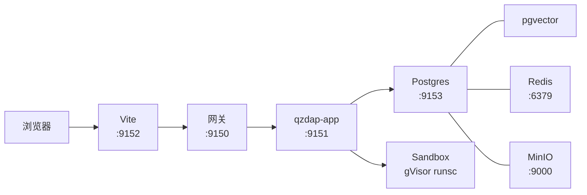

### SSE 时序图 (一次 turn)

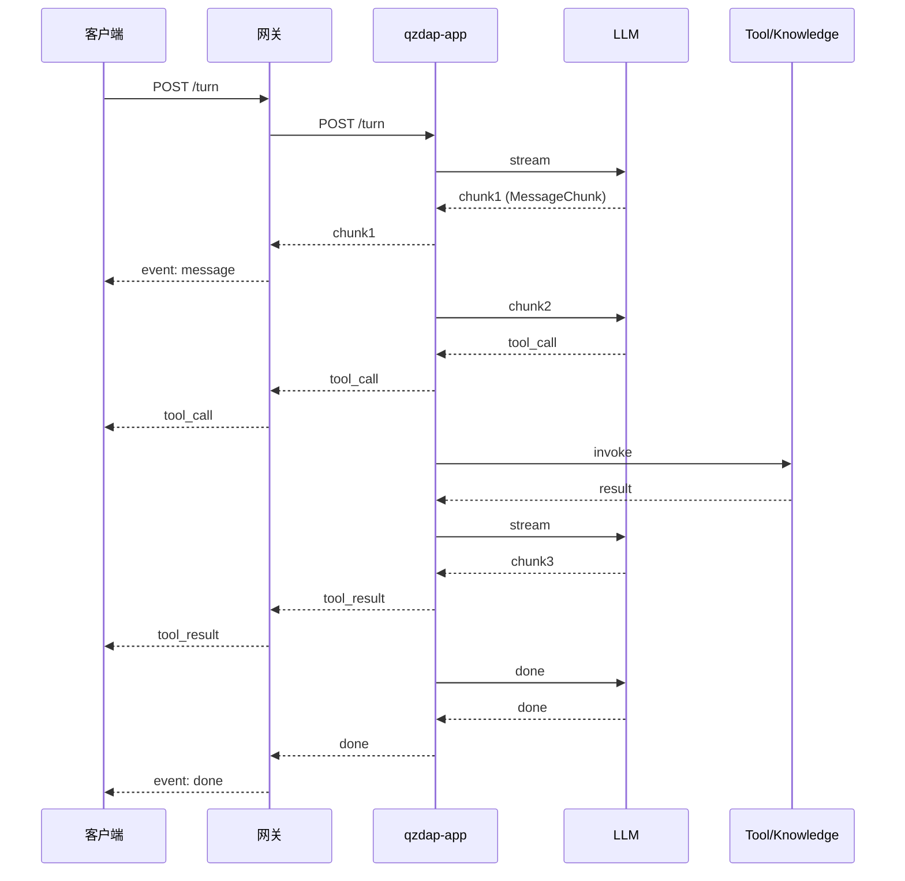

### 技术栈

| 层 | 选型 |
| --- | --- |
| 前端 | React 18 · Vite · Tailwind · pnpm workspace (`@qzdap/web-{api,ui,hooks,types,utils}`) |
| 后端 | Python 3.12 · FastAPI · uv workspace (`qzdap.*`) |
| 架构 | 模块化单体 · 六边形 Ports & Adapters · import-linter 守护边界 |
| 数据 | Postgres + pgvector · Redis · MinIO |
| 沙箱 | gVisor (runsc) · Docker `NetworkDisabled` · 网络出站白名单 |
| 鉴权 | JWT · `Authorization` / `X-Tenant-Id` / `X-Workspace-Id` / `X-Tenant-Schema` / `X-Trace-Id` |
| 密钥 | Vault (env / file / csi / hashicorp) |
| 观测 | OpenTelemetry · Prometheus · Grafana |
| 编排 | k8s · Envoy (见 [`infra/`](./infra/)) |

### 仓库结构

```
.
├── backend/                       Python 3.12 + FastAPI + uv workspace (qzdap.*)
│   ├── libs/                      10 个共享内核
│   ├── modules/                   15 个能力域
│   ├── composition/qzdap_app/     组合根 = 唯一部署产物
│   ├── runtimes/                  embedding_runtime · sandbox_runtime
│   ├── packs/                     示例 pack
│   └── migrations/                Alembic
├── frontend/                      pnpm workspace
│   ├── web/                       工作台 SPA
│   └── packages/                  @qzdap/web-{api,ui,hooks,types,utils}
├── bin/qzdap-stack/               本机开发栈: Vite(:9152) + 网关(:9150) + qzdap-app(:9151) + Postgres(:9153)
├── deploy/                        部署脚本与编排
├── infra/                         k8s / envoy / prometheus / grafana
├── docs/                          ADR · runbook · 演示截图 · 品牌资产
└── README.md
```

---

##  本地部署

### 环境

| 工具 | 版本 | 说明 |
| --- | --- | --- |
| Python | 3.12+ | 后端运行时 |
| uv | 最新 | 后端包管理 (取代 pip) |
| Node.js | 20+ | 前端运行时 |
| pnpm | 9+ | 前端包管理 |
| Docker | 24+ | Postgres + Redis + MinIO |
| Make | - | 一键脚本 |

### 端口

| 端口 | 服务 | 启动命令 |
| --- | --- | --- |
| `:9152` | Vite (前端) | `pnpm --filter web dev` |
| `:9150` | 网关 (Envoy) | `make qzdap-up` |
| `:9151` | qzdap-app (FastAPI) | `make qzdap-up` |
| `:9153` | Postgres | `docker compose up -d postgres` |
| `:6379` | Redis | `docker compose up -d redis` |
| `:9000` | MinIO | `docker compose up -d minio` |

### Docker Compose

```bash
cd backend
docker compose up -d       # PG (pgvector) + Redis + MinIO
make db-upgrade            # Alembic 迁移
make run-app               # qzdap-app (:9151)
```

### LaunchAgent (macOS 开机自启)

```bash
# 把开发栈注册为 macOS LaunchAgent
./bin/qzdap-stack/install-launchagent.sh

# 启停
launchctl start com.qzdap.devstack
launchctl stop  com.qzdap.devstack
```

### 前端登录

打开 [http://127.0.0.1:9152](http://127.0.0.1:9152),使用种子账号:

| 角色 | 邮箱 | 密码 |
| --- | --- | --- |
| 管理员 | `admin@acme.com` | `dev-admin-password-change-me` |
| 成员 | `user@acme.com` | `dev-admin-password-change-me` |

>  **生产环境务必修改默认密码** — `.env` 里改 `QZDAP_ADMIN_PASSWORD`,然后跑 `make reset-admin-password`。

---

##  验证与常见问题

### 健康检查

```bash
curl http://127.0.0.1:9151/healthz     # qzdap-app 健康
curl http://127.0.0.1:9151/readyz      # qzdap-app 就绪 (含 DB / Redis)
curl http://127.0.0.1:9150/healthz     # 网关健康
```

### 常见问题

<details>
<summary><b>Q: 启动后 502 / 504 ?</b></summary>

检查:
- `docker compose ps` — Postgres / Redis 都 healthy?
- `make qzdap-status` — 所有端口都 listen?
- 看 `bin/qzdap-stack/logs/` 下的日志

</details>

<details>
<summary><b>Q: 登录提示 "token 过期" 但实际没过期?</b></summary>

清浏览器 localStorage 的 `qzdap_token`,刷新重登。生产环境的 token 持久化清理逻辑详见 [`docs/refactor/`](./docs/refactor/)。

</details>

<details>
<summary><b>Q: Copilot 对话没反应?</b></summary>

- 检查 `QZDAP_LLM_*` 环境变量是否配置
- 看 `QZDAP_LLM_PROVIDER` 是否指向真实供应商 (默认是 `unavailable`)
- 管理员侧 `/admin/models` 配置供应商 + 拉取模型

</details>

<details>
<summary><b>Q: 工具调用失败 "TOOL_NOT_FOUND"?</b></summary>

- 检查 `docs/refactor/agent-builtin-tools.md` 看工具注册情况
- 沙箱工具 (bash / read_file / etc.) 需要 workspace 已挂载
- 网络工具 (web_search / http_fetch) 需要网络出站白名单

</details>

<details>
<summary><b>Q: 多智能体派发被拒 "DELEGATION_DEPTH_EXCEEDED"?</b></summary>

嵌套深度上限 3 层。如果业务确实需要更深的嵌套,改 `DelegateSubagentUseCase.MAX_DELEGATION_DEPTH` 并重测。

</details>

---

##  文档索引

| 文档 | 路径 | 用途 |
| --- | --- | --- |
| **架构决策记录 (ADR)** | [`docs/adr/`](./docs/adr/) | 重大技术决策的背景与权衡 |
| **重构 ticket** | [`docs/refactor/`](./docs/refactor/) | 正在 / 已完成的功能演进 |
| **运维 runbook** | [`docs/runbook/`](./docs/runbook/) | 故障排查 · 备份恢复 · 扩容 |
| **API 文档** | `http://127.0.0.1:9151/docs` (本地) | OpenAPI 自动生成 |
| **品牌资产** | [`docs/images/brand/`](./docs/images/brand/) | Logo · 配色 · 字体 |
| **演示截图** | [`docs/images/demo/`](./docs/images/demo/) | 控制台各页面截图 |
| **种子数据** | [`backend/seed/`](./backend/seed/) | 管理员 / 成员 / 智能体 / 知识 |

---

##  贡献

我们欢迎所有形式的贡献 — 代码、文档、Issue、Discussion、PR。

### 贡献方式

-  **报告 Bug** — [Issues](../../issues) 选 `bug` 模板
-  **提需求** — [Issues](../../issues) 选 `feature` 模板
-  **改进文档** — 直接提 PR 到 `docs/`
-  **讨论** — [Discussions](../../discussions)

### 开发流程

1. Fork 仓库
2. 创建 feature 分支 (`git checkout -b feat/xxx`)
3. 提交 (`git commit -m "feat(scope): description"`)
4. 推送 (`git push origin feat/xxx`)
5. 创建 PR

### 提交规范

**Conventional Commits** (commitlint 校验):

```
feat(scope): 新功能
fix(scope): 修复 bug
docs(scope): 文档变更
refactor(scope): 重构 (无功能变化)
test(scope): 测试
chore(scope): 杂项
```

### 工程约定

- 后端 pre-commit: ruff · mypy (strict) · lint-imports · gitleaks
- 前端 pre-commit: eslint · prettier · tsc
- 多租户请求携带 `X-Tenant-Id` 与 `X-Workspace-Id`
- 命名空间: Python `qzdap.*` · 前端 `@qzdap/web-*` · 环境变量 `QZDAP_*`

---

##  许可证

本项目基于 **Apache License 2.0** 开源 — 详见 [LICENSE](./LICENSE) 文件。

```
Copyright 2026 QIZHIDA Contributors

Licensed under the Apache License, Version 2.0 (the "License");
you may not use this file except in compliance with the License.
You may obtain a copy of the License at

    http://www.apache.org/licenses/LICENSE-2.0
```

---

<div align="center">

**[ 回到顶部](#企智搭--智能体平台)**

Made with  by the QIZHIDA team · [English →](./docs/en/README.md)

</div>
