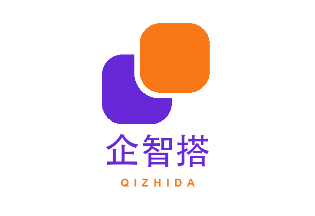
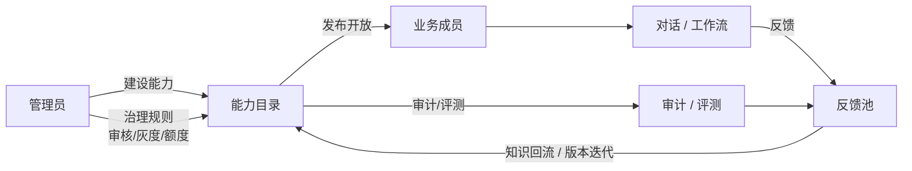
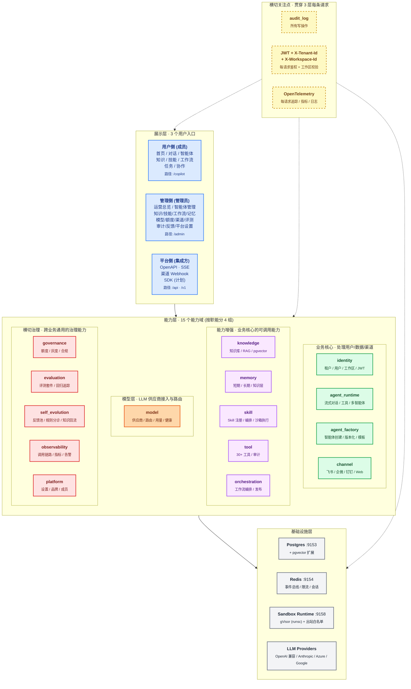
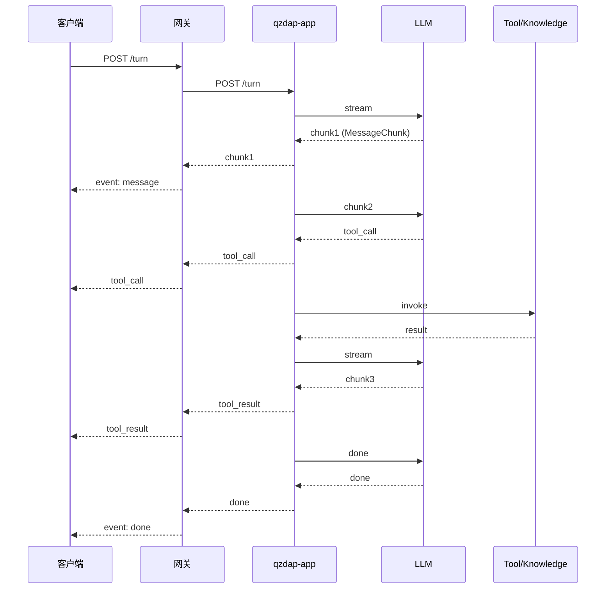

<div align="center">



# 企智搭 · 智能体平台

**QiZhiDa Agent Platform (QIZHIDA)** — 企业级智能体中台

让每个员工都有一个数字伙伴，让每个流程都装进办公开箱。

---

[](#-快速开始)
[](#-功能模块)
[](#-许可证)
[](#-验证与常见问题)
[](#-验证与常见问题)

[项目介绍](#-项目介绍) · [产品价值](#-产品价值) · [重点产品](#-重点产品讲解) · [快速开始](#-快速开始) · [功能模块](#-功能模块) · [技术架构](#-技术架构) · [本地部署](#-本地部署) · [文档索引](#-文档索引) · [贡献](#-贡献)

</div>

---

##  项目介绍

**企智搭 (QIZHIDA)** 是一套面向企业的智能体中台。把智能体、知识、技能、工具、记忆、工作流、模型、额度、审计这些碎片能力统一成可治理的"目录 + 工作台",让管理员专注于能力建设与质量把控,让业务成员专注于用对话与流程把事情做完。

| 我们不是 | 我们是 |
| --- | --- |
|  一个聊天机器人 |  一个**企业级智能体中台** |
|  一个 prompt playground |  一个**可治理的能力目录 + 工作台** |
|  一个孤立的 Agent 框架 |  一个**多智能体协同 + 工具编排 + 知识检索 + 记忆**的完整平台 |
|  一个只能演示的项目 |  一个**支持多租户 / 多工作区 / 审计 / 额度**的完整平台 |

>  **冷启动办公开箱** — 部署当天就能给全员用。平台自带数字伙伴 (Copilot)、办公技能 (Skill)、企业知识 (Knowledge)、审批流 (Workflow) 的**完整能力**,管理员只需按企业情况配置内容,不必从 0 搭建。

后端 **Python 3.12 + FastAPI 模块化单体** (15 个能力域 + 11 个共享内核 + 3 个运行时,六边形分层 + import-linter 守护边界),前端 **React 18 + Vite** 双侧工作台 (用户侧 + 管理侧)。

---

##  产品价值

| 支柱 | 价值 | 落地方式 |
| --- | --- | --- |
|  **安全零信任** | 默认所有调用都可疑,全程审计 | JWT + 多租户隔离 · gVisor 沙箱 · 网络出站白名单 · Vault 密钥 · 工具调用 100% 审计 |
|  **先进生产力** | 每个员工配一个数字伙伴 | 17 种 SSE chunk 流式可见 · 多智能体协同 (嵌套深度 3) · 知识+记忆双引擎 · 渠道即插即用 |
|  **成本新范式** | 按需购买,按量计费 | 工作区粒度额度 · 部门用量看板 · 告警阈值 · 成本可追溯到具体 turn |
|  **单一事实源** | 一套实现,不许两份 | 前后端共用**同一套 API 契约**,数据只从后端来 —— 没有第二份手写数据 |

### 价值流转



---

##  重点产品讲解

### 1.  数字伙伴 (Copilot)

每个员工都有,登录即用。

- 流式 SSE 对话,17 种 chunk 实时可见
- LLM 自动从工作区可见的知识 + 长期记忆里拉上下文
- 可调工具 / 查知识 / 走工作流 / 派给子智能体
- 多智能体协同:父 agent 调 `delegate_to_agent` → 后端同步派给目标 agent → final_response 喂回父 LLM

### 2.  办公开箱 (Out-of-the-Box)

部署当天就能给全员用 —— 开箱就有**账号可登**、**内置工具可用**,内容从管理台按企业情况自建:

- **租户 / 工作区 / 账号** — 种子直接建好,登录页「一键登录」直接进 ✓
- **30+ 内置工具** — `web_search` / `bash` / `read_file` / `csv_query` / `delegate_to_agent` 等,开箱即可被智能体调用
- **内容由管理员建** — 智能体 / 技能 / 工作流 / 知识库**不预置**,目录页开箱是空态,管理员建完即发布
- 管理员只需按企业情况配置,不必从 0 搭建

### 3.  专家协作 (Multi-Agent)

复杂任务自动拆分,多个 agent 协同完成。

- 父 agent 派子 agent,嵌套深度上限 3 层
- 跨租户 / 跨工作区派发直接拒绝
- 子 agent 结果作为工具结果喂回父 LLM,父 turn 继续生成
- 可视化调用链路,每一步都能追溯

### 4.  信任治理三件套

- **额度管理** — 工作区预算 · 部门用量 · 告警阈值
- **策略与审批** — 策略按角色 / 用户 / 智能体匹配,效果为 `allow` / `deny` / `approval`;高风险动作走人工审批
- **审计中心** — 工具调用 100% 留痕 (actor / workspace / 耗时 / 风险等级),越权 / 风险规则实时告警
- **数据主体请求** — 按 scope 分发的删除 / 导出(记忆等各域自行实现 scope)

### 5.  管理台全景

管理侧 (`/admin/*`) 覆盖平台运行的全部面:

- **总览** — 运营指标与健康度
- **能力建设** — 智能体 / 知识 / 技能 / 工作流 / 工具的创建、审核、发布
- **模型** — 供应商接入、模型拉取、路由策略、用量
- **质量** — 评测套件 / 回归追踪 / 反馈池 / 规则分诊
- **治理** — 额度预算 / 通知渠道 / 工具审计 / 平台设置

### 6.  运营总览

`/admin/overview` 一屏看清平台健康度:

- 6 个 KPI 磁贴(调用量 / 成功率 / 延迟 / Token / 成本 / 告警)带环比与迷你曲线
- 调用趋势曲线(1h / 6h / 24h / 7d),区分成功与错误
- 实时告警列表(级别 / 影响面 / 处理建议)
- 服务健康列表(状态 / 延迟 / 明细)
- Top 智能体调用占比

---

##  快速开始

### 2 分钟跑通

```bash
# 1. 准备 (后端依赖 + 前端依赖 + 本地配置)
cd backend && make sync
cp .env.example .env
# 换掉示例里的占位主密钥 (模型凭据的 AES-GCM 主密钥,32 字节 hex)
sed -i '' "s|<paste 32-byte hex-encoded key here>|$(openssl rand -hex 32)|" .env   # macOS
cd ../frontend && pnpm install && cd ..

# 2. 起数据层 (Postgres :9153 + Redis :9154) 并迁移
cd backend && docker compose up -d && make db-upgrade && cd ..

# 3. 一键启动 (Vite :9152 + 网关 :9150 + qzdap-app :9151)
make qzdap-up

# 4. 打开浏览器
open http://127.0.0.1:9152
```

>  `make qzdap-up` **只起应用栈**,不起 Postgres / Redis —— 数据层要先 `docker compose up -d` ✓。

### 验收清单

打开 [http://127.0.0.1:9152](http://127.0.0.1:9152),用**开发栈**的种子账号登录(登录页有「一键登录」按钮):

| 步骤 | 期望结果 | 状态 |
| --- | --- | --- |
| ① 用 `admin@dev.qzdap.dev` 登录 | 跳到 `/admin/*` 管理侧 |  |
| ② 用 `user@dev.qzdap.dev` 登录 | 跳到 `/copilot/*` 用户侧 |  |
| ③ 管理侧建一个智能体并发布 | 资源库页出现该智能体 |  |
| ④ 在用户侧发起一次对话 | 流式 SSE 输出,17 种 chunk 可见 |  |
| ⑤ 调一个工具 (如 `web_search`) | 工具调用走审计 |  |
| ⑥ 派给子智能体 (`delegate_to_agent`) | 子 agent 同步跑完,父 turn 继续 |  |
| ⑦ 回到管理侧看调用链路 | 完整还原会话全过程 |  |
| ⑧ 管理侧 `/admin/models` 配一个 LLM 供应商 | 未配时一轮对话以 `TURN_FAILED` 结束 —— 是环境没配模型,不是回归 |  |

> ⚠️ **开发环境不预置内容** ✓ —— 目录页开箱是空态 ✓，③ 之前要先在管理侧建内容 ✓。

### 单环境:只有开发栈

仓库**只保留开发环境** ✓ —— 演示 / 预发 / 生产环境连同相关能力都已退役 ✓。

| | 开发栈 (dev) |
| --- | --- |
| 前端 | `http://127.0.0.1:9152` |
| 网关 | `http://127.0.0.1:9150` |
| 后端 | `http://127.0.0.1:9151` |
| 库 | `127.0.0.1:9153/qzdap_dev` |
| 管理员 | `admin@dev.qzdap.dev` / `dev-admin-password-change-me` |
| 成员 | `user@dev.qzdap.dev` / `dev-user-password-change-me` |
| 起停 | `make qzdap-up` / `make qzdap-down` |

⚠️ **库里只有 dev 租户的内容** ✓ —— 不存在第二个库 ✓、第二个租户 ✓、
第二套账号 ✓。目录页开箱是空态 ✓。

详见 [`docs/architecture/oncall-runbook.md`](docs/architecture/oncall-runbook.md) 的「单环境:账号与入口」一节。

---

##  功能模块

### 信息架构

QIZHIDA 平台按 **3 层 + 1 个横切关注点** 组织:

- **展示层** — 3 个用户入口 (成员 / 管理员 / 集成方)
- **能力层** — 15 个能力域,按业务核心 / 能力增强 / 模型层 / 横切治理 4 组分类
- **基础设施层** — 存储 (Postgres + pgvector + Redis) + 沙箱 (gVisor) + LLM 供应商
- **横切关注点** — 审计 / 鉴权 / 观测,贯穿 3 层每条请求



### 15 个能力域总表

| # | 域 | 职责 | 状态 |
| --- | --- | --- | --- |
| 1 | `identity` | 租户 / 用户 / 工作区 / 成员 / JWT 鉴权 |  |
| 2 | `agent_runtime` | 流式对话引擎 · 工具调用 · 多智能体协同 |  |
| 3 | `agent_factory` | 智能体创建 / 版本化 / 模板 |  |
| 4 | `skill` | Skill 注册 / 编排 / 沙箱执行 |  |
| 5 | `tool` | Tool 注册 / 调用 / 审计 |  |
| 6 | `knowledge` | 知识库 · RAG · pgvector |  |
| 7 | `memory` | 会话缓冲 · L2 事实层 · 知识提升 |  |
| 8 | `model` | 模型供应商 / 路由 / 用量 |  |
| 9 | `channel` | 飞书 / 企微 / 钉钉 / Web 渠道 |  |
| 10 | `orchestration` | 工作流编排 / 发布 |  |
| 11 | `governance` | 额度 · 策略 / 审批 · 审计 · 数据主体请求 |  |
| 12 | `evaluation` | 评测套件 / 回归追踪 |  |
| 13 | `self_evolution` | 反馈池 / 规则分诊 / 知识回流 |  |
| 14 | `observability` | 调用链路 / 指标 / 告警 |  |
| 15 | `platform` | 平台设置 / 品牌 / 成员管理 |  |

### 5 个重点模块详解

#### ① agent_runtime — 流式对话引擎

- `POST /api/sessions/{id}/turns/stream` — SSE 流式,17 种 chunk（`ChunkKind`）
- 轮次编排走 `CopilotSessionService`（claim / 幂等 / 取消 / 审批 合一）
- ⚠️ 旧的 `/v1/sessions*` 与第二套 turn 实现（`RunTurnUseCase` / `RunTurnCompletionUseCase`）**已整段删除** —— 会话 API 的唯一入口是 `/api/sessions*`,轮次只有一套实现
- 工具调用走 `_finish_pending` 通路,支持高风险工具审批 (ApprovalRequiredChunk)
- 多智能体协同:父 agent 调 `delegate_to_agent` → `DelegateSubagentUseCase` 创建 sub_session + 嵌套深度校验 + 同步跑

#### ② tool — Tool 注册 / 调用 / 审计

- 31 个内置工具 (Claude Code 能力对标): `web_search` / `http_fetch` / `bash` / `read_file` / `write_file` / `edit_file` / `ls` / `glob` / `grep` / `apply_patch` / `diff` / `image_view` / `pdf_read` / `json_query` / `csv_query` / `git_status` / `git_diff` / `git_log` / `code_search` / `convert_format` / `fetch_url_with_auth` / `calculator` / `ask_user_question` / `notify_user` / `plan_submit` / `todo_write` / `delegate_to_agent` / `echo` / `reverse` / `clock` / `write_artifact`
- 所有工具调用 100% 写 `audit_log` (actor_id / workspace_id / duration_ms / risk_level)
- 沙箱工具走 gVisor (runsc),网络出站默认 `NetworkDisabled`

#### ③ knowledge — 知识库 + RAG

- pgvector 嵌入存储
- LLM 自动从工作区可见的知识里拉上下文 (RAG)
- 来源追溯:每个召回片段都带原文链接
- 权限隔离:知识库按工作区授权

#### ④ memory — 记忆分层

- 会话缓冲 (`session_memory_buffer`) — 当前 session 的消息历史,管理端仍按「L1」视图展示
- L2 事实层 (`admin_memory_l2`) — 用户偏好 / 角色 / 部门,状态 `pending` / `confirmed` / `retired`
- 提升终点是 **knowledge** — 不再有 L3 表,团队知识候选走 `admin_memory_promotions` 落到知识库
- 保留策略可配 (`admin_memory_policies`);淘汰是置 `retired` 而非物理删除,审计仍在

#### ⑤ observability — 调用链路

- 完整还原会话中智能体 / 工具 / MCP / 知识召回 / 记忆写入的全过程
- OpenTelemetry 兼容
- Prometheus 指标 (`/metrics`)
- 调用超时 / 失败重试 / 死信队列

---

##  技术架构

### 设计原则

1. **模块化单体** — 一个部署产物 (`composition/qzdap_app`),15 个能力域独立发布
2. **六边形 Ports & Adapters** — 应用层只依赖 Port 接口,具体实现在 adapter 层
3. **import-linter 守护边界** — 防止跨层引用,违反即 CI 红
4. **流式优先** — 所有 LLM 交互都走 SSE chunk,前端无需轮询
5. **审计默认开启** — 任何工具调用 / 知识召回 / 记忆写入都进 `audit_log`

### 部署拓扑

**本地开发栈** (`bin/qzdap-stack/`) 是仓库唯一的运行形态 —— 只有一套组件,没有第二套:

```mermaid
graph TB
    subgraph Entry [" 入口层"]
        direction LR
        Browser["浏览器<br/>(用户 / 管理员)"]
        Vite["Vite 前端<br/>:9152<br/>React 18 SPA"]
        Gateway["网关 :9150<br/>Python 透传代理"]
    end

    subgraph App [" 应用层"]
        App["qzdap-app<br/>FastAPI :9151<br/>15 个能力域"]
    end

    subgraph Data [" 数据层"]
        direction TB
        PG["Postgres :9153<br/>pgvector 扩展<br/>库 qzdap_dev"]
        Redis["Redis :9154<br/>事件总线 / 限流 / 会话状态<br/>db 0"]
    end

    subgraph Sandbox [" 沙箱层"]
        Sandbox["sandbox_runtime :9158<br/>gVisor (runsc)<br/>NetworkDisabled + 出站白名单"]
    end

    subgraph Model [" 模型层"]
        LLM["LLM Providers<br/>OpenAI 兼容 / Anthropic / Azure / Google<br/>(凭据经 AES-GCM 加密落库,<br/>主密钥来自 QZDAP_MODEL_MASTER_KEY)"]
    end

    subgraph Obs [" 密钥 + 观测"]
        direction TB
        Vault["Vault / env / file / csi<br/>QZDAP_*_REF 启动期解析"]
        OTel["OpenTelemetry<br/>链路 / 指标 / 结构化日志"]
        Prom["Prometheus 指标<br/>(/metrics)"]
    end

    subgraph Channel [" 外部集成"]
        Webhook["渠道 Webhook<br/>飞书 / 企微 / 钉钉<br/>(inbound + outbound)"]
    end

    Browser --> Vite
    Vite --> Gateway
    Gateway --> App
    App --> PG
    App --> Redis
    App --> Sandbox
    App --> LLM
    App --> Vault
    App --> OTel
    Prom -. 拉取 .-> OTel
    Channel <--> App
```

### SSE 时序图 (一次 turn)



### 技术栈

| 层 | 选型 |
| --- | --- |
| 前端 | React 18 · Vite · Tailwind · pnpm workspace (`@qzdap/web-{api,ui,hooks,types,utils}`) |
| 后端 | Python 3.12 · FastAPI · uv workspace (`qzdap.*`) |
| 架构 | 模块化单体 · 六边形 Ports & Adapters · import-linter 守护边界 |
| 数据 | Postgres + pgvector · Redis |
| 沙箱 | gVisor (runsc) · Docker `NetworkDisabled` · 网络出站白名单 |
| 鉴权 | JWT · `Authorization` / `X-Api-Key` / `X-Tenant-Id` / `X-Workspace-Id` / `X-Trace-Id` |
| 密钥 | Vault (env / file / csi / hashicorp) · `QZDAP_*_REF` 启动期解析 |
| 观测 | OpenTelemetry · Prometheus 指标 |
| 编排 | docker compose (见 [`backend/docker-compose.yml`](./backend/docker-compose.yml)) |

### 仓库结构

```
.
├── backend/                       Python 3.12 + FastAPI + uv workspace (qzdap.*)
│   ├── libs/                      11 个共享内核 (kernel / schema / persistence / auth / …)
│   ├── modules/                   15 个能力域 (qzdap.modules.*)
│   ├── runtimes/                  agent_runtime · sandbox_runtime
│   ├── composition/qzdap_app/     组合根 = 唯一部署产物
│   ├── migrations/                Alembic (最新 0067)
│   └── scripts/                   种子 / 门禁扫描 / 备份恢复演练
├── frontend/                      pnpm workspace
│   ├── web/                       工作台 SPA (用户侧 /copilot + 管理侧 /admin)
│   └── packages/                  @qzdap/web-{api,ui,types,utils}
├── bin/qzdap-stack/               本机开发栈: Vite(:9152) + 网关(:9150) + qzdap-app(:9151) + Postgres(:9153) + Redis(:9154)
├── docs/                          方案集 · 审查方法论 · 品牌资产
└── README.md
```

---

##  本地部署

### 环境

| 工具 | 版本 | 说明 |
| --- | --- | --- |
| Python | 3.12+ | 后端运行时 |
| uv | 最新 | 后端包管理 (取代 pip) |
| Node.js | 20+ | 前端运行时 |
| pnpm | 11+ | 前端包管理 (仓库以 `packageManager` 锁定版本) |
| Docker | 24+ | Postgres + Redis |
| Make | - | 一键脚本 |

### 端口

| 端口 | 服务 | 启动命令 |
| --- | --- | --- |
| `:9152` | Vite (前端, dev) | `make qzdap-up` |
| `:9150` | 网关 (dev 透传代理) | `make qzdap-up` |
| `:9151` | qzdap-app (FastAPI, dev) | `make qzdap-up` |
| `:9153` | Postgres (pgvector) | `cd backend && docker compose up -d postgres` |
| `:9154` | Redis | `cd backend && docker compose up -d redis` |
| `:9158` | sandbox_runtime (gVisor) | 独立 sidecar,默认 stub |

> 只有一个开发栈 ✓ —— **没有第二个库** ✓、**第二个端口** ✓、**第二套账号** ✓。

### Docker Compose

```bash
cd backend
docker compose up -d       # PG (pgvector) + Redis
make db-upgrade            # Alembic 迁移
make run-app               # qzdap-app (:9151)
```

### 前端登录

打开 [http://127.0.0.1:9152](http://127.0.0.1:9152),登录页有「一键登录」按钮(账号只有 dev 这一套):

| 角色 | 邮箱 | 密码 |
| --- | --- | --- |
| 管理员 → `/admin/*` | `admin@dev.qzdap.dev` | `dev-admin-password-change-me` |
| 成员 → `/copilot/*` | `user@dev.qzdap.dev` | `dev-user-password-change-me` |

>  **默认口令只适合开发** ✓ —— 默认值在 `backend/composition/qzdap_app/src/qzdap/composition/settings.py` 的 `dev_*` 字段里 ✓。要换凭据用 `QZDAP_*_REF` 从 Vault 注入 ✓,不走这些默认值 ✓。
>
> ⚠️ **不再有「生产环境启动闸门」** ✓ —— 原来的硬失败闸门已改成**健康检查** ✓（`Container._collect_runtime_health` ✓），结果挂在 `app.state.runtime_health` ✓，`/readyz` 响应里的 `runtime` 字段能看到 ✓（`degraded` / `issues` ✓）—— **启动不崩** ✓。

---

##  验证与常见问题

### 健康检查

```bash
curl http://127.0.0.1:9151/healthz     # qzdap-app 健康
curl http://127.0.0.1:9151/readyz      # qzdap-app 就绪 (含 DB / Redis)
curl http://127.0.0.1:9150/healthz     # 网关健康
curl http://127.0.0.1:9151/metrics     # Prometheus 指标
```

### 常见问题

<details>
<summary><b>Q: 启动后 502 / 504 ?</b></summary>

检查:
- `cd backend && docker compose ps` — Postgres / Redis 都 healthy?
- `make qzdap-status` — 所有端口都 listen?
- 看 `bin/qzdap-stack/logs/` 下的日志

</details>

<details>
<summary><b>Q: 登录提示 "token 过期" 但实际没过期?</b></summary>

清浏览器 localStorage 里的 `qzdap:token`,刷新重登。

> 老版本的 key 带环境段（`qzdap:development:development-api:token`）—— 应用启动时 `migrateLegacyStorageKeys()` 会自动搬到新 key,搬完即删旧的。

</details>

<details>
<summary><b>Q: Copilot 对话没反应?</b></summary>

- LLM 凭据**不走环境变量** (`QZDAP_LLM_*` 那条路径已下线) —— 在管理侧 `/admin/models` 配置供应商,凭据 AES-GCM 加密落 `admin_model_providers`
- 没配供应商时,后端抛 `ProviderUnavailable` (HTTP 503, `PROVIDER_UNAVAILABLE`),一轮对话以 `TURN_FAILED` 结束 —— **这是环境没配模型,不是回归**
- 检查 `QZDAP_MODEL_MASTER_KEY` 已设置 (32 字节 hex):没设时 model 模块在启动时被跳过,`/admin/models` 会不可用

</details>

<details>
<summary><b>Q: 工具调用失败 "TOOL_NOT_FOUND"?</b></summary>

- 检查 `docs/modules/tool.md` 看工具注册情况
- 沙箱工具 (bash / read_file / etc.) 需要 workspace 已挂载
- 网络工具 (web_search / http_fetch) 需要网络出站白名单

</details>

<details>
<summary><b>Q: 多智能体派发被拒 "DELEGATION_DEPTH_EXCEEDED"?</b></summary>

嵌套深度上限 3 层。如果业务确实需要更深的嵌套,改 `DelegateSubagentUseCase.MAX_DELEGATION_DEPTH` 并重测。

</details>

---

##  文档索引

| 文档 | 路径 | 用途 |
| --- | --- | --- |
| **功能模块文档** | [`docs/modules/`](./docs/modules/) | **15 个能力域各一篇** —— 当前代码已实现的行为 + 已知边界 |
| **会话生命周期基线** | [`docs/architecture/session-lifecycle.md`](./docs/architecture/session-lifecycle.md) | 泳道划分与时序（Gateway / Router / Session / Context / Memory / Agent） |
| **对话链路梳理** | [`docs/architecture/copilot-chat.md`](./docs/architecture/copilot-chat.md) | 一次对话从发送到渲染的逐层链路 + 读代码顺序 |
| **清理台账** | [`docs/architecture/cleanup-ledger.md`](./docs/architecture/cleanup-ledger.md) | 旧实现收敛台账 —— **CI 扫描规则的唯一来源** |
| **值班手册** | [`docs/architecture/oncall-runbook.md`](./docs/architecture/oncall-runbook.md) | 告警阈值 · 排查 · 回退步骤 · 入口与账号 |
| **数据通道** | [`docs/architecture/data-separation.md`](./docs/architecture/data-separation.md) | 单环境口径 · 验收样本 · 历史清理记录 |
| **待实施项** | [`docs/planned/`](./docs/planned/) | 方案已写好、代码未实现的 ticket |
| **API 文档** | `http://127.0.0.1:9151/docs` (本地) | OpenAPI 自动生成 |
| **品牌资产** | [`docs/images/brand/`](./docs/images/brand/) | Logo · 配色 · 字体 |
| **种子脚本** | [`backend/scripts/`](./backend/scripts/) | `seed_dev_data.py` · `seed_acceptance_samples.py` |

---

##  贡献

我们欢迎所有形式的贡献 — 代码、文档、Issue、Discussion、PR。

### 贡献方式

-  **报告 Bug** — [Issues](https://github.com/Lianjifu/QiZhiDaAgentPlatform/issues) 选 `bug` 模板
-  **提需求** — [Issues](https://github.com/Lianjifu/QiZhiDaAgentPlatform/issues) 选 `feature` 模板
-  **改进文档** — 直接提 PR 到 `docs/`
-  **讨论** — [Discussions](https://github.com/Lianjifu/QiZhiDaAgentPlatform/discussions)

### 开发流程

1. Fork 仓库
2. 创建 feature 分支 (`git checkout -b feat/xxx`)
3. 提交 (`git commit -m "feat(scope): description"`)
4. 推送 (`git push origin feat/xxx`)
5. 创建 PR

### 提交规范

**Conventional Commits** (commitlint 校验):

```
feat(scope): 新功能
fix(scope): 修复 bug
docs(scope): 文档变更
refactor(scope): 重构 (无功能变化)
test(scope): 测试
chore(scope): 杂项
```

### 工程约定

- 后端 pre-commit (`backend/.pre-commit-config.yaml`): ruff · ruff-format · mypy · lint-imports · gitleaks · commitlint
- 后端 CI 门禁: lint → import-lint → 旧实现扫描 → 依赖声明检查 → mypy → gitleaks → pip-audit → pytest (覆盖率 ≥ 70%) → 备份恢复演练 → e2e 冒烟
- 前端: `pnpm -r typecheck` (tsc) · `pnpm --filter web test` (vitest)
- 多租户请求携带 `X-Tenant-Id` 与 `X-Workspace-Id`(登录后的 `tid` / `wid` 就在 token 里)
- 命名空间: Python `qzdap.*` · 前端 `@qzdap/web-*` · 环境变量 `QZDAP_*`
- 改完代码**重启栈**,否则跑的还是旧进程

---

##  许可证

本项目基于 **Apache License 2.0** 开源 —— 许可证正文见下方。

```
Copyright 2026 QIZHIDA Contributors

Licensed under the Apache License, Version 2.0 (the "License");
you may not use this file except in compliance with the License.
You may obtain a copy of the License at

    http://www.apache.org/licenses/LICENSE-2.0
```

---

<div align="center">

**[ 回到顶部](#企智搭--智能体平台)**

Made with  by the QIZHIDA team

</div>
