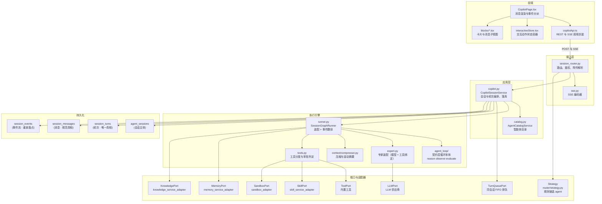
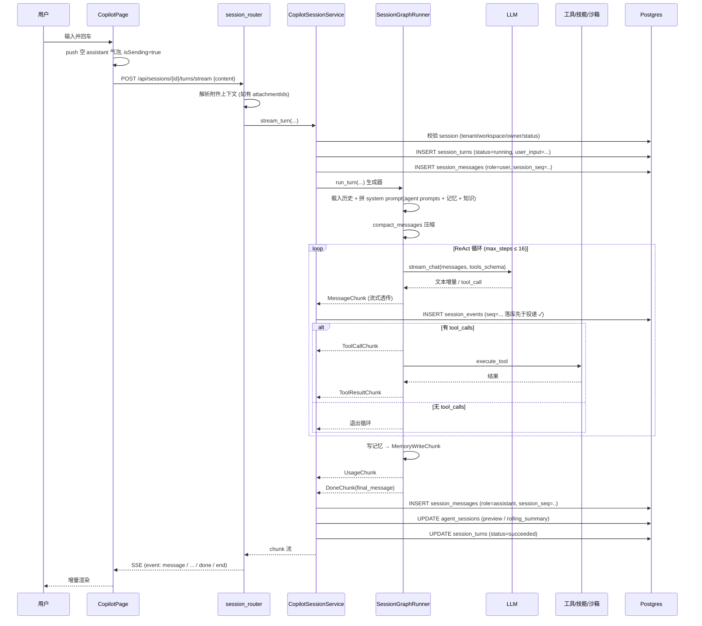

# 对话（Copilot）功能模块 — 架构梳理

> 版本：1.4（2026-10-31 更新：**Agent Stage 5 + Stage 7**（循环本体迁到契约层 `agent_loop/` ✓ —— 旧手写循环与那批整包**已删** ✓）· **Router Stage 2/3**（规则链选 agent ✓ + 同会话 FIFO 排队 ✓）· **Memory Stage 4/5/6**（策略绑定接线 ✓ + 异步补向量 ✓ + 会话缓冲与提炼 ✓ + 使用统计与淘汰 ✓）· **Session 收口**（审批过期/幂等 ✓ + 旧续传状态列退役 ✓ + checkpoint saver 撤掉 ✓）之后的事实 —— 逐条见 **§12** ✓）
> 适用项目：`QiZhiDaAgentPlatform`
> 状态：**现状（as-is）梳理**，描述当前代码已实现的行为，不含改造计划
> 读者：需要理解「一次对话从点击发送到渲染完成」全链路的人

本文只做现状记录。重构方案在 `docs/refactor/session-architecture/`（方案集：生命周期基线 + 清理台账 + 逐层方案）—— 那份讲**目标代码**，本文讲**当前代码**，两者不应混读。

⚠️ **§9–§11 是历史记录**（2026-10-28 ~ 10-30 的补齐过程与当时的回归数字）—— 它们记录「当时补了什么」，不代表今天的现状；**今天的现状看 §1–§8** ✓。

---

## 1. 范围

「对话」在本项目里指用户在 Copilot 页面与智能体（Agent）的一轮多轮交互，核心形态是 **HTTP POST + SSE 流式响应**。它与平台里另外两条「看起来也是对话」的路径要区分开：

| 路径 | 入口 | 与本文的关系 |
|---|---|---|
| Copilot 页面对话 | `POST /api/sessions/{id}/turns/stream` | **本文主体** |
| 渠道消息对话（飞书 / 企微 / 钉钉 / Webhook） | `backend/modules/channel/` | 复用 channel 的入站归一化，但对话内核不同，本文不展开 |
| 工作流运行 | `backend/modules/orchestration/` | 事件驱动编排，非消息驱动，另有契约 |

对话内核归属 `backend/modules/agent_runtime` 模块。

---

## 2. 阅读代码的先后顺序

给第一次接触这块代码的人。**按这个顺序读，每一步都能独立验证**，不要从后往前啃（先读 ORM 和 schema 会很快失去方向）。

### 2.1 第一遍：跑通主线（约半天）

| 步 | 文件 | 读的时候盯住什么 |
|---|---|---|
| 1 | `frontend/web/src/features/user/copilot/CopilotPage.tsx` | `sendMessage` —— 前端唯一的真相：怎么发请求、怎么按 `event` 分派、怎么渲染 |
| 2 | `frontend/web/src/features/user/copilot/copilotApi.ts` | 对外契约：5 个 REST + 1 个 SSE 流 |
| 3 | `frontend/packages/api/src/index.ts` → `streamEvents` | 手写 SSE 解析；**全前端只有这一处** SSE 实现 |
| 4 | `backend/.../agent_runtime/adapter/http/session_router.py` → `turns/stream` | 与前端对称：入参、三个租户头、附件解析、首 chunk 预取 |
| 5 | `backend/.../agent_runtime/application/copilot.py` → `stream_turn` | 会话/轮次/消息三者的编排与落库时机 |
| 6 | `backend/.../agent_runtime/adapter/graph/runner.py` → `run_turn` | **真正干活的地方**：prompt 组装 → 压缩 → ReAct 循环 → 工具执行 → 记忆写入 |

读到第 6 步结束时，应该能回答：「一次提问从浏览器到 LLM 再回到气泡，中间经过了哪几个文件」。

### 2.2 第二遍：横切能力（按需展开）

| 步 | 文件 | 解决什么疑问 |
|---|---|---|
| 7 | `adapter/graph/chat_model.py` | LLM 流怎么变成 assistant 消息；tool_call 分片怎么合并 |
| 8 | `adapter/graph/loop.py` + `adapter/graph/compact.py` | 循环什么时候停（`next_route`）、空转守卫、上下文压缩与滚动摘要 |
| 9 | `adapter/graph/tools.py` | 工具按什么顺序分发；什么工具需要审批 |
| 10 | `application/catalog.py` | agent 配置怎么读；system prompt 的素材从哪来（⚠️ 旧的 `adapter/llm/prompts.py` **已删** —— 四套模板随第二套 turn 实现一起删了，台账 **X10** ✓；上下文渲染归 Context 层，尚未接线）|
| 11 | `application/use_cases/delegate_subagent.py` | 多智能体委派怎么建子会话、深度怎么限制 |

### 2.3 第三遍：数据与契约

| 步 | 文件 | 作用 |
|---|---|---|
| 12 | `backend/libs/schema/src/qzdap_schema/dtos/turn.py` | 16 种 chunk 的字段定义——**前后端契约的单一真相** |
| 13 | `adapter/persistence/models.py` | 轮次 / 消息 / 事件三张**新表**的列（`session_turns` / `session_messages` / `session_events` ✓ —— 旧的 `agent_turns` / `agent_session_messages` **已停写**，见 §5.4 ✓） |
| 14 | `adapter/http/sse.py` | 编码规则，很薄，不用花时间 |

### 2.4 第四遍：装配与外围

| 步 | 文件 | 作用 |
|---|---|---|
| 15 | `backend/composition/qzdap_app/src/qzdap/composition/lifespan.py` → `_CopilotFactory` | **端口接线的唯一位置**，想知道某个能力通没通看这里 |
| 16 | `adapter/memory` / `adapter/knowledge` / `adapter/skills` / `adapter/sandbox` | 四个外部能力的适配器 |
| 17 | `backend/modules/channel/` | 非 Web 入口（飞书/企微/钉钉）怎么接进来 |

### 2.5 先知道的五个坑（能省一小时）

1. `runner.py:92` 的 `compile_loop_graph` 是**占位图**（`llm_node`/`tools_node` 都是 `_passthrough_*`），真正的循环是手写 `while True`。改图节点不会改变行为。
2. `agent_sessions.graph_state` 存的是**运行时续传状态**（`pending_approval` / `messages` / `step`），不是业务数据，但和业务数据混在同一张表里。⚠️ **审批挂起的权威已经搬到轮次表** ✓（`session_turns.pending_approval` + `status='waiting'` ✓，Session Stage 3a/5a）—— `graph_state` 这一列的**停写**还没做（台账 **S-35**，要 ≥95% 流量 + ≥7 天只读期 ✓）。
3. `/api/*`（Copilot 页面用）与 `/v1/*`（通用会话 API）是**两套并行路由**，语义不完全一致。
4. `tool_port` 没有接线（`lifespan.py:297-307`），`backend/modules/tool` 的内置工具在对话中不可达。 ✅ 已修：HTTP 层按请求绑定 `ToolServiceAdapter`（`session_router.py:88-123`）。
5. `knowledge_search` chunk 只有 mock LLM 会下发，真实召回路径只把内容拼进 system prompt。

### 2.6 一分钟自测

```bash
cd backend && uv run pytest modules/agent_runtime/tests -q
cd frontend/web && VITE_QZDAP_ENV=demo pnpm vitest run src/features/user/copilot
```

第二条**必须带 demo 环境变量**，原因见 §9。

## 3. 全链路分层职责

### 3.1 分层图



图中把「端口」与「适配器」合并为一个子图：两者是一一对应的实现关系，展开后的完整清单见 §3.2 表格。

图刻意用 `graph TD` + 双引号标签这类保守写法（与 README 里的 mermaid 风格一致），并配纯文本兜底：个别 markdown 预览器会把 mermaid 上一次渲染注入的 `<style>` 内容误当成图表源码喂给 mermaid，从而报 `No diagram type detected ... for text: #mermaid-xxx{...}`；此时纯文本版仍然可读。

<details>
<summary>纯文本版（图中渲染失败时看这里）</summary>

```
前端        CopilotPage ──► copilotApi ──► (POST + SSE)
            CopilotPage ──► interactiveStore / blocks

接入层      session_router ──► sse

应用层      CopilotSessionService ──► AgentCatalogService

接入层      session_router ──► sse
            session_router ──► Strategy（规则链选 agent ✓）

执行引擎    SessionGraphRunner
              ├─ agent_loop  ──► 契约层循环本体（reason/observe/evaluate ✓）
              ├─ tools       ──► SandboxPort   ──► 沙箱(gVisor)
              │                └► SkillPort    ──► 技能(沙箱内执行)
              │                └► ToolPort     ──► 内置工具 ✓（已接线 ✓）
              ├─ memory      ──► MemoryPort    ──► 记忆服务
              └─ knowledge   ──► KnowledgePort ──► 知识检索
            CopilotSessionService ──► TurnQueuePort（同会话 FIFO 排队 ✓）

持久化      agent_sessions（会话）
            session_turns（轮次·唯一真相） / session_messages（消息） / session_events（事件流）
```

</details>

### 3.2 逐层职责

| 层 | 关键文件 | 职责 | 不负责 |
|---|---|---|---|
| 前端页面 | `frontend/web/src/features/user/copilot/CopilotPage.tsx` | 维护 `messages / isSending / sessions / sessionId / pendingApproval / notices` 本地状态；按 SSE `event` 分派渲染 | 不做业务校验，不缓存消息 |
| 前端 API | `features/user/copilot/copilotApi.ts` | 封装会话 CRUD、`streamCopilotTurn`、`decideCopilotApproval` | 不解析 SSE（交给 `web-api` 包） |
| SSE 传输 | `frontend/packages/api/src/index.ts`（`ApiClient.streamEvents`） | `fetch` + `ReadableStream` 读流，按 `\n\n` 切块、解析 `event:`/`data:`；120s 超时 | 不理解 chunk 语义 |
| 交互状态 | `features/user/copilot/interactiveStore.tsx` + `InteractionHost.tsx` | 承接 5 类 `interactive_action`，维护 question / plan / toast / todo 队列 | 不发网络请求（由页面注入回调） |
| 接入层 | `agent_runtime/adapter/http/session_router.py` | 路由、租户/工作区/用户头解析、附件上下文注入、审批恢复 | 不含业务规则 |
| SSE 编码 | `agent_runtime/adapter/http/sse.py` | `TurnChunk` → `event: {kind}\ndata: {json}\n\n`，尾部补 `event: end` | — |
| 应用服务 | `agent_runtime/application/copilot.py` | 会话生命周期、轮次创建、历史读取、消息落库、审批决策 | 不直接调 LLM |
| 执行引擎 | `agent_runtime/adapter/graph/runner.py` + 契约层 `qzdap_agent_runtime/agent_loop/` | **循环本体在契约层** ✓（`reason` / `observe` / `evaluate` / `runner` ✓ —— 2026-10-31，Agent Stage 5 ✓ —— 模块侧只做**装配 + 事件翻译** ✓）；上下文压缩、工具调用、记忆写入 | 不做 HTTP · **不实现循环** ✓ |
| 端口 | `agent_runtime/application/ports/__init__.py` | `LLMPort / ToolPort / SkillPort / SandboxPort / MemoryPort / KnowledgePort` 六个抽象 + `SessionJournal`（轮次与事件的**唯一写入口** ✓）+ `TurnRepository`（轮次**只读** ✓） | — |
| 路由 | 契约层 `qzdap_agent_runtime/router/` | **规则链选 agent** ✓（sticky > 显式 > 业务线 > 用户标签 > 兜底 ✓）；web 与**渠道入站走同一条链** ✓（2026-10-31，Router Stage 2 ✓） | 不查会话表 ✓（粘性由 Session 的只读端口给 ✓） |
| 排队 | 契约层 `qzdap_agent_runtime/session/queue.py` | **同会话严格有序** ✓（序号分配 + 入队 + FIFO 放行 ✓ —— 放行权威是**轮次行状态 CAS** ✓）；**开关 `QZDAP_ROUTER_QUEUE_ENABLED`** ✓（默认关 ✓） | 不做执行 ✓ |
| 持久化 | `agent_runtime/adapter/persistence/` | 新表 `session_turns` / `session_messages` / `session_events` 的 ORM 与仓储 ✓（旧表 ORM 已删 ✓） | — |

### 3.3 装配点

所有端口的实现在 composition root 注入，不在模块内部互相 import 具体实现：

`backend/composition/qzdap_app/src/qzdap/composition/lifespan.py` 的 `_CopilotFactory.for_session`（约 245–316 行）：

```
SessionGraphRunner(
    llm=LLMPortAdapter(container.llm_client(), model_service=model_service),
    skill_port=SkillServiceAdapter(...),          # skill_factory 存在时
    sandbox_port=SandboxRuntimeAdapter(...),       # sandbox_client 存在时
    memory_port=MemoryServiceAdapter(...),         # memory_factory 存在时
    knowledge_port=KnowledgeServiceAdapter(...),   # knowledge_factory 存在时
    approval_factory=container.approval_service(),
    catalog_model_resolver=catalog_model_resolver,
)
→ TurnRunner(                         # ← **唯一 turn 实现**（契约层 ✓）
    executor=SessionGraphExecutor(graph),
    lifecycle=TurnLifecycle(          # 轮次只写 session_turns ✓
        journal=container.session_journal(),
        events=AgentRuntimeEventPublisher(container.bus()),
    ),
    messages=PostgresSessionMessageStore(session),
    session_state=SqlSessionState(sessions_repo),
    cancel=SqlCancelProbe(sessions_repo),
)
→ CopilotSessionService(
    sessions=SqlSessionRepository, turns=SqlTurnRepository,   # turns **只读** ✓
    messages=PostgresSessionMessageStore,                     # 新表唯一落点 ✓
    journal=container.session_journal(),                      # 轮次 + 事件的唯一写入口 ✓
    claim=PostgresTurnClaim(session),
    catalog=AgentCatalogService, events=AgentRuntimeEventPublisher, graph=graph,
    turn_runner=TurnRunner(...))
```

**非 Web 入口（渠道消息）另有一套装配**（Session Stage 4b/5b ✓）：

```
ChannelTurnService            # 会话按 channel_session_key 粘住 ✓
  → 渠道侧 dispatcher（adapter/dispatch/channel_turn_dispatcher.py）
    → 出站走 outbox：事件先落 session_events（event_type='im_reply'）✓
      → OutboxWorker（契约层）定时取件 → ChannelOutboxDispatcher 投递 ✓
        → 失败重试 / 死信（outbox_dead_letters）✓
```

⚠️ **出站是「先落库再投递」** ✓ —— 断线或投递失败都不会丢消息 ✓（重试与死信归 outbox worker ✓）。

HTTP 层每个请求再通过 `session_router.py` 的 `copilot_dependency` 按请求绑定的 tenant/workspace 重新绑定 skill 与 sandbox 适配器——即**作用域在请求级确定，不在单例上**。

> **注意**：`tool_port` 在 `_CopilotFactory` 中**没有注入**（只传了 skill / sandbox / memory / knowledge）。因此 `tools.py` 中 `tool_port.invoke` 分支在 Copilot 路径上不可达，`backend/modules/tool` 里 30+ 内置工具当前无法被对话调用。详见 [§7 已知缺口](#7-已知缺口as-is)。

---

## 4. 对话主流程与异常分支

### 4.1 主流程时序



### 4.2 关键实现细节

**首 chunk 预取**：`session_router.py:298` 在返回 `StreamingResponse` 之前先 `await` 第一个 chunk。这样后端的早期错误（session 不存在、agent 未发布等）能变成标准 HTTP 错误码，而不是变成流里的一个 `error` 事件。代价是首字节延迟略增。

**LLM 流的两段式**（`chat_model.py`）：`stream_chat` 先 yield 文本增量（前端逐字渲染），再 yield 一个完整的 assistant dict（含累积后的 `tool_calls`）。`ToolCallAccumulator`（`chat_model.py:22-71`）负责把带 `index` 的分片工具调用合并成完整调用，避免半截参数被执行。

**压缩策略**（`compact.py`）：预算 = `context_window × 0.70`（默认窗口 32000）。超预算时保留 system + 最近 6 条，其余折叠成滚动摘要（每条截 180 字，最多保留 20 条摘要片段，摘要本身截 4000 字）。压缩发生在**进入循环前和每轮循环内各一次**，触发时下发 `context_compacted` 事件。

**工具分发顺序**（`tools.py:34-67`）：

```
1. name == "sandbox_exec"  → SandboxPort.exec
2. SkillPort.invoke       → 若返回 error_code != "SKILL_NOT_FOUND" 则直接返回
3. ToolPort.invoke        → 当前 Copilot 路径不可达（未注入）
4. 否则返回 TOOL_NOT_FOUND
```

工具结果文本经 `result_text` 截断到 8000 字符后作为 `role=tool` 消息回灌给 LLM。

**审批中断与恢复**：

```
LLM 请求高风险工具
  → needs_confirm() 命中（sandbox_exec 恒命中 / needConfirm / risk != low）
  → 创建 approval 记录 → 下发 approval_required 事件
  → 把 pending_approval 写入 **session_turns.pending_approval**，轮次状态 → 'waiting' ✓
  → 挂起该轮（SSE 以 approval_required 结束，不发 done）
  ↓ 用户在前端点「批准 / 拒绝」
POST /api/sessions/{id}/approvals/{aid}/approve|deny
  → decide_approval() → 以 resume={pending_approval, decision, messages} 重入 run_turn
  → approved  → _finish_pending() 执行那个被挂起的工具，续跑循环
  → denied    → 注入 role=tool / content="SKILL_DENIED"，续跑循环
```

⚠️ **「等你确认」的权威是轮次表** ✓（`session_turns.status='waiting'` + `pending_approval` ✓）—— 会话那一列 `wait_status` **已退役并 DROP** ✓（台账 X6 ✓，迁移 0053 ✓）；任务列表的「等你确认」由**一次查询**推导 ✓（`list_waiting_approval_sessions` ✓，不逐会话查 ✗）。

### 4.3 异常与边界分支

| 场景 | 触发点 | 行为 | 用户可见结果 |
|---|---|---|---|
| session 不存在 / 跨租户 | `copilot.py:270` `_require_session` | 抛 `SessionNotFound` | HTTP 错误（首 chunk 预取生效） |
| session 已关闭 | `copilot.py:274` | 抛 `SessionClosedError`（code `SESSION_CLOSED`） | HTTP 错误 |
| 非 owner / 跨工作区 | `copilot.py:271` | 抛 `SessionNotFound`（不泄露存在性） | HTTP 错误 |
| agent 未发布 | `copilot.py:277` `catalog.get_published` | 抛错 | HTTP 错误 |
| 附件解析失败 | `session_router.py:243-262` | 内容里 `[附件:xxx]` 替换失败时保留原文本 | 正常进入对话，附件上下文缺失 |
| LLM 流未产出 assistant | `runner.py:320` | 抛 `RuntimeError` | 补齐后：首 chunk 之前抛异常（HTTP 状态码），之后产出 `error` 事件 |
| 工具不存在 | `tools.py:62` | 返回 `TOOL_NOT_FOUND` | `tool_result` 事件，`is_error=false`（错误信息在 output 文本里） |
| 工具执行异常 | `adapter/graph/tools.py` | 补齐后：转成失败的工具结果回灌模型 | 轮次继续，工具显示为失败 |
| 高风险工具待确认 | `runner.py:370-393` | 中断本轮，挂起信息存 `session_turns.pending_approval` ✓（轮次转 `waiting` ✓） | `approval_required` 事件 |
| 相同工具连续空转 ≥2 次 | `loop.py:28` `apply_stall_guard` | 注入 system 提示「请直接给最终回答」，并清空 `pending_approval` | 无感，模型被引导收尾 |
| 达到 max_steps | `loop.py:17` | 退出循环，用最后一次 `final` 作为答案 | 正常 `done`，答案可能不完整 |
| 上下文超窗 | `compact.py` | 折叠旧消息为滚动摘要 | `context_compacted` 事件 + 前端提示 |
| 记忆/知识召回失败 | `runner.py:376,398` | `except Exception` 吞掉，降级为空 | 对话继续，无召回内容 |
| 产出超过 8000 字符 | `tools.py:70` `result_text` | 截断 | 工具结果不完整 |
| 前端 SSE 断流 | `web-api` 超时（对话流 600s）/ `AbortController` | `ApiError('E_STREAM')` | 前端 error 分支提示「后端执行失败」；后端把轮次落 failed |

**空转守卫的一个副作用**：`apply_stall_guard` 在 stall≥2 时把 `pending_approval` 置为 `None`。若这发生在审批挂起之后，恢复路径里 `state["pending_approval"]` 已被清空，`_finish_pending` 不会执行——该工具被静默跳过。

---

## 5. 数据模型与接口契约

### 5.1 REST 端点

| 方法 | 路径 | 请求体 | 响应 | 定义位置 |
|---|---|---|---|---|
| GET | `/api/sessions` | — | `SessionCard[]` | `session_router.py:141` |
| POST | `/api/sessions` | `{agentId?, title?}` | `SessionDetail` (201) | `session_router.py:169` |
| GET | `/api/sessions/{id}` | — | `SessionDetail` | `session_router.py:172` |
| DELETE | `/api/sessions/{id}` | — | 204 | `session_router.py:180` |
| GET | `/api/tasks` | query: `q`, `status` | `TaskCard[]` | `session_router.py:193` |
| POST | `/api/tasks/{id}` | `{action: complete\|archive\|retry}` | `{ok, id, action}` | `session_router.py:210` |
| **POST** | **`/api/sessions/{id}/turns/stream`** | `{content\|message, attachmentIds?, model?, route_id?}` | **SSE 流** | `session_router.py:229` |
| POST | `/api/sessions/{id}/approvals/{aid}/approve` | — | SSE 流 | `session_router.py:412` |
| POST | `/api/sessions/{id}/approvals/{aid}/deny` | — | SSE 流 | `session_router.py:433` |
| POST | `/api/sessions/{id}/interactive/answer` | `{call_id, action, payload}` | `{accepted, call_id, action}` (202) | `session_router.py:454` |
| POST | `/api/sessions/{id}/plans/{pid}/approve\|deny` | — | `{ok, plan_id, decision}` | `session_router.py:341/354` |
| GET | `/api/artifacts/{aid}/content` | — | 文件流 | `session_router.py:550` |

所有 `/api/*` 路由要求请求头 `X-Tenant-Id`、`X-Workspace-Id`；`X-User-Id` 可选，缺省时回落到 `_owner_id(request, x_user_id)` 从认证上下文解析。

> ⚠️ **`agentId` 现在只是「显式指定」这一条规则的输入**（Router Stage 1，台账 **R2 已清理**）：
> 建会话的 agent 由 **Router 的规则链**选出（粘性 > 显式 > 业务线 > 用户标签 > 兜底默认），
> 请求体里的 `agentId` 不再直取。**不带 `agentId` 且工作区没有兜底默认 agent 时返回 400**
> （文案说明缺什么）—— 与改造前同形，只是失败原因更明确。路由决策留痕在
> `session_turns.route_decision`（可查「为什么是这个 agent」）。
>
> ⚠️ **旧的 `/v1/sessions*` 已删除**（Gateway Stage 5，台账 **G7 / G8**）—— API owner 已确认
> **无仓外调用方**（Gateway 方案 §9.4 的前置 **P-11**）→ 兼容保留期归零。
> 会话 API 的**唯一入口**是 `/api/sessions*`（走 `CopilotSessionService`）。
> 通用会话 API 原本走的 `AgentRuntimeService`（第二套 turn 实现，台账 **X2**）只剩
> IM 入口一个调用方，随 Session Stage 5b 删除。

### 5.2 会话对象结构

```jsonc
// SessionCard
{
  "id": "uuid",
  "title": "与XX智能体对话",
  "preview": "最近一轮回复前 80 字",
  "updatedAt": "iso8601",
  "agentId": "uuid",
  "waitStatus": "idle | waiting_approval"
}

// SessionDetail = SessionCard + 以下字段
{
  "messages": [{ "role": "user|assistant|tool|system", "content": "...", "toolName": "..." }],
  "pendingApproval": { "approval_id": "...", "tool_name": "...", "arguments": {}, "reason": "..." },
  "agent": { /* CatalogAgent 字典 */ },
  "status": "open | closed"
}
```

`/api/tasks` 的 `TaskCard` 是从 session + 最新 turn **派生**出来的（`copilot.py:573` `_task_card`），不建独立表。状态映射：

| session / turn 状态 | 展示状态 |
|---|---|
| session closed + archived | 已完成（低优先级） |
| session closed | 已完成 |
| 无 turn | 待处理 |
| turn running | 执行中 |
| turn failed / denied | 异常 |
| turn succeeded | 待处理（等你回复） |

### 5.3 SSE 事件契约

统一包络（`backend/libs/schema/src/qzdap_schema/dtos/turn.py`）：所有 chunk 都带 `turn_id: UUID`、`seq: int`（轮内自增）、`kind: ChunkKind`。前端按 `kind` 分派。

| kind | 关键字段 | 前端用途 |
|---|---|---|
| `message` | `content: str` | 逐字追加到 assistant 气泡 |
| `tool_call` | `tool_call_id, tool_name, arguments` | 展示工具调用卡 |
| `tool_result` | `tool_call_id, output, is_error, latency_ms` | 展示工具结果 |
| `skill_invocation` | `invocation_id, skill_name, status, tool_call_id?` | 技能执行状态（补齐后由后端下发，`tool_call_id` 用于合并进工具条目） |
| `memory_write` | `layer: l1\|l2`, `preview` | 提示「已写入记忆」 |
| `knowledge_search` | `query, hits[], citations[], degraded` | 展示引用来源（当前只有 mock LLM 路径会真的下发，见 §6.4） |
| `approval_required` | `approval_id, tool_name, arguments, reason` | 渲染批准/拒绝按钮 |
| `context_compacted` | `tokens_before, tokens_after` | 提示「上下文已压缩」 |
| `usage` | `input_tokens, output_tokens, cache_*, cost_usd` | 本轮用量（`cost_usd` 恒为 0） |
| `done` | `final_message` | 结束本轮，落库 assistant 消息 |
| `error` | `code, message, retriable` | 前端抛错提示 |
| `plan_proposed` | `plan_id, title, steps[], reason` | 计划卡（按步批准/拒绝） |
| `artifact_ready` | `artifact_id, kind_, name, mime, size_bytes, download_path, snippet` | 产物卡 + 下载 |
| `attachment_ready` | `attachment_id, name, mime, size_bytes, download_path` | 附件 chip |
| `workflow_invocation` | `invocation_id, workflow_name, status` | 工作流调用状态 |
| `interactive_action` | `call_id, action, payload` | 交给 `interactiveStore` 分派 |

`interactive_action` 的 `action` 取值：`show_question_card` / `toast` / `render_plan` / `render_todo_list` / `delegate_agent`。后端在 `tool_result` 的 output 里检测 `_pending_frontend_action` 标记后再补发这个 chunk（`runner.py:769-780`）。

**流终止**：正常结束发 `event: end\ndata: {}`（`sse.py`）。前端 `streamEvents` 在读到 `end` 时不产出任何事件。

**心跳帧**：空闲超过 15s 时后端会插一帧 `: keepalive`（SSE 注释帧）。它没有 `data:` 行，前端解析器会直接跳过；作用是让网关的 `proxy_read_timeout` 不把长轮次掐断。

**首 chunk 语义**：`stream_turn` 路由在返回响应前预取第一块，因此**第一个 chunk 到达即代表鉴权与 session 校验已通过**。

### 5.4 持久化模型

**新表（当前真相 ✓）**：

| 表 | ORM | 关键列 | 用途 |
|---|---|---|---|
| `agent_sessions` | `persistence/models.py:31` | `workspace_id, owner_id, agent_id, agent_version, status, metadata(JSONB), graph_state(JSONB), current_revision, current_turn_id, channel_session_key, next_message_seq` | 会话主体。`metadata` 存 `title/preview/agentName/model/rolling_summary/archived`；`graph_state` 存 `pending_approval/messages/step`（**运行时续传状态**）。⚠️ **`wait_status` 已退役并 DROP** ✓（台账 X6 ✓） |
| `session_turns` | `persistence/models.py:102` | `session_id, idempotency_key, key_strength, user_input, status, started_at, finished_at, agent_version, model_version, cost_usd, error_code, pending_approval, cancel_requested, ingress_seq, route_decision, agent_decision` | **轮次的唯一真相** ✓（旧表已停写 ✓）。状态枚举 `queued/running/waiting/succeeded/failed/cancelled` ✓（比领域多 `queued`/`waiting`/`cancelled` ✓） |
| `session_messages` | `persistence/models.py:163` | `turn_id, seq, role, content, message_id, metadata_(JSONB), session_id, session_seq` | **消息的规范真相** ✓。两个序号：`seq` = **轮次内**（PK 的一部分 ✓）；`session_seq` = **会话内**（唯一索引 ✓ —— 上下文重建靠它单表有序扫描 ✓）。⚠️ **没有 `tenant_id` 列** ✓ —— 租户归属由它的**轮次**决定 ✓ |
| `session_events` | `persistence/models.py:203` | `turn_id, seq, event_type, payload(JSONB), delivery_status, delivered_at` | **事件流** —— 每个 chunk 一行 ✓（落库先于投递 ✓）。它是 Gateway 重放的落点 ✓（`Last-Event-ID` 续传 ✓）。⚠️ **没有 `tenant_id` 列** ✓ —— 读它必须 **JOIN 轮次表按租户过滤** ✓ |

**旧表（已停写 ✓，待 DROP ✓）**：

| 表 | 状态 |
|---|---|
| `agent_turns` | **停写** ✓（Session Stage 6d · S-15b ✓）—— ORM 与写方法已删 ✓；**物理 DROP 还没做** ✗（台账 **S-36** —— 要「只读窗口 ≥7 天」（从 2026-10-30 起算 ✓）+ 备份恢复**演练过** ✗） |
| `agent_session_messages` | 同上 ✓ |

⚠️ **历史数据已经搬过去了** ✓（迁移 **0054** ✓）—— 旧表里的轮次与消息都进了新表 ✓；真库**对账差异 = 0** ✓（脚本 `backend/scripts/verify_session_tables.py` ✓ —— 它是删表前的硬判据 ✓）。

`agent_sessions.metadata` 与 `graph_state` 都是 JSONB，**无 schema 约束**——读取侧靠 Python 侧的 `.get()` 兜底（`copilot.py:57/101/288`）。`agent_sessions` 继承 `TenantScopedMixin`，由 `install_tenant_loader` 的 `do_orm_execute` 监听器**自动按当前租户过滤**所有查询 ✓；新表三张**不继承**（`session_messages` / `session_events` 没有 `tenant_id` 列 ✓ —— 继承会凭空多出列 ✗）。

---

## 6. 扩展能力与横切关注点

### 6.1 智能体配置如何进入对话

对话行为由**已发布的 CatalogAgent** 决定（`copilot.py:277` 取 `catalog.get_published`）：

| 配置项 | 影响点 |
|---|---|
| `prompts.soul/prompt/agents/tools/user` | 拼成 system prompt（`runner.py:505-513`），按此顺序以空行连接 |
| `model` | 传给 `stream_chat`；可被请求体 `model` 覆盖；str 形态经 `CatalogModelResolver` 解析成 `ModelId` |
| `max_steps` | ReAct 循环上限，实际取 `min(agent.max_steps, HARD_MAX_STEPS=16)` ✓（`agent_loop/evaluate.py` ✓ —— **终止条件只有一处** ✓） |
| `tools[]` | 工具白名单 ✓（**绑定集** ✓ —— 2026-10-31，Agent Stage 4/5 ✓：模型只能调用 agent 绑定的工具 ✓）；未绑定时提供**全部可执行技能** ✓（旧行为兼容 ✓） |
| `knowledge_refs[]` | RAG 召回范围（`package_ids`）✓；**其中 `type ∈ {memory, l3}` 的条目在召回时额外纳入** ✓（2026-10-31，Memory Stage 4 ✓） |
| `memory_policy` | `enabled` ✓（false → **一条不写** ✓）· `scope` ✓（`user` 跨会话 / `session` 只本会话 ✓ —— **不再是标签** ✓）· `policyLabel` ✓（解析成保留策略 ✓）· `l3EntryIds` ✓（一定被召回 ✓） |

### 6.2 工具与技能

| 能力 | 端口 | 实现 | 说明 |
|---|---|---|---|
| 沙箱执行 | `SandboxPort` | `SandboxRuntimeAdapter` → `HttpSandboxRuntimeClient` | 镜像 `qzdap/sandbox-python:latest`，`network="none"`，`memory_mb=256`，语言限 python / shell，默认超时 30s |
| 技能 | `SkillPort` | `SkillServiceAdapter` → `SkillService.invoke_in_sandbox` | 技能在沙箱内执行；`SkillNeedsConfirm` 映射为 `SKILL_NEEDS_CONFIRM` |
| 内置工具 | `ToolPort` | `ToolServiceAdapter` | ✅ **已接入** ✓（2026-10-31，Agent Stage 5 ✓ —— 端口在 HTTP 层按请求绑定 ✓ —— 工具按 tenant/workspace 现取 ✓） |
| 前端交互桩 | 通过 skill/tool 名 | `backend/modules/tool/.../builtin_extra_tools.py` | 5 个桩：`ask_user_question` / `notify_user` / `plan_submit` / `todo_write` / `delegate_to_agent`；完成后由 `interactive_action` chunk 通知前端渲染 |

### 6.3 多智能体协同

父 agent 调用 `delegate_to_agent` 工具时：

1. `runner.py:396-398` 注入 `parent_session_id` 到工具参数
2. `DelegateSubagentUseCase`（`application/use_cases/delegate_subagent.py`）创建 sub-session，校验嵌套深度 ≤ 3
3. 子 session 完整跑一轮，返回 `final_response` 回灌父循环

### 6.4 记忆与知识

上下文装配现在走**契约层的 `ContextBuilder`**（`backend/runtimes/agent_runtime/src/qzdap_agent_runtime/context/builder.py` ✓）—— 旧循环 `runner._run_turn_inner` 在 **2026-10-30（Agent A-26）** 起改调它 ✓，不再自己拼 system 段 ✓。

- **记忆**：`MemoryPort.recall(top_k=8)` 在**每轮开始时**按用户输入召回，**按当前用户过滤**（`user_id` ✓），进「相关记忆」段。⚠️ **召回失败不再被静默吞掉** —— 置 `degraded_flags["recall_degraded"]` ✓（旧路径是 `except Exception: memories = []` ✗）。
- **知识**：`KnowledgePort.search(top_k=6, package_ids=agent.knowledge_refs)` 召回 —— **只取 agent 绑定的且 enabled 的知识库** ✓，进「相关知识」段。✅ **现在会下发 `knowledge_search` chunk**（含 `hits` 与 `citations` ✓）—— 命中结果由 Builder **顺带带回** ✓（不必再召回一次 ✗✗）。**这是 2026-10-30 的变化** ✓：此前真实路径只把内容拼进 prompt，下发该 chunk 的只有 mock LLM 的 `synthetic_chunks` 旁路。
- **轮末记忆写入**：走 `MemoryPort.write_turn(...)` ✓ → 契约层 `memory/writer.py` 的**五步流水线** ✓（抽取 → 敏感闸门 → 幂等去重 → 置信度 → 落库 L2 带 provenance ✓）。⚠️ **不再无条件写一条「用户：… 助手：…」** ✓（旧 `_remember` 每轮都写 ✗）—— 只写**抽出来的事实** ✓，手机号 / 密码类内容**整条拒绝** ✓（闸门 ✓）。
- **策略绑定真的被消费** ✓（2026-10-31，Memory Stage 4 ✓）—— `enabled` / `scope` / `policyLabel` / `l3EntryIds` / `knowledge_refs` **五个字段运行时都读** ✓（此前只读两个 ✗✗）：**关掉记忆就一条不写** ✓；**会话级作用域只召回本会话的记忆** ✓（过滤下推到 SQL ✓）；**显式绑定的条目一定被召回** ✓（绕过阈值 ✓ —— 绑定不是搜出来的 ✓）。
- **会话级作用域落在 `session_memory_buffer`** ✓（2026-10-31，Memory Stage 5 ✓）—— 会话结束后**由 sweeper 提炼成用户级 L2** ✓（还在跑的会话不动 ✓；过期丢弃 ✓）。
- **L1 缓冲表退役了** ✓（2026-10-31，**M-46** ✓ —— 决策 #5 ✓）—— `admin_memory_l1` **已 DROP** ✓（迁移 **0057** ✓ —— dev / demo / 测试库都跑过 upgrade ✓ —— downgrade 也能建回来 ✓）；管理端那 4 个 L1 端点**改读会话缓冲** ✓（`session_memory_buffer` ✓）—— **契约没变** ✓（前端那套 `L1Session` 形状照旧 ✓ —— `bufferSize` / `ttlRemainMin` / `status` 都还在 ✓）；「谁 ↔ 哪个 agent」由**窄端口** `SessionInfoPort` 补 ✓（Memory 不查会话表 ✓ —— 边界 ✓）。
- **向量异步补写** ✓（2026-10-31，Memory Stage 5 ✓）—— **写路径不等 embedding** ✓（排进应用级队列 ✓）；**兜底补写** ✓（worker 定期扫「最近更新过的」✓）；**淘汰时同步删向量** ✓。
- **使用统计与淘汰有执行者了** ✓（2026-10-31，Memory Stage 6 ✓）—— **召回命中就更新** `used_count` / `last_used_at` / `usage_history` ✓（**真实时间戳** ✓）；`admin_memory_policies` 的 TTL / max_items / storage_mb **第一次有执行者** ✓（淘汰 = 置 `retired` ✓ —— 不物理删 ✓）。
- 上下文的**优先级与降级**由 Builder 统一决定 ✓（system → agent → 租户 → 摘要 → 召回 → 最近 → 本轮输入 ✓）；当前输入与工具结果**永不降级** ✓。
- **压缩**：走契约层的 `ContextCompressor` ✓（`context/compressor.py` ✓）—— **async** ✓；超预算（窗口 × 0.70 ✓）时**先摘要**（模型摘要 ✓，提示词按 role 分组 ✓），摘要失败 → **确定性窗口** ✓（每条 180 字 × 20 条 ✓），仍超限 → **抛 `CONTEXT_TOO_LARGE`** ✓（明确错误，不静默截断 ✓）。**每次模型调用前都会压一次** ✓（ReAct 里工具结果会不断进上下文 ✓）。⚠️ **这是 2026-10-30 的变化** ✓ —— 此前走旧的 `compact.py`（纯字符截断 ✓，且环内那处 `tokens_before` 恒为 0 ✗）。
- **manifest**：**每次模型调用前**落一条到 `session_context_manifests` ✓（`turn_id` + `step` ✓）—— 记「这次喂了什么」✓（来源 / token / `ref_id` / `score` / `filtered_reason` ✓）。⚠️ **模型已回答 ⇒ manifest 一定存在** ✓（落库失败就让这一轮失败 ✓）。
- **摘要的落点**：`agent_sessions.rolling_summary` ✓（**唯一落点** ✓）—— 旧的 `metadata['rolling_summary']` **不再写** ✓（读侧暂作过渡回退 ✓）。

### 6.5 审计

对话路径上**显式写审计**的地方只有两处：

| 位置 | 事件类型 | 触发 |
|---|---|---|
| `session_router.py:454-497` | `tool.interactive_answer` | 前端提交交互问题的真实答案时 |
| `backend/modules/tool/adapter/adapters/tool_audit.py` | 工具调用审计 | 每次 `ToolPort.invoke` 一行 `audit_log`，失败只记日志不抛出 |

由于 `tool_port` 未接入（§3.3），**对话中的工具调用目前不产生 `audit_log` 记录**。README 宣称的「所有工具调用 100% 写 audit_log」在 Copilot 路径上尚未成立。

### 6.6 其它横切能力

| 关注点 | 现状 |
|---|---|
| 额度 / 计费 | 额度扣减在 `ModelService.stream` 里（走已保存模型时生效 ✓）；**成本落 `session_turns.cost_usd`** ✓（新表有这一列 ✓）；⚠️ **token 数不再入库** ✗ —— 新表没有 `input_tokens/output_tokens` 列 ✓，它们在 **`usage` 事件**里 ✓（`session_events` ✓） |
| 可观测 | `libs/observability` 提供 OTel / Prometheus 基建；对话路径未见显式 span 埋点，仅有 `current_trace_id()`（`copilot.py:296`）随事件发布 ✅ 已修：见 §11.6 / §11.8 |
| 审批服务 | `container.approval_service()`，创建时 `requester_id` 是会话 owner（`runner.py:658`）；`decide_approval` 的 `approver_id` 也是真实用户（`copilot.py:461`）✅ |
| 事件总线 | `AgentRuntimeEventPublisher(container.bus())` 发布 `session.opened` / `turn.started` / `session.closed` |
| 多租户隔离 | 表级 `TenantScopedMixin` 自动过滤 + 应用层 `tenant/workspace/owner` 三重校验 |
| 错误语义 | 统一 `ErrorChunk{code, message, retriable}`；但实际多数错误直接抛异常变成 HTTP 500，`error` chunk 在 Copilot 路径上基本不出现 |

---

## 7. 已知缺口（as-is）

以下是梳理过程中在当前代码中确认的事实，**不是改造计划**。改造方案见 `docs/refactor/session-module-refactor-plan.md`。

> ⚠️ 本节记录的是**补齐前**的快照。其中若干条已在 [§11 补齐记录](#11-补齐记录2026-10-28) 里修掉：工具未接线、失败不落库、无心跳/超时、并发、停止生成、审批主体、计划 ack、知识召回事件、usage 消费。完整的当前状态见 [§10 功能完备性审查](#10-功能完备性审查)。

| # | 缺口 | 位置 | 影响 |
|---|---|---|---|
| 1 | `tool_port` 未注入 Copilot 装配 | `lifespan.py:297-307` | ✅ 已修：改为在 HTTP 层按请求绑定 `ToolServiceAdapter`（`session_router.py:88-123`），工具按 tenant/workspace 现取 |
| 2 | ~~`agent_sessions.graph_state` 承担运行时续传~~ | — | ✅ **已修**（2026-10-31，Session S-35 ✓）：续传状态改归 `metadata["resume"]` ✓、待审批从轮次行读 ✓、**列已 DROP** ✓（迁移 0056 ✓） |
| 3 | ~~`compile_loop_graph` 是占位图~~ | — | ✅ **已修**（2026-10-31，Agent Stage 5/7 ✓）：循环本体迁到契约层 `agent_loop/` ✓ —— **没有图了** ✓（旧图与那批整包**已删** ✓） |
| 4 | ~~审批挂起后若触发空转守卫，恢复时该工具被静默跳过~~ | `loop.py:55` | ✅ **已修**（2026-10-30，Agent Stage 5 ✓）：空转守卫改为**追加一条系统消息** ✓（不是塞字典 ✓）—— 旧文件已删 ✓ |
| 5 | 计划批准 / 拒绝端点是 ack 空实现 | `session_router.py:498-549` | ✅ 已修：决定写进 `session.metadata["plan_decisions"]` ✓（原 `graph_state` ✓ —— 该列已退役 ✓） |
| 6 | ⚠️ 仍未修 | `session_router.py:550-566` | 从 `/tmp/qzdap-mock-artifacts` 读文件，非数据库存储 |
| 7 | 审批人 / 请求人 ID 是常量 | `copilot.py:461`、`runner.py:658` | ✅ 已修：请求人与审批人都是真实用户 |
| 8 | `UsageChunk.cost_usd` 恒 0 | `runner.py:264` / `runner.py:486` | ✅ 已修：按 `admin_models.price_in/price_out` 计价，成本落 **`session_turns.cost_usd`** ✓（旧表那一列随旧表退役 ✓）|
| 9 | ✅ 已修（2026-10-29，Gateway Stage 5） | `adapter/http/router.py`（**已删**） | `/api/*` 与 `/v1/*` 两套并行路由 —— **旧的 `/v1/sessions*` 整段删除**（台账 **G7 / G8**；API owner 确认无仓外调用方）；会话 API 只剩 `/api/sessions*` 一套契约。README 提到的同步 `POST /v1/sessions/{id}/turns` 在代码中**从来不存在**，已一并删掉那条说明 |
| 10 | README 声称「8 种 SSE 事件」 | `README.md:79` | 实际 `ChunkKind` 有 16 种；前端原处理 14 种（含 `error`），`skill_invocation` 与 `usage` 无消费方 ✅ 已修：两者现在都有 UI |
| 11 | 真实召回路径不下发 `knowledge_search` chunk | `runner.py:900` | ✅ 已修：真实召回路径现在也下发 `knowledge_search` chunk（`runner.py:188`） |
| 12 | 旧表 `agent_turns` / `agent_session_messages` 还在 | 迁移 0054/0055 ✓ | ⚠️ **已停写** ✓（S-15b ✓ —— 没人再写它们 ✓），但**物理 DROP 还没做** ✗（台账 **S-36** —— 要「只读窗口 ≥7 天」✓ + 备份恢复**演练过** ✗） |
| 13 | `wait_status` 列 | 迁移 0053 ✓ | ✅ **已退役并 DROP** ✓（台账 X6 ✓）—— 「等你确认」由轮次表推导 ✓ |

---

## 8. 相关文档

| 文档 | 内容 |
|---|---|
| `docs/refactor/session-architecture/` | **会话链路重构方案集**（当前入口）：生命周期基线 + 清理台账 + 逐层方案 |
| `docs/refactor/session-module-refactor-plan.md` | 会话模块重构方案（状态模型与持久化设计仍有效；分层视角已被上一行取代） |
| `docs/refactor/agent-builtin-tools-v2.md` | 内置工具集 v2 设计与接入方案（对应缺口 #1） |
| `docs/refactor/frontend-interactive-tools.md` | 5 个前端交互桩工具的前端契约（对应 `interactive_action`） |
| `docs/refactor/subagent-delegate-dispatch.md` | 多智能体委派与派发机制 |
| `docs/refactor/sandbox-network-egress-control.md` | 沙箱网络出站管控 |
| `docs/refactor/langgraph-1x-migration-notes.md` | LangGraph 1.x 迁移记录（对应缺口 #3） |
| `README.md` §5 模块详解 | 15 个能力域概览，agent_runtime 为「流式对话引擎」 |

---

## 9. 功能回归

回归时间：2026-10-28 · 工作区：`main`（含未提交改动）· 未启动 Postgres / Redis

### 9.1 结果

| 范围 | 命令 | 结果 |
|---|---|---|
| 后端 · 对话模块 | `cd backend && uv run pytest modules/agent_runtime/tests -q` | **93 passed**，6 skipped（跳过项为需要 Postgres 的集成测试） |
| 后端 · 全量 | `cd backend && uv run pytest -q` | **1342 passed**，63 skipped，4 errors（error 全部来自 Redis 集成测试，本机无 Redis） |
| 前端 · 对话模块 | `cd frontend/web && VITE_QZDAP_ENV=demo pnpm vitest run src/features/user/copilot` | **3 passed** |
| 前端 · 类型检查 | `cd frontend/web && pnpm typecheck` | 通过 |
| 前端 · 全量（default 模式） | `cd frontend/web && pnpm vitest run` | 41 文件 / 131 用例失败（192 passed） |
| 前端 · 全量（demo 模式） | 同上 + `VITE_QZDAP_ENV=demo` | 同样 41 文件 / 131 用例失败 —— **与环境变量无关** |

### 9.2 回归中发现的两件事

**① 对话模块的前端测试不隔离环境（测试缺陷，非产品缺陷）**

`CopilotPage.test.tsx` 的「附件名写入输入框」用例在默认环境下必然失败：

- 用例断言输入框出现 `[附件: 会议纪要.pdf]`；
- 但 `CopilotPage.tsx:556` 的 `handleAttachment` 只在 `runtimeConfig().dataMode === 'demo'` 时才把该文本写进输入框；真实分支走 `POST /api/sessions/{id}/attachments`，且要求已有 `sessionId`；
- 本地 `.env` 未设 `VITE_QZDAP_ENV=demo` / `VITE_USE_DEMO=true`，默认落在 `development-api` 模式 → 用例断言落空。

也就是说，这个用例测的是**演示分支**。建议二选一：给该用例显式设置 demo 环境，或改测真实上传分支（断言上传请求与输入框内容）。在此之前，`pnpm test` 的默认结果里这条永远是红的。

**② 前端全量测试大面积红，属分支既有状态**

131 个失败集中在 admin 与 mock 数据驱动的页面（AdminAgents / AdminKnowledge / 工作流 / 技能 / 设置 / 首页摘要等），与对话模块无交集。判定依据：

- 两种 env 模式下失败数完全一致（41 文件 / 131 用例），排除环境变量因素；
- 失败文件与本次工作区改动（`TrendChart.tsx`、`CopilotPage.tsx`）不重叠，`TrendChart.test.tsx` 4 个用例全绿；
- 单独验证过 `AdminOverview.test.tsx`：把未提交的 `TrendChart.tsx` 改动 stash 掉再跑，失败数不变（7 failed / 2 passed），确认与工作区改动无关；
- 后端全量 1342 通过，说明不是构建或依赖层面的问题。

### 9.3 回归盲区（本次未覆盖）

- **真实端到端对话**：未启动 Postgres 与沙箱运行时，完整链路（真实 LLM → 工具执行 → SSE 回流）未跑通；上文所有描述来自代码静态阅读 + 单元测试。
- **集成测试**：6 个 agent_runtime 集成用例与 63 个后端跳过用例需要 `QZDAP_TEST_DATABASE_URL` / Postgres。
- **Redis 事件总线**：4 个 error 用例需要 Redis 实例。
- **多智能体委派**：`delegate_subagent` 的深度限制与子会话创建只有单元测试覆盖，无端到端验证。

---

## 10. 功能完备性审查

审查时间：2026-10-28 · 判定口径：**该有的生产能力是否真的存在**，而不是「接口在不在」

§11 记录了审查之后的补齐动作，下表的「状态」列是补齐后的最终状态。

### 10.1 分维度结论

| # | 维度 | 结论 | 状态 |
|---|---|---|---|
| 1 | 会话生命周期 | 基本完备 | ✅ |
| 2 | 消息与上下文 | 基本完备 | ✅ |
| 3 | 流式协议 | 缺 error 事件 / 无心跳 / 无续传 / 前端硬超时 | ✅ 已补齐（续传仍未做，见 §11.4） |
| 4 | 工具与执行 | `tool_port` 未接线；计划批准空实现；产物下载读 mock 路径 | ✅ 工具与计划已补齐；产物持久化仍未做 |
| 5 | 审批与人工介入 | 框架完备，审批主体是常量 ID | ✅ 主体已改为真实用户 |
| 6 | 治理（额度/审计/合规） | 额度只在已保存模型路径生效；工具调用无审计 | ✅ 工具审计随接线恢复；额度见 §11.3 的修正 |
| 7 | 可靠性 | 失败不落库、turn 永久 running；无并发保护；无停止生成；无幂等 | ✅ 前三项已补齐；幂等仍未做 |
| 8 | 可观测 | 无 span 埋点；`cost_usd` 恒 0；`usage` 不消费 | ✅ 四层 span + 成本核算 + 用量展示（见 §11.6 / §11.8） |
| 9 | 反馈闭环 | `self_evolution` 的反馈池与对话无连接 | ✅ 对话里的 👍/👎 写进 `feedback.list`（见 §11.6） |
| 10 | 附件与安全 | 完备 | ✅ |

**总评：设计骨架完备；补齐后生产闭环的主要断点已经接上，剩下的都是「更大的工程」而不是「洞」。**

### 10.2 三个 P0 —— 已全部修复

**P0-1　内置工具整条链路没接线** ✅ 已修复（见 §11.1）

`tool_port` 原本没注入 Copilot 装配（`lifespan.py:297-307`），`tools.py` 的 `tool_port.invoke` 分支不可达。后果：

- `backend/modules/tool` 的 30+ 内置工具（`web_search` / `http_fetch` / `bash` / `read_file` / `write_file` / `grep` / `apply_patch` …）在对话中**一个都调不到**；
- README「30+ 内置工具（Claude Code 能力对标）」的能力宣称与实现不符；
- 工具调用不写 `audit_log`（审计写在 `tool_audit.py`，只有 `tool_port` 路径才经过它）。

**P0-2　中途失败对用户不可见，且 turn 永久卡在「执行中」** ✅ 已修复（见 §11.2）

Copilot 路径**从不产出 `ErrorChunk`**——`ErrorChunk` 只在第二套 turn 实现（`application/use_cases/run_turn.py`，台账 **X2**，现只剩 IM 入口一个调用方）里产生。而 `/api/sessions/{id}/turns/stream` 的第一个 chunk 是预取的（`session_router.py:298`），所以：

- 首 chunk 之前的错误（session 不存在、agent 未发布）→ 变成 HTTP 错误，用户看得到；
- **首 chunk 之后的错误**（LLM 中途报错、工具抛异常、沙箱不可用）→ 响应已经以 200 开始，流静默结束。前端 `CopilotPage.tsx` 的 `error` 分支永远不触发，`streamCopilotTurn` 正常返回，用户看到的是一段**被截断的回答，且没有任何错误提示**。

同时，`copilot.py` 只在 `DoneChunk` 时把 turn 置为 `succeeded`，**没有任何路径把它置为 `failed`**。客户端超时、用户关页面、后端异常——turn 行永远停在 `running`，`/api/tasks` 也就永远显示「执行中」。

**P0-3　网关 60s 静默超时与无心跳** ✅ 已修复（见 §11.3）

`infra/envoy/nginx.compose.conf` 配了 `proxy_read_timeout 60s`（且 `proxy_buffering off`）。而 SSE 流**不发心跳**，只在有 chunk 时才产生字节。一次慢的工具调用（沙箱超时上限就有 30s）、一次慢的知识召回、或模型首字延迟，都可能让链路静默超过 60 秒——**网关直接掐断连接**，用户看到流突然结束，而后端还在跑（且不会取消）。

叠加前端 `frontend/packages/api/src/index.ts` 的 120s 硬超时，长轮次存在两道独立的截断。

### 10.3 P1 —— 补齐情况

| 缺口 | 位置 | 状态 |
|---|---|---|
| 额度未扣减、`cost_usd` 恒 0 | `runner.py` | ⚠️ **修正**：额度其实在 `ModelService.stream` 里扣（`backend/modules/model/src/qzdap/modules/model/application/services.py:765`），走已保存模型时生效；只有走 legacy 模型名（agent.model 是字符串别名）才绕过。`cost_usd` 恒 0 仍然成立 |
| 工具调用无审计 | `tool_audit.py` | ✅ 随 `tool_port` 接线自动恢复 |
| 审批主体是常量 | `copilot.py` / `runner.py` | ✅ 改为真实 owner |
| 无会话级并发保护 | `copilot.py` | ✅ 增加原子占用（`try_claim`），第二个轮次返回 409 `SESSION_BUSY` |
| 无「停止生成」 | 前端无按钮；后端无 cancel 路由 | ✅ 增加 `POST /api/sessions/{id}/cancel` + 前端停止按钮 |
| 发送无幂等 | 前端无 request id | ✅ `clientRequestId` + 会话内去重（见 §11.6） |
| 计划批准/拒绝是 ack 空实现 | `session_router.py` | ✅ 决策落库 + 写审计 |
| 产物下载读 mock 路径 | `session_router.py` | ❌ 未做（需产物表；产物链路本身仍是 mock） |
| 知识召回不下发 chunk | `runner.py` | ✅ 真实路径补发 `knowledge_search` |
| `usage` / `skill_invocation` 前端不消费 | `CopilotPage.tsx` | ✅ 前端已消费；后端补发 `skill_invocation` |
| 模型选择无 UI 入口 | 后端支持 `body.model`，前端只发 `{content}` | ❌ 未做（需产品决定） |
| 策略路由 `route_id` 前端从不传 | `session_router.py` | ❌ 未做（同上） |
| 反馈闭环未接 | `agent_runtime` 无任何 `feedback` 引用 | ❌ 未做 |
| 会话标题恒为「与 X 对话」 | `copilot.py` | ✅ 用第一句用户输入生成（见 §11.6） |

---

## 11. 补齐记录（2026-10-28）

这一节记录上面那些缺口是怎么补的，以及补完之后的行为契约。

### 11.1 P0-1 内置工具接线

| 改动 | 位置 |
|---|---|
| 新增内置工具的**参数契约目录**（30 个工具的 description / parameters / risk / needConfirm） | `backend/modules/tool/src/qzdap/modules/tool/application/tool_catalog.py` |
| `ToolPort` 增加 `list_tools()`，返回 `{name, description, parameters, risk, needConfirm}` | `application/ports/__init__.py` |
| `ToolServiceAdapter.list_tools()` 把 DB 行与静态目录合并：内置工具取目录里的 schema，管理员注册的工具退化为宽松 schema | `adapter/tools/tool_service_adapter.py` |
| 工具白名单纳入目录工具；**只有 agent 显式列出的目录工具才会暴露给模型**（未配置工具列表时保持旧行为：只给技能 + `sandbox_exec`） | `adapter/graph/runner.py` `_whitelist` |
| 函数 schema 用真实 `parameters`，不再是空 `properties` | `adapter/graph/runner.py` `_openai_tools` |
| 每次请求按 tenant/workspace/owner 绑定 `tool_port` | `adapter/http/session_router.py` `copilot_dependency` |
| 工具执行异常不再掀翻整轮，改成失败的工具结果回灌给模型 | `adapter/graph/tools.py` `execute_tool` |
| 高风险内置工具（`bash` / `write_file` / `edit_file` / `apply_patch` / `fetch_url_with_auth`）走既有审批闸门 | `risk: high` + `needConfirm` |

工具调用审计（`tool_audit.py`）挂在 `tool_port` 路径上，接线后自动生效。

### 11.2 P0-2 失败可见 + turn 收尾

- Copilot 路径补 `ErrorChunk`：**首 chunk 之前**的失败仍然抛异常（HTTP 层给状态码），**首 chunk 之后**的失败转成 `error` 事件（前端 `streamCopilotTurn` 见到 `error` 即抛，用户看到「请求失败：…」）。
- turn 收尾补全：成功 → `succeeded`；异常 → `failed(TURN_FAILED)`；客户端断开/取消 → `failed(TURN_CANCELLED)`。**不会再有永久停在 `running` 的轮次**。
- 取消路径同时覆盖 `asyncio.CancelledError`（任务取消）与 `GeneratorExit`（响应体生成器被关闭 = 用户关页面）。
- 工具自身失败不再算「轮次失败」——它是一条失败的工具结果，轮次照常收尾。
- 挂起等审批时，任务列表从「执行中」改成「等你确认」（`session.wait_status`）。

### 11.3 P0-3 心跳与超时

| 层 | 改动 |
|---|---|
| SSE 编码器 | 空闲时每 15s 发一帧 `: keepalive`（SSE 注释帧，客户端按规范忽略）；前端解析器不匹配 `event:`/`data:` 前缀，自动跳过 |
| 网关 | `proxy_read_timeout` 60s → 300s，另加 `proxy_send_timeout 300s` |
| 前端 | SSE 超时从写死的 120s 改为可配置，对话流用 600s |

### 11.4 本轮补齐的其他能力

| 能力 | 说明 |
|---|---|
| 会话级并发保护 | `try_claim` 用一条 `UPDATE ... WHERE wait_status != 'running'` + 立即 commit 做原子占用；第二个轮次得到 409 `SESSION_BUSY`。占用超过 30 分钟视为上一轮已死，可被接管 |
| 停止生成 | `POST /api/sessions/{id}/cancel` 把停止标记写进 session 行（跨 worker 有效），运行中的轮次在下一个 chunk 边界发现标记后收尾；前端发送按钮在生成中变成「停止」，点击即断流 + 通知后端 |
| 审批主体 | 请求人 / 审批人从常量 `UUID(0)`/`UUID(1)` 改为真实 owner |
| 知识召回事件 | 真实召回路径补发 `knowledge_search` chunk（hits + citations） |
| 技能执行事件 | 后端补发 `skill_invocation` chunk（带 `tool_call_id`，前端可合并进工具条目）；`SkillInvocationChunk` 新增可选 `tool_call_id` 字段 |
| 计划决策 | 批准 / 拒绝不再只是 ack：决策落库到 `session.graph_state["plan_decisions"]`，并各写一行审计 |
| token 用量 | 前端消费 `usage` chunk，助手消息下方显示本轮输入 / 输出 token |

### 11.5 仍未做（需要更大的工程或产品决策）

| 项 | 为什么没做 |
|---|---|
| 断线续传 / SSE 重放 | 需要给 chunk 加事件日志与 `Last-Event-ID` 语义 |
| ~~发送幂等~~ | 已完成：`clientRequestId` + 会话内最近 8 个 id 去重 |
| 产物持久化 | 需要一张产物表 + 对象存储，当前产物仍从 mock 路径读 |
| ~~成本核算~~ | 已完成：`admin_models.price_in/price_out` 已在用 |
| 模型选择 / 策略路由的前端入口 | 需要产品决定暴露哪些模型、是否给普通用户看 |
| ~~反馈闭环~~ | 已完成：对话里的 👍/👎 写进平台 `feedback.list` 集合 |
| ~~可观测埋点~~ | 已完成：`http.chat.stream` / `agent.turn` / `agent.llm` / `agent.tool` 四层 span |

### 11.6 第二轮补齐

| 能力 | 做了什么 | 位置 |
|---|---|---|
| **可观测埋点** | `agent.turn` / `agent.llm` / `agent.tool` 三层 span，父 span 带 tenant/workspace/session/turn/model，子 span 带 token 用量、工具名、耗时、成功与否 | `adapter/graph/runner.py` |
| **成本核算** | `admin_models.price_in` / `price_out`（每 1K token）第一次被真正用上：`UsageChunk.cost_usd` 不再恒为 0；新增 `agent_turns.cost_usd` 列（迁移 `0043`），轮次成本落库；前端显示本轮成本 | `chat_model.py`（暴露解析后的 model id）、`runner.py`、`catalog_model_resolver.py`（新增 `price_of`）、`domain/entities.py`、`persistence/models.py`、迁移 `0043_turn_cost_usd.py` |
| **发送幂等** | 前端每次发送带 `clientRequestId`；后端把最近 8 个 id 记在会话上，重复到达直接 409 `DUPLICATE_REQUEST`，不再跑第二轮（双击 / 网络重试安全） | `copilotApi.ts`、`CopilotPage.tsx`、`application/copilot.py`、`persistence/repositories.py` |
| **反馈闭环** | 助手消息下方加 👍/👎；`POST /api/sessions/{id}/feedback` 校验会话归属后写进平台已有的 `feedback.list` 集合（管理员在「管理 → 反馈池」直接可见），同时写一行 `chat.feedback` 审计 | `session_router.py`、`copilotApi.ts`、`CopilotPage.tsx` |
| **会话标题** | 会话标题不再恒为「与 XX 对话」——用户说的第一句话会成为标题 | `application/copilot.py` `_auto_title` |

**顺带修掉的一个真 bug**：页面在每轮结束后会重新拉一次会话并**用服务端消息整体替换本地状态**，于是刚渲染出来的工具卡片、产物、用量行会在回答结束的瞬间消失。根因是那个 effect 依赖了 `isSending`。现在每个会话只同步一次（`syncedSessionRef`），本地新建的会话直接标记为已同步。

**关于 OTel span 的一个坑**：`start_as_current_span` 依赖 ContextVar 的 token 复位，而异步生成器每次恢复可能跑在不同的 Context 里，退出时会抛 `created in a different Context`。所以这里用的是显式 parent/child（`start_span(..., context=...)`），不用 context manager。

### 11.7 回归结果

| 范围 | 结果 |
|---|---|
| 后端 · agent_runtime | **107 passed** / 6 skipped（累计新增 14 个用例） |
| 后端 · 全量 | **1356 passed** / 63 skipped / 4 errors（error 全部来自 Redis 集成测试，本机无 Redis） |
| 前端 · 对话模块 | **5 passed**（新增停止生成、反馈两个 UI 用例） |
| 前端 · 类型检查 | 通过 |
| 前端 · 全量 | 与补齐前一致：41 文件 / 131 用例失败（分支既有状态，见 §9.2）；新增用例全绿 |
| 静态检查 | `ruff`（改动文件无新增告警）、`mypy`（无新增错误，另修掉 1 处历史报错）、`lint-imports`（3 条边界契约全部保持） |

新增用例覆盖：工具失败不杀轮次、中途失败产出 error 事件且 turn 落 failed、首 chunk 失败仍抛异常、取消不留 running 轮次、目录工具带真实 schema 进模型、并发第二轮被拒、取消请求能停住运行中的轮次、遗留停止标记不影响新一轮、SSE 心跳帧与前端解析兼容、停止按钮断流、重复的 clientRequestId 不跑第二轮、第一句话成为会话标题、usage 带出真实成本。

### 11.8 第三轮补齐

这一轮只做三件事：把 trace 树补完整、清掉静态检查上的历史欠账、修一个前端既有失败用例。

| 项 | 做了什么 | 位置 |
|---|---|---|
| **HTTP 层 span** | 新增 `http.chat.stream` span 覆盖整个 SSE 请求（含首 chunk 预取与后续流式输出），并把它的 context 显式传下去，让 `agent.turn` 成为它的子节点。整条 trace 现在是 `http.chat.stream → agent.turn → agent.llm / agent.tool` 四层，一眼能看出「这次请求慢在模型还是在工具」。发消息和审批恢复两条 SSE 路径共用同一个 `_sse_response` 助手 | `adapter/http/session_router.py`（`_sse_response` 助手，建 span、错误/断连时置 ERROR 状态）、`application/copilot.py`（`parent_span_context` 逐层透传）、`adapter/graph/runner.py`（`run_turn` 接 `parent_span_context`） |
| **mypy 收尾** | `run_turn` / `_run_turn_inner` 的返回类型从 `AsyncIterator` 改成 `AsyncGenerator` —— `aclosing()` 需要 `aclose()`，只有 `AsyncGenerator` 有。顺手修掉了 `copilot.py` 里一处历史的 `route_id` 类型不匹配 | `adapter/graph/runner.py`、`application/copilot.py` |
| **前端既有失败用例** | `CopilotPage.test.tsx` 的附件用例依赖 demo 模式，但测试环境解析出来是 `development-api`，于是走的是「先要会话」分支、文件名没进输入框 —— 这条用例在 HEAD 上就是失败的。改成显式 mock `runtimeConfig()`，用例不再依赖环境变量 | `CopilotPage.test.tsx` |

**新增用例**（`backend/modules/agent_runtime/tests/unit/test_copilot_tracing.py`，4 个）：用 `InMemorySpanExporter` 收集 span，断言 `agent.llm` / `agent.tool` 的 parent 就是 `agent.turn`，`agent.turn` 的 parent 是 HTTP 层传下来的 span，`agent.turn` 上带着 session/tenant/model 属性，以及**走真实 HTTP 路由**时 `http.chat.stream` 确实被创建、且 `agent.turn` 挂在它底下。

**为什么 HTTP span 要显式传 context 而不是用 `start_as_current_span`**：见 §11.6 的说明 —— 异步生成器跨 Context 时 ContextVar token 复位会抛 `created in a different Context`。这里 HTTP 层同样用显式的 `start_span(...)` + `set_span_in_context(...)`，并把 context 当参数一路传到 `run_turn`。

### 11.9 回归结果（第三轮后）

| 范围 | 结果 |
|---|---|
| 后端 · agent_runtime | **111 passed** / 6 skipped（新增 4 个 tracing 用例） |
| 后端 · 全量 | **1360 passed** / 63 skipped / 4 errors，连跑 3 次稳定（error 全部来自 Redis 集成测试，本机无 Redis） |
| 前端 · 对话模块 | **5 passed** |
| 前端 · 全量 | **40 文件 / 130 用例失败**（比补齐前少 1 个 —— 修好的就是那条附件用例；其余是分支既有状态，见 §9.2） |
| 静态检查 | `mypy` 在 `agent_runtime` 下 **24** 处，比 HEAD 的 26 处**少 2 处**，**零新增**；`ruff` **55** 处，比 HEAD 的 57 处**少 2 处**，无新增；`lint-imports` 3 条边界契约全部保持 |

> 顺带一提：`modules/model` 里那条 `test_weighted_dict_list_picks_by_weight` 是**概率性用例**（50 次加权采样后断言大小关系，源码里用的是未播种的 `random.Random()`），约 30 次里有 1 次会失败。它在 `modules/model` 里，与本次对话模块的改动无关，但排查时容易被误判成回归——真正判断本次改动是否引入问题，要看**同一套命令连跑 3 次是否稳定**。


---

## 12. 会话架构重构落地后的现状（2026-10-31）

> 本节记录 **2026-10-31 之前**落地的重构对**本文所述现状**的影响 ✓ —— 逐条对应
> `docs/refactor/session-architecture/` 的方案集 ✓（Gateway / Router / Session /
> Context / Memory / Agent 六层 ✓）。

### 12.1 Agent 层：循环本体归契约层

| 变化 | 现状 |
|---|---|
| **循环本体** | 在契约层 `qzdap_agent_runtime/agent_loop/` ✓（`reason` ✓ / `observe` ✓ / `evaluate` ✓ / `runner` ✓）—— **终止条件只有一处** ✓（§3.4 的六条 ✓）；模块侧只做**装配 + 事件翻译** ✓ |
| **旧的实现** | **已删** ✓（手写 `while True` 循环 ✓ / 占位图 ✓ / 那批整包 ✓ —— Agent Stage 7 ✓，约 11k 行 ✓） |
| **工具白名单** | 模型**只能调用 agent 绑定的工具** ✓（此前是「模型说什么就执行什么」✗✗ —— 那是个洞 ✓） |
| **专家装配** | 模型与工具**只来自 agent 配置** ✓（契约层 `expert.py` ✓） |

### 12.2 Router 层：规则链 + 同会话有序

| 变化 | 现状 |
|---|---|
| **选 agent** | **规则链** ✓（sticky > 显式 > 业务线 > 用户标签 > 兜底 ✓）—— web 与**渠道入站走同一条链** ✓（此前 IM 直取渠道登记的 agent ✗✗） |
| **会话 key** | **哈希版** ✓（长度前缀 + sha256 ✓ 6 维 ✓）—— 原文不再进库 ✓ |
| **同会话有序** | **FIFO 排队** ✓（序号分配 ✓ + 入队 ✓ + 放行 ✓ —— 权威是**轮次行状态 CAS** ✓）；**开关 `QZDAP_ROUTER_QUEUE_ENABLED`** ✓（默认关 ✓ —— 关掉即旧语义 ✓） |
| **排队可见性** | 排队期间前端能收到 `queued` chunk ✓（位置 / 已等时长 ✓） |

### 12.3 Session 层：唯一 turn 实现 + 收口

| 变化 | 现状 |
|---|---|
| **唯一 turn 实现** | 契约层 `session/turn_runner.py` ✓ —— 旧的第二套实现**已删** ✓ |
| **审批** | **自动过期** ✓（判定在治理域 ✓）+ **幂等** ✓（同键复用同一 approval ✓） |
| **续传状态** | 归 `metadata["resume"]` ✓ —— 旧的 `graph_state` **列已 DROP** ✓（迁移 0056 ✓） |
| **checkpoint saver** | **不再起** ✓（唯一的消费者是那张已删的 LangGraph 图 ✓）—— 新的循环用会话 metadata + 轮次行续传 ✓ |

### 12.4 Memory 层：策略绑定 + 异步向量 + 淘汰

见 §6.4 ✓（策略绑定 ✓ / 会话缓冲与提炼 ✓ / 异步补向量 ✓ / 使用统计与淘汰 ✓）。

### 12.5 Gateway 层：降级标记 + 结果形状只有一套

| 变化 | 现状 |
|---|---|
| **降级标记** | **有可投递的通道** ✓ —— `ChunkEnvelope.flags` ✓（挂在**信封**上 ✓ —— 每一块都带 ✓）+ 内部 `ResultEvent.flags` ✓（**同一个词汇** ✓ —— 前端不用写两套判断 ✓）；词汇只有三个 ✓（`recall_degraded` ✓ / `compaction_degraded` ✓ / `interactive_degraded` ✓ —— Gateway 方案 §9.0 ✓）—— Context 产出的 `recall_degraded` **现在到得了前端** ✓（此前**没有通道** ✗✗） |
| **结果形状** | **只有一套** ✓ —— 内部那 16 种 `*Event` **已删** ✓（台账 **X1-a** ✓）→ `result/` 只剩**一个工厂** ✓（`to_chunk` ✓ —— 「事件 → chunk」只有这一处 ✓ —— 之前**两份** ✗✗）；⚠️ **换之前先扩了 chunk 契约** ✓（usage 的 6 维 ✓ / error 的 `detailed` ✓ / `event_id` ✓ …—— **没丢字段** ✓） |

### 12.6 现状文档的边界

§9–§11 仍是 2026-10-28 ~ 10-30 的**历史记录** ✓ —— 数字与当时的文件行号**不再代表今天** ✓；
**今天的现状看 §1–§8 + §12** ✓。
