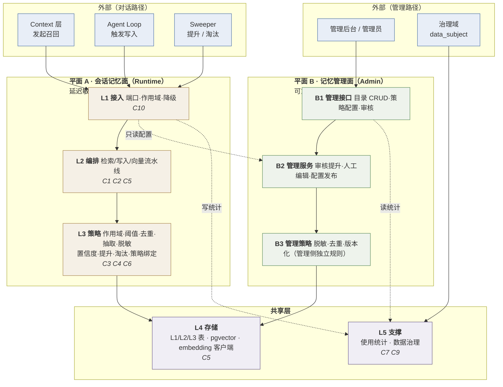

# Memory 层重构方案

> 版本：1.4（审查修正后；按**使用面**切分为「会话记忆面 / 记忆管理面」两个平面，各自分层 —— **+ 本轮重排**：代码层改名 A1/A2/A3·S1/S2、§2.6 加「正文节」索引列）
> 适用项目：`QiZhiDaAgentPlatform`
> 状态：**已定稿**（19 条审查问题已修正 + **本轮重排**，逐条见附录 C；附录 A 的 12 条决策于 2026-10-29 逐条确认）
> 方案集入口：[`README.md`](README.md)
> 上位基线：[`session-lifecycle-sequence.md`](session-lifecycle-sequence.md) —— 本方案实现其中 **Memory 泳道**
> 收敛机制：[`cleanup-ledger.md`](cleanup-ledger.md) —— 本方案对应条目 **X11–X16** + **X19**（死表 `memory_l2_embeddings`，Stage 0 迁移内 DROP）
> 硬约束：**最终态只有一个实现**；先上新、后清旧
> 方案集导航：落地路线与里程碑见 [`README.md`](README.md) §6 · 系统级验收见 §7 · 外部前置依赖见 §8 · 跨层不变量见 [`session-lifecycle-sequence.md`](session-lifecycle-sequence.md) §6

---

## 0. 定位与范围

### 0.1 Memory 在基线图上的位置

```
Context ──检索相关记忆──▶ Memory
   ▲                        │
   └────────返回记忆片段────┘

Agent Loop ──写入新记忆──▶ Memory
```

**两个方向，归属不同**：

- **读**（Retrieval）：由 **Context 主动发起**（基线图方向），Memory 提供存取；
- **写**（Writer）：由 **Agent Loop 在 Observe/Evaluate 之后触发**，Memory 提供沉淀。

### 0.2 按实际能力划分（不是三个子件）

Memory 域在代码里实际承担 **10 项能力**。它们不是三个子件，而是**能力面**——每项能力在运行时、管理侧、数据面上的落地状态各不相同，这正是本层最需要收敛的地方。

| # | 能力 | **平面** | 层（平面内） | 数据面 | 运行时 | 管理侧 | 现状判定 |
|---|---|---|---|---|---|---|---|
| **C1** | **写入沉淀** | **A**（自动）/ **B**（人工） | A:A2+A3　B:B2+B3 | L1 / L2 | `MemoryService.write` | — | ⚠️ 每轮无条件写，无抽取、无去重、无敏感过滤 |
| **C2** | **检索召回** | **A** | A:A2+A3 | L1 / L2 / L3 | `MemoryService.recall` | — | 🔴 无用户隔离、全量扫描 |
| **C3** | **分层与提升** | **A**（自动）/ **B**（审核） | A:A3　B:B2 | L1→L2→L3 | write 时自动记 L1→L2 | `/api/admin/memory/promotions` | ⚠️ L2→L3 只有布尔位，无流程 |
| **C4** | **保留与淘汰** | **A**（sweeper 驱动） | A:A3 | `admin_memory_policies` | **无执行者** | 策略 CRUD | 🔴 策略写了，没人执行 → 只增不减 |
| **C5** | **向量化** | **A**（共享存储） | A:A2　共享:S1 | `memory_l2_embeddings` | `MemoryService._embed_item` | — | ⚠️ **只有 L2 有向量**，L3 只能关键词 |
| **C6** | **策略绑定**（agent ↔ 记忆策略 / L3 条目） | **B** 写 / **A** 读 | B:B2　A:A3 | `admin_agents.memory_policy` | **完全不消费** | `/policies/{label}/agents`、`/l3/{id}/agents` | 🔴 管理端能看，运行时读不到 |
| **C7** | **使用统计与趋势** | **共享**（A 写 / B 读） | 共享:S2 | `hits` / `hits_trend` / `usage_history` / `hit_rate` | **不更新** | `/api/admin/memory/trend` | 🔴 全是静态值 |
| **C8** | **管理目录 CRUD** | **B** | B:B1+B2 | 全部五张表 | — | **18** 个端点 | ✅ 完整 |
| **C9** | **数据治理**（删除 / 导出） | **共享**（横跨两面） | 共享:S2 | 全部 | — | 治理域 `data_subject` | ⚠️ 记忆表未纳入删除范围 |
| **C10** | **降级与健康** | **A** | A:A1（贯穿各层） | — | 写入侧有、读取侧无 | — | ⚠️ 只覆盖一半 |

> **⚠️ 两套「L」不要混**（本层最容易读错的地方）：
> - **数据层**（存储分层）：**L1**（会话 buffer，决策 #5 后退役）/ **L2**（用户级事实）/ **L3**（工作区知识）—— 出现在**表名、字段、指标**里（`admin_memory_l1` / `L2Fact` / `l3EntryIds`）
> - **代码层**（平面内分层）：**A1** 接入 / **A2** 编排 / **A3** 策略（平面 A），**B1/B2/B3**（平面 B），**S1** 存储 / **S2** 支撑（共享）—— 出现在**架构分层、文件归属、依赖规则**里
>
> 早期版本两边都叫 L1/L2/L3 → 同一张图里混用「L2 编排」与「L2 事实」。**代码层已全部改名为 A1/A2/A3 · S1/S2**；数据层保持 L1/L2/L3。

**代码单元（子件）与能力面的关系**：本层落地为 **8 个代码单元**（§10.1 的逐文件清单是权威）—— 平面 A：`retrieval`（C2）、`writer`（C1）、`vectorize`（C5）、`scope`/`ranking`/`extraction`/`redaction`/`confidence`/`promotion`/`eviction`/`policy`（A3 策略层）—— 而 **C6 策略绑定**与 **C8 管理目录**是**跨单元的读侧能力**，需要在本层显式接线。

### 0.4 实现收敛规则

**最终态只有一个实现**；**先上新、后清旧**。清理机制由 [`cleanup-ledger.md`](cleanup-ledger.md) 统一管理（弃用标记 → 调用打点 → 指标归零 → 删除 → CI 扫描脚本 → 阶段门禁）。

本方案涉及台账条目 **X11**（`_remember`）、**X12**（`layered.py`）、**X13**（`admin_memory_l1`）、**X14**（跨用户泄漏，**修复类**不是删除类）、**X15**（`admin_memory_l3`）、**X16**（`MemoryService` 单类）、**X19**（死表 `memory_l2_embeddings`）。

**本层的收敛形态**：与其它层不同 —— **本层要拆的是一个类，不是接管一条路径**。`MemoryService` 同时提供运行时的 `recall/write` 与管理侧的 `list_*/trend`，两者**必须分开**（§2.2 规则 6）→ Stage 0 先拆类（纯重构，旧代码减少 0），运行时调用点在 Stage 3 才切走，管理侧留在平面 B。

**唯一 owner**：X11 的**停用**在 **Agent Stage 5 的 A-26**（旧循环改接新 Writer）之后 —— 那是本层的**前置**，不是本层的 Stage；X11 的**删除**归 Memory Stage 7。

### 0.3 Memory 明确不做

| 不做 | 归属 |
|---|---|
| 协议、鉴权、幂等、渠道回包 | Gateway |
| 选 agent / 路由 / 排序 | Router |
| 会话生命周期、轮次状态、事件落库 | Session |
| **上下文拼装、压缩、manifest** | Context（Memory 只提供片段，不组装） |
| 推理、**模型与工具的取值**、实际执行 | Agent Loop / Agent Router / Execution |
| **文档摄取、切块、索引重建** | **Knowledge 模块**（见 §1.9 的职责边界争议） |

> **一句话**：Memory 管的是「**记什么、怎么找、谁能看见、怎么提升、什么时候忘、谁在用**」。

---

## 1. 现状盘点

### 1.1 五张表 + 一张向量表

| 表 | 语义 | 关键列 |
|---|---|---|
| `admin_memory_l1` | 短期缓冲 | `buffer_text`, `buffer_size`, `tokens_used`, `ttl_minutes`, `ttl_remain_min`, `status` |
| `admin_memory_l2` | 事实 | `key`, `value`, `category`, `confidence`, `status`, `promoted_to_l3`, `usage_history`, `user_name` |
| `admin_memory_l3` | 工作区知识 | `team`, `title`, `summary`, `category`, `hits`, `contributor`, `status`, `hits_trend`, `promoted_from_l2_ids` |
| `admin_memory_promotions` | 提升事件 | `layer`, `label`, `operator`, `target_id` |
| `admin_memory_policies` | 保留策略 | `layer`, `label`, `ttl_minutes`, `max_items`, `storage_mb`, `eviction`, `hit_rate` |
| `memory_l2_embeddings` | L2 向量 | 迁移 0036 |

> **表命名的含义**：`admin_` 前缀 = **管理后台的数据表**。运行时（对话中召回/写入）与后台管理**共用同一批表**。

### 1.1b 🔴 会话记忆面与记忆管理面混在同一个服务里

`modules/memory/src/qzdap/modules/memory/application/services.py` 的 `MemoryService` **一个类同时提供两种语义**：

| 方法 | 属于哪一面 | 调用方 |
|---|---|---|
| `recall()` / `write()` | **会话记忆面** | Context / Agent Loop |
| `list_l1` / `get_l1` / `list_l2` / `get_l2` / `list_l3` / `get_l3` | **管理面**（读） | 管理后台 |
| `list_promotions` / `list_policies` / `get_policy` | **管理面**（读） | 管理后台 |
| `trend()` | **管理面**（读） | 管理后台 |
| `flush_l1()` / `flush_all_l1()` | **管理面（写）** | 管理后台（`:118`） |
| `update_l2()` / `update_l3()` | **管理面（写）** | 管理后台（`PATCH /l2/{id}` / `PATCH /l3/{id}`） |
| `promote_l2()` / `create_l3()` | **管理面（写）** | 管理后台（`:164` / `:204`） |

两面的**权限模型、时延要求、失败语义、审计口径完全不同**，却共享一个类与同一批方法。

更具体的问题在**管理端的编辑路径**：

```python
# modules/memory/.../adapter/persistence/repositories.py:167-175
async def update_l2(self, item: L2Fact) -> None:
    row.value = item.value            # ← 直接改内容
    row.status = item.status          # ← 直接改状态
    row.confidence = item.confidence  # ← 直接改置信度
```

管理端 `PATCH /api/admin/memory/l2/{id}` 走的是这条路径 —— **完全绕过**写入侧的敏感信息闸门、去重与来源追溯。管理员手工粘进去的敏感内容会直接进库，并被后续召回注入到对话里。

### 1.2 🔴 C2 召回没有用户隔离 —— 工作区内跨用户泄漏

`MemoryService.recall()`（`modules/memory/src/qzdap/modules/memory/application/services.py:331-384`）：

```python
facts = [item for item in await self._catalog.list_l2(workspace_id)
         if item.status != "retired"]
knowledge = [item for item in await self._catalog.list_l3(workspace_id)
             if item.status == "published"]
```

而仓储层（`adapter/persistence/repositories.py:161-165, 204-208`）：

```python
async def list_l2(self, workspace_id: UUID) -> list[L2Fact]:
    result = await self._s.execute(
        select(MemoryL2ORM).where(MemoryL2ORM.workspace_id == workspace_id)
    )
    return [_l2(row) for row in result.scalars().all() if not _cross_tenant(row)]
```

**没有 `user_id` 过滤**。`L2Fact` 有 `user_name` 字段，但只用于打标签（`_hit()` 里 `scope = "workspace" if layer == "l3" else "user"`），**不参与过滤**。向量检索同理：

> **⚠️ 而且两个「定位到人」的参数被显式丢弃**：
> - `recall()` 里 `_ = scope_filter`（`services.py:337`）—— 端口传进来的作用域过滤**被丢掉**；
> - `write()` 里 `_ = owner_id`（`services.py:325`）—— 唯一能定位到人的参数**被丢掉**。
>
> 所以修复**不只是「给 SQL 加 WHERE」**，还得**让端口把作用域传得进去**（现状 `MemoryPort.recall` 压根没有 scope 参数，见 §10.3）。

```python
# adapter/persistence/vector_adapter.py:62
results = await self._store.search(query, top_k=..., filter={"workspace_id": str(workspace_id)})
```

> **后果**：同一工作区内，**用户 A 的记忆会被召回并注入到用户 B 的上下文里**。L2 的语义恰恰是「用户级事实」（用户偏好、个人信息）—— 这是**工作区内的用户级数据泄漏**。

### 1.3 🔴 C2 召回是全量扫描

`recall()` 先 `list_l2(workspace_id)` + `list_l3(workspace_id)` **把整层记忆全量加载进内存**，再逐条关键词打分，最后与向量结果合并排序。

- 延迟随数据量线性增长；
- 跨租户检查 `_cross_tenant(row)` 也是**Python 侧逐行判断**（租户隔离没落到 SQL 的 WHERE 里）；
- `top_k` 只在最后截断，前面的全量扫描照做。

### 1.4 🔴 C1 写入无条件、语义失真、无幂等

`runner._remember()`（`adapter/graph/runner.py:664-694`）每轮结束都写：

```python
content = f"用户：{user_input}\n助手：{final}"
meta = {"scope": policy.get("scope") or "user", "agentName": ...,
        "key": "会话事实", "category": "fact"}
await self._memory_port.write(...)          # 一次 write → 内部写 L1 + L2 + promotion
out = [("l1", final[:80])]
if policy.get("autoSummarize"):
    out.append(("l2", final[:80]))          # ← 声称写了两层，实际 L2 里是同一段拼接文本
```

| 问题 | 说明 |
|---|---|
| **每轮无条件写** | 不判断有没有值得记的东西 → 记忆库被自己的对话灌满 |
| **写入内容截断** | `runner._remember` 传的是 `content[:4000]`（`runner.py:687`）—— 新 Writer 必须复刻这个上限，否则单条记忆长度行为会漂移 |
| **`scope` 无效** | `meta['scope']` 只是标签，**不影响存储位置** —— L2 永远在 workspace 级 |
| **`autoSummarize` 无实现** | 声称写 L2 摘要，实际 L2 里是同一段原文拼接 |
| **无幂等** | L2 表**没有 `content_hash`** → 同一轮重试会写两条重复记忆 |
| **来源不可追溯** | `source_session` 是 `String(64)` **自由文本**，不是 FK；`user_name` **连显示名都不是** —— 自动沉淀写进去的是占位符 `"用户"`（见 §1.4.1） |
| **置信度固定 0.8** | 没有评估 |
| **无敏感信息闸门** | 用户随口说的手机号会被原样写进 L2，跨会话召回给另一个对话 |

> **`user_name` 存显示名**是连锁问题：无法按 `user_id` 精确检索、无法做数据主体删除（PIPL 定位不到记录）、改名即失联。

#### 1.4.1 🔴 自动沉淀的 `user_name` 是**占位符 `"用户"`**，不是显示名

`MemoryService.write()` 收到的 `owner_id` 被**显式丢弃**，而 `user_name` 由常量兜底：

```python
# modules/memory/.../application/services.py:284, 325
user_name=user_name or str(meta.get("userName") or "用户"),   # ← 兜底成字面量 "用户"
...
_ = owner_id          # ← 唯一能定位到人的参数被丢掉
```

`MemoryServiceAdapter.write()` 不传 `user_name`；`runner._remember` 的 metadata 里也只有 `scope` / `agentName` / `key` / `category`，**没有 `userName`** → **每一条自动沉淀的记忆，`user_name` 都是 `"用户"`**。

> **⚠️ 这条决定了 §9.2 的回填不可行**：按 `display_name = user_name` 回填时，自动沉淀的那批会**全部落空**（或撞上同名的真实用户 → **串号**）。
> **修复必须从写入侧开始** —— `write()` 接上 `owner_id` 并持久化 `user_id`；**存量行不做归属回填**（见 §9.2 与决策 #11）。

### 1.5 🔴 C3 L1 与会话无关联；L2→L3 无提升流程

- `MemoryL1ORM` **没有 `session_id` 列**（`adapter/persistence/models.py:21-33`）→ L1 是「一个 buffer + 一段文本 + 60 分钟 TTL」，**不绑定任何会话**，且 **`recall()` 从不读 L1** —— 只写不读的死数据；
- `promoted_to_l3` 是 L2 上的布尔位，**没有真正的提升流程**（只能人工在后台改）。

### 1.6 🔴 C4 保留策略没有执行者

`admin_memory_policies` 定义了 `ttl_minutes` / `max_items` / `storage_mb` / `eviction`（lru）—— 但**全仓没有任何 evict / prune / enforce 实现**（`grep "def evict|def prune|def apply_policy"` 无命中）。

> **记忆只增不减**。与治理模块的 `expire_if_due()`（审批过期）同一类问题：**策略写了，执行者没写**。

### 1.7 🔴 C6 策略绑定能力：管理端能看，运行时读不到

`admin_agents.memory_policy` 这个 JSONB 里实际有 **4 个字段**（从管理端 API 的读法反推）：

| 字段 | 默认值 | 管理端用法 | 运行时消费情况 |
|---|---|---|---|
| `enabled` | `True` | `/policies/{label}/agents` 过滤 | ✅ `runner._remember` 读了（`runner.py:675`） |
| `scope` | `"user"` | 同上（`l1→session` / `l2→user` / `l3→tenant` 的映射） | ⚠️ 读了但**只当标签，不影响存储** |
| `retentionDays` | `30` | — | ❌ **完全不消费**（默认策略里就有，运行时无视） |
| `autoSummarize` | `True` | — | ⚠️ 读了但**无实现**（只往返回值里塞一个 `"l2"` 字符串，见 §1.4） |
| `policyLabel` | —（管理端写入） | `/policies/{label}/agents` 过滤 | ❌ **完全不消费** |
| `l3EntryIds` | —（管理端写入） | `/l3/{item_id}/agents` 反查 | ❌ **完全不消费** |

> 默认形状见 `modules/agent_runtime/.../domain/catalog.py:43-49`：`{enabled, retentionDays, scope, autoSummarize}`；`policyLabel` / `l3EntryIds` 由管理端写入（`router.py:254-296` 反查）。**六个字段里运行时只真正消费了两个**。

另外 `admin_agents.knowledge_refs` 里 `type ∈ {"memory", "l3"}` 的条目（`/l3/{id}/agents` 会查）—— **运行时也不消费**。

> **后果**：管理员在后台给某个 agent 绑定了「记忆策略 X」或「引用 L3 条目 Y」，**对话时完全不生效**。管理面与运行面脱节。

### 1.8 🔴 C7 使用统计全是静态值

`hits` / `hits_trend` / `usage_history` / `hit_rate` 都有列，但**运行时从不更新** —— 召回命中不写 `used_count`；写入确实写 `usage_history`，但写死成 `["刚刚"]`（`services.py:311`），**没有真实事件序列**。管理端 `/api/admin/memory/trend` 返回的是 `trend()` 里用 `len()` 算出来的**条目数量序列**，不是真实使用趋势。

> **后果**：C4 的淘汰策略（LRU / 命中率）**没有数据依据**；置信度调整也没有反馈信号。

### 1.9 🔴 L3 与 `modules/knowledge` 职责重叠，运行时双份注入

`modules/knowledge/` 是**一整套独立的知识库能力**：

| 能力 | 实现 |
|---|---|
| KB 管理 | `admin_knowledge_kbs` |
| 文档摄取 | `KnowledgeService.ingest_doc` |
| 切块 + 向量 | `admin_knowledge_chunks` + `_embed_and_store` |
| 索引重建 | `_reindex_kb` |
| 检索 | `search_query`（关键词 + 向量混合） |
| 评测 / 任务 | `admin_knowledge_eval_cases` / `admin_knowledge_tasks` |

而 Memory 的 **L3 也是「工作区知识」**（`team` / `title` / `summary` / `status='published'`）。**两者职责重叠**。

更糟的是**运行时两套都在注入**：

```python
# runner.py:517-524（记忆）→ MemoryService.recall 返回 L2 **和 L3** 混合的 hits
memories = await self._memory_port.recall(...)
# runner.py:538-547（知识）→ knowledge 模块的 chunks
knowledge = await self._knowledge_port.search(...)
# runner.py:548-559
system += f"\n\n相关记忆：\n{hits}"    # ← 含 L3 内容
system += f"\n\n相关知识：\n{hits}"    # ← 含 knowledge chunks
```

> **同一个知识内容可能被注入两次**（L3 一次、knowledge chunks 一次），且两套的召回、排序、ACL 口径完全不一致。
>
> 而且 **`memory_l2_embeddings` 只存 L2 的向量**（表名和 `_embed_item(fact.id, "l2", ...)` 都写明）→ **L3 没有向量，只能关键词检索**；而 knowledge 的 chunks **有向量**。**能力更强的那个反而不在运行时链路里。**

> **决策 #1（已定稿）**：L3 与 knowledge 模块的职责边界 → **L3 退役**（知识统一归 `modules/knowledge`），L2→团队知识改走 knowledge 的 KB。见 §5.3。

### 1.10 ✅ 可直接复用的资产

| 资产 | 位置 | 状态 |
|---|---|---|
| 三层实体 + 提升事件 + 保留策略 | `modules/memory/src/qzdap/modules/memory/domain/entities.py` | ✅ 模型可用，需补字段 |
| `EmbeddingPort` / `VectorSearchPort` 协议 | `modules/memory/src/qzdap/modules/memory/application/ports.py` | ✅ 契约可用 |
| **独立 embedding 服务**（`/embed` + `/healthz`，sbert / openai / noop 三适配器） | `backend/runtimes/embedding_runtime/` | ✅ 真实供应商接入已就位 |
| 向量存储适配器（pgvector） | `modules/memory/.../adapter/persistence/vector_adapter.py` | ✅ 已接**且已接线**（`lifespan.py:647`），但过滤维度只有 `workspace_id`（§1.2） |
| `LayeredMemory` Protocol | `runtimes/.../ports.py:80-106` | ✅ 契约可用 |
| `RecallHit`（layer / content / score / source_id / citation / metadata） | `runtimes/.../ports.py:68-77` | ✅ 结构可用，缺 `scope` / `used_count` / `ref_id` / `version` |
| 提升事件表 `admin_memory_promotions` | 迁移 0023 | ✅ 已建 |
| **`admin_memory_vec` 表（真正的向量表）** | 迁移 0023 | ✅ **生产在用**：`embedding vector(dim)` + `payload JSONB` + **HNSW 索引**；composition 里 `PgVectorStore(table="admin_memory_vec")`（`lifespan.py:647`） |
| `memory_l2_embeddings` 表 | 迁移 0036 | 🔴 **死表**：列齐（连 `user_id` / `content_hash` 都有）但**零代码引用**（grep 只命中自己的迁移）→ **Stage 0 迁移里 DROP**（台账 **X19**） |
| 管理端 **18** 个 API 端点 | `modules/memory/.../adapter/http/router.py` | ✅ 完整 |
| `admin_agents.memory_policy` 四字段 | 现有 JSONB | ✅ 配置已就位，**运行时未消费**（§1.7） |

---

## 2. 目标架构：两个平面，各自分层

Memory 域必须先按**使用面**切成两个平面，再在平面内分层。两面共享数据面，但**接口面、权限面、写入路径、时延要求全部不同**。



### 2.1 两个平面的分界

| | **平面 A · 会话记忆面** | **平面 B · 记忆管理面** |
|---|---|---|
| 使用者 | Context / Agent Loop / Sweeper | 管理员 / 治理域 |
| 触发 | 对话中自动 | 人工操作或后台任务 |
| 时延要求 | **敏感**（在对话主路径上） | 不敏感（可重试、可异步） |
| 入口 | `LayeredMemory` Port（runtime） | 管理端 HTTP API（admin） |
| 写入路径 | **自动沉淀**（抽取 → 脱敏 → 去重 → 置信度） | **人工编辑**（直接指定内容 → 脱敏 → 记录来源） |
| 幂等键 | `content_hash` + `idempotency_key` | `idempotency_key` + **版本号**（乐观并发） |
| 权限模型 | 运行时主体（租户 / 用户作用域） | 管理员角色 + 工作区权限 |
| 失败处理 | **降级继续**（不中断对话） | **报错**（管理操作必须让管理员知道结果） |
| 审计 | 记录写入事件 | 记录完整操作日志（谁、何时、改了什么） |

### 2.2 平面的交互规则（**关键**）

| # | 规则 | 说明 |
|---|---|---|
| **1** | **平面 A 不得调用平面 B 的服务** | 运行时不能依赖管理逻辑（管理可能慢、可能失败、可能不存在） |
| **2** | **配置从 B → A 是单向只读** | 管理员在 B 里配的 `memory_policy` / `RetentionPolicy`，A 只读取。**A 不得回写 B** |
| **3** | **两面的写入路径必须分开** | 管理端 `PATCH /l2/{id}` **不得走平面 A 的写入流水线**（那是自动沉淀路径，会套用抽取 / 置信度规则，人工编辑的内容会被误判）——但**必须过同一道敏感信息闸门** |
| **4** | **统计是共享写入、单向读取** | A 的召回更新统计；B 读统计做趋势。**B 不改统计**（除非是人工修正，需留痕） |
| **5** | **治理横跨两面** | 删除请求要同时清理 A 的数据（表 + 向量）与 B 的配置关联 |
| **6** | **两面的服务类必须分开** | 不能像现在 `MemoryService` 一个类同时提供 `recall/write` 与 `list_*/trend` |

> **规则 3 的必要性**：现状管理端 `PATCH /api/admin/memory/l2/{id}` 直接改 `value` / `confidence` / `status`，**绕过**了写入侧的敏感过滤与去重 —— 管理员手工粘进去的敏感内容会直接进库并被召回。分面后这条路径必须显式补上闸门。

### 2.3 平面 A（会话记忆面）的内部分层

> 代码层用 **A1/A2/A3** 命名（**不是**数据层的 L1/L2/L3 —— 见 §0.2 的命名说明）。

| 层 | 职责 | 本层**不做** | 代码单元 |
|---|---|---|---|
| **A1 接入** | 解析作用域（tenant/workspace/user/session）、统一降级包装（**C10**）、翻译领域异常 | 不做检索算法、不做策略判断 | `gateway.py` |
| **A2 编排** | 检索七步、写入五步、向量异步补写与删除同步（**C1 / C2 / C5**） | 不含阈值 / 规则常量 | `retrieval.py` / `writer.py` / `vectorize.py` |
| **A3 策略** | 作用域、阈值与 top-k、abstain、去重、抽取、敏感闸门、置信度、提升、淘汰、agent 策略绑定（**C3 / C4 / C6**） | **不碰 DB / 向量库**（策略必须能脱库单测） | `scope.py` / `ranking.py` / `extraction.py` / `redaction.py` / `confidence.py` / `promotion.py` / `eviction.py` / `policy.py` |

### 2.4 平面 B（记忆管理面）的内部分层

| 层 | 职责 | 本层**不做** | 代码单元 |
|---|---|---|---|
| **B1 管理接口** | 目录 CRUD、策略配置、审核操作、趋势查询（**C8**，现有 18 端点） | 不含业务规则 | 管理端 router |
| **B2 管理服务** | 审核提升、人工编辑、配置发布与生效、冲突检测（乐观并发） | 不做运行时召回 | `admin_service.py` |
| **B3 管理策略** | 管理侧**独立的**脱敏 / 去重 / 版本化规则（与平面 A 的规则可不同，但**敏感信息闸门必须共用同一套**） | 不做运行时写入 | `admin_rules.py` |

### 2.5 共享层

| 层 | 职责 | 归属 |
|---|---|---|
| **S1 存储** | 表与向量的读写、embedding 调用、统计字段落库（**C5**） | 共享（A 写、B 写） |
| **S2 支撑** | 使用统计聚合与趋势（**C7**）、数据治理删除与导出（**C9**） | A 写统计、B 读统计；治理横跨两面 |

### 2.6 十项能力的平面归属（**唯一归属 + 正文索引**）

> 这张表是**两件事的索引**：① 每项能力**归哪个代码层**（唯一归属）；② 它**在正文的哪一节**（§3–§7）。**正文按能力分章、架构按平面分层，两套轴靠这张表对齐** —— 没有「正文节」列就无从查起。

| 代码层 | 能力 | 该层做什么 | **正文节** | 跨平面协作点 |
|---|---|---|---|---|
| A1 | **C10** 降级与健康 | 捕获 provider / 存储故障 → 降级为词法召回或跳过写入，置 `recall_degraded` / `write_degraded` | **§3.6** | 无 |
| A2 | **C2** 检索召回 | 编排七步流水线，产出 `RecallHit` | **§3.1–§3.5** | 向 A3 索取作用域与阈值；向 S1 取数；向 S2 写统计 |
| A2 | **C1** 写入沉淀（自动路径） | 编排写入流水线 | **§4.1–§4.6** | 向 A3 抽取 / 脱敏 / 定置信度；向 S1 落库 |
| A2 | **C5** 向量化 | 编排「落库后异步补向量」「删除时同步删向量」 | **§5.4** | S1 提供 embedding 与 pgvector 客户端 |
| A3 | **C3** 分层与提升（自动路径） | 自动提升规则 | **§5.1 / §5.2** | 触发时机由 A2 的写入流水线决定；人工审核路径在 B2 |
| A3 | **C4** 保留与淘汰 | 淘汰规则（TTL / max_items / storage_mb / LRU） | **§6** | 触发时机由 sweeper 驱动，仍走 A2 的写入路径 |
| A3 | **C6** 策略绑定 | 解析 `enabled` / `scope` / `policyLabel` / `l3EntryIds` | **§7.1** | **配置来自 B2**（单向只读） |
| S1 | **C5** 向量化（存储侧） | embedding 调用与向量读写 | **§5.4** | 共享 |
| S2 | **C7** 使用统计与趋势 | 统计更新与趋势聚合 | **§7.2** | A 写、B 读 |
| B1/B2 | **C8** 管理目录 CRUD | **18** 个管理端点 | **§7.3** | 与 A 共享 S1 |
| B2 | **C3** 分层与提升（人工路径） | 审核提升、人工编辑 | **§7.1 / Stage 6b** | 人工编辑走 B3，**不走 A 的写入流水线** |
| B3 | **C1** 写入沉淀（人工路径） | 人工编辑的脱敏 / 去重 / 版本化 | **§7.1 / Stage 6b** | **敏感闸门与 A 共用同一套** |
| S2 | **C9** 数据治理 | 删除 / 导出 provider | **§7.4** | 横跨两面 + 向量 |

### 2.6.1 `RecallHit` 契约终态

Context 需要 `ref_id`（可回溯的稳定 ID）、`score`（召回得分）、`version`（来源版本）三个字段组装 manifest（见 Context 方案 §3.5）。现有 `RecallHit` **缺 `ref_id` 与 `version`**：

```python
@dataclass(frozen=True, slots=True)
class RecallHit:
    layer: str                  # 'stm' | 'l2' | 'l3'（**统一用 stm**，不用 l1 —— L1 表按决策 #5 退役后不留 l1 这个名字，避免同一指标里新旧取值并存）
    content: str
    score: float
    source_id: str              # 现有字段（记忆条目 id）
    citation: str | None
    metadata: Mapping[str, Any]
    # ↓ 本方案新增
    ref_id: str                 # = source_id 的稳定别名（Context 用它做 manifest.ref_id）
    version: str                # 来源版本：L2 行版本 / 嵌入批次版本 / 知识包版本
    scope: str                  # 'tenant' | 'workspace' | 'user' | 'session'
    used_count: int             # 被召回过的次数
```

> **`ref_id` 与 `source_id` 是同一个值**，同时保留是为了兼容现有调用点（`source_id` 已被引用），新代码统一用 `ref_id`。**不是两套 ID**。
>
> **`version` 的取值**：L2 → 行级 `version`（若表无该列，用 `updated_at` 的 ISO 串）；L1（STM 缓冲）→ 缓冲批次号；知识 → 知识包版本（由 `modules/knowledge` 提供）。
>
> **契约变更性质**：这是**扩字段**，不是「契约保持不变」。下游（Context 的 manifest 组装）依赖 `ref_id` / `version`，因此本方案的 Stage 0 必须同时交付这两个字段。
>
> **⚠️ 生产路径现在返回的根本不是 `RecallHit`**：`MemoryService.recall()` 返回的是 `_hit()` 造的 **5 键 dict** —— `{id, content, score, scope, layer}`（`services.py:443-451`），**没有** `source_id` / `citation` / `metadata`。`RecallHit` 只是**新 runtime（从未接线）**里定义的契约。
> 所以「扩字段」实际要做三件事：① 让生产返回改用 `RecallHit`（字段一一对应，`id → source_id`）；② 补 `ref_id` / `version` / `scope` / `used_count`；③ Context 的 manifest 组装才有稳定来源。

### 2.7 两条主路径（平面 A）

**读路径（C2）**

```
Context
  → L1: 解析作用域（tenant/workspace/user/session）+ 降级包装
  → L2: 检索流水线
       ├─ L3: 作用域规则（tenant → workspace → user → session）
       ├─ L3: 阈值 / top-k / abstain 规则
       ├─ L3: 去重规则
       ├─ L4: 向量候选（pgvector，filter 带 user_id）
       ├─ L4: 词法候选
       ├─ L3: 融合排序 + 阈值判定
       └─ L3: provenance 组装规则
  → L2: 组装 RecallHit[]
  → L5: 更新使用统计（used_count / last_used_at）
  → L1: 返回（含 recall_degraded）
```

**写路径（C1，自动沉淀）**

```
Agent Loop
  → A1: 解析作用域 + 降级包装
  → A2: 写入流水线
       ├─ A3: 敏感信息闸门（不通过 → 拒绝 + 审计）
       ├─ A3: 事实抽取规则
       ├─ A3: 置信度分级（低于阈值 → 只留 STM）
       ├─ A3: 去重规则（content_hash → 更新而非插入）
       ├─ A3: agent 策略绑定（enabled / scope → 决定存储层）
       ├─ S1: 落库 L1/L2（数据层，含来源 turn_id）
       └─ A2: 异步补向量（不阻塞对话）
  → S2: 更新使用统计与 usage_history
  → A1: 返回（含 write_degraded）
```

**提升与淘汰**不是独立路径：它们**复用写路径**，只是触发源不同（提升 ← 抽取结果达标；淘汰 ← sweeper）。

### 2.8 分层规则（可写成架构测试）

| # | 规则 | 检查方式 |
|---|---|---|
| 1 | 依赖单向向下：A 内 L1→L2→L3→L4；B 内 B1→B2→B3→L4 | import 方向检查 |
| 2 | **平面 A 不得 import 平面 B** | 跨平面 import 禁令 |
| 3 | **L3 策略层不得有 IO**：不得 import sqlalchemy / pgvector / httpx | import 禁令（策略可脱库单测） |
| 4 | **B3 与 L3 的敏感闸门必须共用同一实现** | 实现同一函数的断言（防两套脱敏规则漂移） |
| 5 | **L4 存储层不得含业务规则**：不得出现阈值 / top-k / 置信度常量 | 关键字扫描 |
| 6 | L1 / B1 是各自平面的唯一对外入口 | 模块可见性 |
| 7 | 平面 B 的管理操作**不得进入对话主路径** | 主路径调用图检查 |

> **规则 2 是本层最有价值的约束之一**：把「运行时」与「管理」在 import 层面隔开，运行时就不会因为管理逻辑变慢、报错或不存在而被拖垮。
>
> **规则 3 同理**：策略层纯函数化后，「用户隔离」「阈值」「敏感过滤」这些最关键的行为**可以脱库单测**，不必起数据库。这是把 §1 里那串安全缺陷变成可验证代码的前提。

## 3. C2 · Retrieval：记忆检索

### 3.1 召回流水线（固定七步）

```
1. query 归一化
2. 作用域过滤（tenant → workspace → user → session/agent）   ← 🔴 当前缺 user 层
3. 候选检索（向量 + 词法 合并）
4. 去重（content_hash / 语义近似）
5. 可选 rerank
6. 阈值过滤 + top-k
7. 生成 provenance（来源、得分、层级、引用）
```

第 2 步的**作用域过滤必须在 SQL / 向量检索的 WHERE 里**，不能在 Python 侧逐行判断（现状是后者）。

### 3.2 作用域模型（修 §1.2）

| 层 | 作用域 | 谁能召回 |
|---|---|---|
| **STM** | `tenant + workspace + session_id` | 仅当前会话 |
| **LTM-用户级（L2）** | `tenant + workspace + user_id` | 仅该用户 |
| **LTM-工作区级（L3 或 knowledge）** | `tenant + workspace` | 工作区全体（受 ACL 约束） |

> **L2 必须加 `user_id` 列**（现状只有 `user_name`，而且自动沉淀写的是占位符 `"用户"` —— §1.4.1）。这是 §1.4 的连锁修复点，也是 PIPL 数据主体删除能定位到记录的前提。
>
> **⚠️ 落地顺序不能反**：先让**写入侧持久化 `owner_id`**（`write()` 已经收到这个参数却丢弃了 —— §1.2），再谈存量归属；**存量自动记忆不回填**（决策 #11）。
> 顺序反了会出现「新数据照样落空、旧数据靠猜」的最坏组合。

### 3.3 检索实现

现状是「全量加载 → 内存关键词打分 → 与向量合并」。目标：

- **向量优先**（pgvector 已有），词法作为补充与兜底；
- **过滤条件带 `user_id`**：`filter={"workspace_id": ..., "user_id": ...}`；
- **候选集**：`top_k × 4`（与 Context 层的降级序一致），而不是全量。

> **决策 #2（已定稿）**：向量检索的过滤维度 → **下沉到 pgvector**。向量库里若没有 `user_id` payload，就需要**回填历史向量**并同步改写入端。
>
> **⚠️ 落地对象是 `admin_memory_vec`**（迁移 0023，生产在用；`embedding vector(dim)` + `payload JSONB` + **HNSW 索引**；composition 里 `PgVectorStore(table="admin_memory_vec")`，`lifespan.py:647`），**不是** `memory_l2_embeddings`（0036，**死表**，Stage 0 直接 DROP —— 台账 **X19**）。
> 过滤机制是 `payload ->> 'k' = 'v'`（`libs/vector/src/qzdap_vector/pg_vector.py:114-122`）→ **加 `user_id` 进 payload 即可**（filter key 必须是安全标识符）。
> `PgVectorStore.search` 的 WHERE 里**已有 `tenant_id = :tid`** → 租户隔离在向量侧是到位的；`workspace_id` 也在 payload 里过滤 —— **缺的只有 `user_id`**。

### 3.4 阈值与 abstain

- 得分低于阈值 → **返回 abstain 信号**，不硬塞给模型；
- Context 层据此让 agent 请求澄清或说明依据不足；
- **禁止**把「没召回」伪装成「没有相关知识」。

### 3.5 provenance

每条命中必须带：

| 字段 | 含义 |
|---|---|
| `layer` | `stm` / `l2` / `l3` |
| `source_id` | 记忆 id / 知识 chunk id |
| `score` | 得分 |
| `citation` | 可展示的引用（知识包名 / 记忆键） |
| `created_at` / `last_used_at` | 新鲜度 |
| `scope` | `user` / `workspace` / `session` |
| `used_count` | 被引用次数（用于淘汰） |

### 3.6 C10 降级与健康（补读取侧）

| 情况 | 行为 |
|---|---|
| embedding 供应商不可用 | **降级为纯词法**，标 `recall_degraded=true`；**不抛错中断对话** |
| 向量库不可用 | 同上 |
| 记忆库整体不可用 | 同上（Context 侧已设计为 best-effort） |
| 权限过滤后为空 | 返回空 + abstain，**不是**错误 |

> 现状的降级只在**写入侧**（`MemoryService._embed_item` 捕获 `ProviderUnavailable` 后跳过写入）。读取侧要补同样的降级，并让 `recall_degraded` 一路传到 Context → 前端。

---

## 4. C1 · Writer：记忆写入

### 4.1 写入必须「先判断值不值得记」

现状每轮无条件写（§1.4）。目标：

```
一轮结束
   → 抽取候选（从用户输入 + 助手回答中抽取「值得记的事实」）
   → 敏感信息闸门
   → 去重（content_hash + 语义近似）
   → 评估置信度
   → 落库（带 provenance：来源 session/turn、user_id）
   → 写使用统计
```

### 4.2 抽取（Extraction）

| 方案 | 说明 | 代价 |
|---|---|---|
| **(a) 规则抽取**（推荐先做） | 正则 / 关键词命中「我的…」「我是…」「记住…」等模式 | 召回率低，但零成本、确定性强 |
| **(b) LLM 抽取** | 用小模型从对话中抽事实 | 每次多一次 LLM 调用；可能抽错 |
| **(c) 混合** | 规则先过，剩余交给 LLM | 最贵 |

> **决策 #3（已定稿）**：抽取方式 → **(a) 规则起步 + 预留 (b) LLM 接口**。

### 4.3 敏感信息闸门

写入前必须过一道**敏感信息闸门**：身份证号、手机号、银行卡号、密码、密钥、地址等。命中 → **拒绝写入并记审计**。

### 4.4 幂等与去重

- L2 表加 `content_hash`（sha256 of **规范化内容**）→ 唯一约束 `(tenant_id, workspace_id, user_id, content_hash)`；
- **规范化规则必须写死并版本化**（否则同一内容不同写法 hash 不同 → 去重失效）：本方案取「Unicode NFKC + 折叠连续空白 + 去首尾空白 + 转小写」，规则随 `content_hash_version` 一起落库；
- 写入命中已有 hash → **不新增，改为更新 `last_used_at` / `usage_history`**；
- 语义近似去重（向量比对）作为第二道；
- **存量行的 `content_hash` 为 NULL** → 唯一约束对存量**不生效**（`WHERE content_hash IS NOT NULL`）。两条路：① 全量回填（要先定规范化规则 + 重算全库哈希）；② **明确「存量不参与去重」，只在条目下次被重新写入时补 hash**。**本方案取 ②** —— 与 §9.2 的 `user_id` 归属回填同理，存量重算不现实。

### 4.5 置信度

| 来源 | 置信度 | 处理 |
|---|---|---|
| 用户显式说「记住这个」 | 0.95 | 直接入 L2 |
| 规则从陈述句抽取 | 0.6–0.8 | 入 L2，可被人工纠正 |
| LLM 抽取 | 0.5–0.9（模型自评） | 低于阈值只留 STM |
| 从召回结果反推 | **禁止** | 见 §4.6 |

### 4.6 🔴 修掉新 runtime 里的「逻辑反转」

`runtimes/.../graph/nodes.py:1019` 的 `remember` 节点**从 `memory_hits`（召回结果）里提取事实写回 L2** —— 把「**召回到的**」当成「**新学到的**」写回去。

> 这会造成记忆的**自我强化循环**：召回 → 写回 → 下次更容易召回 → 再写回。**必须修**：Writer 的输入只能是**本轮的对话内容**，不是召回结果。

### 4.7 写入的触发点

基线图：**Agent Loop 在 Observe/Evaluate 之后写入**。更精确的时机是**一轮结束（final answer 产生后）**，而不是每次 LLM 调用后。

> **决策 #4（已定稿）**：写入触发点 → **每轮结束一次**。

---

## 5. C3 / C5 · 分层、提升与向量化

### 5.1 STM（短期记忆，当前会话）

| 组成 | 落点 | 生命周期 |
|---|---|---|
| 会话消息序列 | `session_messages`（Session 层） | 会话存续 |
| 滚动摘要 | `agent_sessions.rolling_summary`（Context 层） | 会话存续 |
| 未提炼的对话缓冲 | **新增** `session_memory_buffer`（会话级） | 会话结束 → 提升为 L2 或丢弃 |

> **决策 #5（已定稿）**：L1（`admin_memory_l1`）→ **退役**，STM 用带 `session_id` 的新表。
> - **(a) 退役**（推荐）：L1 现有的「buffer + TTL + 无 session 关联 + 只写不读」语义与 STM 不符；STM 的消息与摘要已由 Session / Context 持有，剩下的「未提炼缓冲」用**带 `session_id` 的新表**表达。
> - **(b) 改造**：给 `admin_memory_l1` 加 `session_id` / `user_id`，保留缓冲语义。
> - **(c) 保留现状**：L1 继续做无主缓冲（不推荐 —— 它只增不减且与 STM 无关）。

### 5.2 LTM（长期记忆，跨会话）

| 层 | 内容 | 作用域 | 提升路径 |
|---|---|---|---|
| **L2** | 用户偏好、稳定事实、任务状态 | `tenant + workspace + user` | STM 缓冲 → 规则/LLM 抽取 → 置信度达标 |
| **L3** | 工作区/团队知识 | `tenant + workspace` | L2 →（人工/自动）→ 发布 |

### 5.3 🔴 决策 #1：L3 与 knowledge 模块的职责边界

这是本层**最大的架构分叉**，必须定。

| 方案 | 含义 | 优点 | 代价 |
|---|---|---|---|
| **(a) L3 退役**（推荐） | 工作区知识**统一由 `modules/knowledge` 提供**（它有摄取、切块、向量、索引重建、评测的完整能力）；Memory 层只管 **L1（会话缓冲）+ L2（用户事实）** | 消除双份注入；把能力更强的向量检索留在运行时链路；Memory 层职责收敛到「会话记忆 + 用户事实」 | `promoted_from_l2_ids` 表达的 **L2→L3 提升路径**需要重新安置（提升到 knowledge 的 KB？还是取消团队级提升？） |
| **(b) knowledge 降级为管道** | knowledge 只做「文档摄取 → 切块 → 提升进 L3」，运行时检索统一走 Memory 的 L3 | 保留 L2→L3 提升语义；Memory 层是唯一记忆入口 | 要给 L3 补 chunk 结构与向量（现在没有）；knowledge 的检索能力要重写到 L3 上 |
| **(c) 维持现状双份** | 两套并存 | — | ❌ 同一内容注入两次、口径不一致、能力更强的向量检索不在链路上 —— **不采纳** |

> **建议 (a)**，并把 L2→L3 提升改名为 **「事实 → 团队知识候选」**，落点是 knowledge 模块的 KB（人工审核发布），而不是 Memory 的 L3 表。这样 C3 的提升链路仍然存在，只是终点换了。

### 5.4 C5 向量化

现状：`_embed_item` 只对 **L2** 做 embedding（`memory_l2_embeddings` 表名即证据），且 `ProviderUnavailable` 时跳过写入（降级正确）。

目标：

| 项 | 现状 | 目标 |
|---|---|---|
| 覆盖层 | 仅 L2 | L2 + STM 缓冲（可选）+ （若决策 #1 选 b）L3 |
| 写入时机 | 写 L2 时同步 | 写入后异步补向量（不阻塞对话） |
| 降级 | 写入侧跳过 | 写入侧跳过 + **读取侧降级为纯词法**（§3.6） |
| 幂等 | 无 | `content_hash` 作为**去重键**；向量表的 upsert 键仍是 `id`（`PgVectorStore.upsert` 是 `ON CONFLICT (id)`），不是 `content_hash` |
| 服务 | `modules/memory/adapter/embedding/` 三适配器 + **独立 `embedding_runtime` 服务** | 统一走独立服务（sbert / openai / noop），memory 模块作为客户端 |

> **决策 #6（已定稿）**：embedding 的调用形态 → **统一走独立 `embedding_runtime` 服务**（可独立扩缩容）。

---

## 6. C4 · 保留与淘汰

`RetentionPolicy` 的 `ttl_minutes` / `max_items` / `storage_mb` / `eviction` **目前没有执行者**（§1.6）。本层要补一个**淘汰器**：

| 规则 | 动作 |
|---|---|
| TTL 到期 | 标记 **`retired`**（**不物理删**，保留审计）—— ⚠️ L2 的 `status` 默认值是 **`confirmed`**（`models.py:45`），现网词表是 `{confirmed, retired}`；**不要引入 `expired` / `active` 这两套新词**（§9.1.1 的 CAS 必须用 `status='confirmed'`） |
| 超出 `max_items` | 按 `eviction` 策略（lru / lfu）淘汰最久未用 |
| 超出 `storage_mb` | 同上 |
| 人工删除 / PIPL 请求 | 物理删 + 留痕（治理域 `data_subject`） |

**淘汰器与 sweeper 一起调度**（Session 层方案 §3.3 已定义清扫器与调度位置）。

**淘汰依赖 C7 的使用统计** —— 没有真实的 `used_count` / `last_used_at`，LRU 就退化为「按写入时间」。

---

## 7. C6 / C7 / C8 / C9 · 策略绑定、统计、管理与治理

### 7.1 C6 策略绑定接线（运行时消费）

现状：管理端能查，运行时读不到（§1.7）。运行时必须消费：

| 字段 | 运行时语义（缺失时的行为） |
|---|---|
| `enabled` | false → **完全不写记忆**（agent 声明不需要记忆） |
| `scope` | 决定写入的**存储层级与作用域**：`l1→session` / `l2→user` / `l3→tenant` —— **不再只是标签**（修 §1.4） |
| `policyLabel` | 绑定一条 `RetentionPolicy` → 决定该 agent 记忆的 TTL / max_items / eviction |
| `l3EntryIds` | 该 agent **显式引用**的记忆条目 → 召回时**额外纳入**（类似 pinned） |
| `knowledge_refs`（`type ∈ {memory, l3}`） | 同上，纳入 agent 绑定的知识/记忆引用 |

> **这是「管理面与运行面脱节」的修复**：管理员在后台做的绑定，运行时必须真的生效。**验收要有一条：后台改绑定 → 下一轮对话行为可见地改变。**
>
> **⚠️ `policyLabel` 的表达能力受表约束限制**：`admin_memory_policies` 有 **UNIQUE `(tenant_id, workspace_id, layer)`**（`models.py:97-100`），而 `RetentionPolicy.defaults()` 恰好每层播种一条（l1 / l2 / l3）→ **每个工作区每层只有一条策略**。
> 于是 `policyLabel` 实际只能指向「本层那唯一一条」，**做不了「多策略、多个 agent 分别绑定不同保留规则」**。
> **决策 #12（已定稿）**：唯一约束放开为 `(tenant_id, workspace_id, layer, label)`（并入迁移 0048）。

### 7.2 C7 使用统计接线

| 字段 | 更新时机 |
|---|---|
| `used_count` / `last_used_at` | 召回命中时 |
| `usage_history` | 写入时 / 召回时 |
| `hits` / `hits_trend` | L3 条目被召回时 |
| `hit_rate` | 由上述统计计算 |

> **决策 #7（已定稿）**：召回命中时**更新**使用统计 —— 淘汰与置信度调整都依赖它。

### 7.3 C8 管理目录

管理端 **18** 个端点（`modules/memory/.../adapter/http/router.py`，单个 `APIRouter` + 18 个 `@router.`）**功能完整**，重构中保持不变。但需要补：

- L2 / L3 的 `user_id` 维度过滤（管理端也要能按用户查）；
- `promotions` 列表补 `from_layer` / `to_layer` / `reason`；
- `trend` 从「条目数量」改为**真实使用趋势**（依赖 C7）。

### 7.4 C9 数据治理

| 对象 | 要求 |
|---|---|
| L1 / L2 / L3 / embeddings / promotions | 纳入 `data_subject` 的删除范围（治理域已有接口） |
| `memory_l2_embeddings` | 随 L2 一起删（按 `user_id`） |
| 向量库 | 删除必须同步删向量（否则向量成为残留副本） |
| 用户数据导出 | 导出该用户的全部 L2 + 相关向量元数据 |

> **决策 #8（已定稿）**：治理接入方式 → 记忆模块**实现 `data_subject` 的一个 scope**（与治理域的 provider 模式一致）。

---

## 8. 与相邻层的边界

| 方向 | 契约 |
|---|---|
| Context → Memory | **`recall_memory(...)`** → `list[RecallHit]`（**Context 主动发起**）。**知识召回不经过 Memory** —— 走 `KnowledgePort.search`（决策 #1：L3 退役，知识归 `modules/knowledge`） |
| Agent Loop → Memory | `write(...)`（候选事实 + 元数据） |
| Memory → Context | `RecallHit`（含 provenance）+ degraded 标记 |
| Memory → Knowledge | 事实 → 团队知识候选（决策 #1 选 a 时的提升终点） |
| Memory ← Session | 会话级信息（`session_id`）用于 STM 关联与提升来源 |

**三个容易混的边界**：

1. **Context 发起召回，Memory 不主动推送**（基线图方向）。
2. **Agent Loop 触发写入，Memory 不自己决定何时写**。
3. **Memory 提供片段，Context 负责组装** —— Memory 不管 token 预算、不管 manifest。

---

## 9. 数据与表

### 9.1 表终态

| 表 / 列 | 处置 | 说明 |
|---|---|---|
| `admin_memory_l2` | **保留 + 补列**（**决策 #9**：沿用 `admin_memory_*` 表族补列，不新建 `memory_*` 运行时表） | 加 `user_id`、`content_hash` + `content_hash_version`（唯一）、`source_turn_id`、`last_used_at`、`used_count`、`confidence_source`、`version`（乐观并发，决策 #10）。⚠️ **`user_id` 必须由写入侧先持久化 `owner_id`**（§1.4.1 / §3.2），存量自动记忆**不回填**（决策 #11） |
| `admin_memory_l3` | **迁往 knowledge 后退役**（决策 #1 已定稿） | 知识统一归 `modules/knowledge`；L2→团队知识改走 knowledge 的 KB |
| `admin_memory_l1` | **退役**（决策 #5 已定稿） | STM 改用带 `session_id` 的新表 |
| `admin_memory_promotions` | **保留 + 补字段** | `from_layer` / `to_layer` / `reason`；⚠️ 旧 `layer` 是 `"l1→l2"` 单串，**必须回填拆分**（§9.2 第 3 步） |
| `admin_memory_policies` | **保留 + 补执行者 + 放开约束** | 淘汰器读它；`policyLabel` 绑定要真的生效（§7.1）→ 唯一约束放开到 `(tenant_id, workspace_id, layer, label)`（决策 #12） |
| **`admin_memory_vec`**（真正的向量表） | **保留 + 补 payload** | 决策 #2 的落地对象：`payload` 加 `user_id`；随 L2 删除同步删向量（§7.4） |
| `memory_l2_embeddings` | **删除**（死表） | 迁移 0036 建、**零代码引用**，与 `admin_memory_vec` 重复 → 迁移 0048 直接 DROP（台账 **X19**） |
| `session_memory_buffer` | **新增** | STM 未提炼缓冲（带 `session_id` / `user_id`） |
| `admin_knowledge_*`（6 张） | **保留** | 若决策 #1 选 (a)，它们是工作区知识的唯一落点 |

### 9.1.1 竞态与并发（决策 #9 / #10 落地要处理的四个点）

| # | 竞态 | 场景 | 处理 |
|---|---|---|---|
| 1 | **并发首写同一内容** | 同一用户两轮对话同时沉淀同一条事实 | `uq_memory_l2_content_hash` 唯一约束 → 冲突时**更新**已有行（`used_count+1`、`confidence` 取高）而非插入第二条 |
| 2 | **人工编辑 vs 自动写入** | 管理员正在改一条 L2，同一轮对话又写入同 `content_hash` | **人工编辑优先**：自动写入遇到 `content_hash` 冲突时**不覆盖已编辑内容**，只更新统计；若内容不同则新增一条 |
| 3 | **人工编辑 vs 人工编辑** | 两个管理员同时改同一条 | **乐观并发**（决策 #10）：`WHERE id=:id AND version=:expected_version`；影响行数为 0 → **返回 409**，管理员重试。**不静默后写覆盖** |
| 4 | **淘汰 vs 写入** | sweeper 正在淘汰 TTL 条目，同一轮对话正在写同一条 | 淘汰与写入都走 `status` 字段的 CAS（**`WHERE status='confirmed'`** —— L2 的默认值就是 `confirmed`，**不是 `active`**）；淘汰后写入会发现 status 不是 `confirmed` → 重新插入 |

> **这四条都需要表级约束支撑**，因此 `admin_memory_l2` 必须补 `version`（Integer，默认 1）与 `status` 的 CAS 语义。决策 #9「沿用 `admin_memory_*` 补列」的选择在此得到验证 —— 若新建运行时表，这四条约束要重写一遍。
>
> **⚠️ `status` 的词表只有一个**：L2 现状是 `{confirmed, retired}`（默认 `confirmed`，`recall()` 过滤 `!= "retired"`）。本方案**沿用这套词**，不引入 `active` / `expired` —— 否则就是「同一件事三套取值」，与 §4.4 的 `wait_status` 同型问题。

### 9.2 迁移草案（0048）

```sql
-- migrations/versions/0048_memory_runtime.py
--
-- ⚠️ 类型写 PostgreSQL 原生类型（VARCHAR / INTEGER / UUID / TIMESTAMPTZ / JSONB），
--    不要用 SQLAlchemy 的 String(64) 写法 —— 那在 SQL 里是语法错误。

-- 1) L2：补用户维度 + 幂等 + 来源 + 统计
ALTER TABLE admin_memory_l2
    ADD COLUMN user_id              UUID,
    ADD COLUMN content_hash         VARCHAR(64),
    ADD COLUMN content_hash_version SMALLINT NOT NULL DEFAULT 1,   -- 规范化规则版本（§4.4）
    ADD COLUMN source_turn_id       UUID,
    ADD COLUMN last_used_at         TIMESTAMPTZ,
    ADD COLUMN used_count           INTEGER NOT NULL DEFAULT 0,
    ADD COLUMN confidence_source    VARCHAR(16) NOT NULL DEFAULT 'rule',
    ADD COLUMN version              INTEGER NOT NULL DEFAULT 1;   -- 乐观并发（决策 #10）

-- 1a) user_id 回填（只回填「真实显示名」的历史行）
--     ⚠️ 表名是 users（identity 模块的 UserORM.__tablename__ = "users"），
--        没有 identity_users 这张表。
--     ⚠️ 自动沉淀的 user_name 是占位符 "用户"（§1.4.1）→ 一律不回填，避免串号。
UPDATE admin_memory_l2 l
   SET user_id = u.id
  FROM users u
 WHERE u.tenant_id = l.tenant_id
   AND u.display_name = l.user_name
   AND l.user_name <> '用户'
   AND u.display_name NOT IN (
       SELECT display_name FROM users
        WHERE tenant_id = l.tenant_id
        GROUP BY display_name HAVING COUNT(*) > 1);

-- 1b) content_hash 存量不回填（§4.4 决策）：存量不参与去重，下次被重写时再补

CREATE UNIQUE INDEX uq_memory_l2_content_hash
    ON admin_memory_l2 (tenant_id, workspace_id, user_id, content_hash)
    WHERE user_id IS NOT NULL AND content_hash IS NOT NULL;

CREATE INDEX ix_memory_l2_user
    ON admin_memory_l2 (tenant_id, workspace_id, user_id, status);

-- 2) STM 缓冲
CREATE TABLE session_memory_buffer (
    id           UUID PRIMARY KEY,
    tenant_id    UUID NOT NULL,
    workspace_id UUID NOT NULL,
    session_id   UUID NOT NULL,
    user_id      UUID NOT NULL,
    turn_id      UUID,
    content      TEXT NOT NULL,
    content_hash VARCHAR(64) NOT NULL,
    candidates   JSONB NOT NULL DEFAULT '[]'::jsonb,
    status       VARCHAR(16) NOT NULL DEFAULT 'buffer',
    created_at   TIMESTAMPTZ NOT NULL DEFAULT now(),
    CONSTRAINT uq_session_memory_buffer_hash UNIQUE (session_id, content_hash)
);

-- 3) 提升事件补字段 + 从旧值回填
--    ⚠️ 旧 layer 存的是 "l1→l2" 这样的**单串**（services.py:320），
--       不回填的话历史事件的新列全是默认值 → 错。
ALTER TABLE admin_memory_promotions
    ADD COLUMN from_layer VARCHAR(8)   NOT NULL DEFAULT 'l1',
    ADD COLUMN to_layer   VARCHAR(8)   NOT NULL DEFAULT 'l2',
    ADD COLUMN reason     VARCHAR(256) NOT NULL DEFAULT '';

UPDATE admin_memory_promotions
   SET from_layer = split_part(layer, '→', 1),
       to_layer   = split_part(layer, '→', 2)
 WHERE layer LIKE '%→%';

-- 4) 保留策略：放开唯一约束到 label 维度（决策 #12）
--    否则一个工作区每层只能有一条策略 → policyLabel 绑定形同虚设（§7.1）
ALTER TABLE admin_memory_policies
    DROP CONSTRAINT IF EXISTS uq_admin_memory_policies_tenant_ws_layer;
ALTER TABLE admin_memory_policies
    ADD CONSTRAINT uq_admin_memory_policies_tenant_ws_layer_label
    UNIQUE (tenant_id, workspace_id, layer, label);

-- 5) 死表下线：memory_l2_embeddings（迁移 0036）零代码引用，
--    与 admin_memory_vec（0023，生产在用的向量表）职责重复 → 直接删（台账 X19）
DROP TABLE IF EXISTS memory_l2_embeddings;
```

> **`user_id` 回填是本方案最脏的一步，而且只是「一半」**：L2 存的是显示名，回填靠 `display_name` 匹配，**重名用户会串号**。脚本必须**输出冲突清单**并把无法确定归属的行标记为「待人工处理」，**不猜**。
>
> **⚠️ 但自动沉淀的那批根本回填不了**：它们的 `user_name` 是占位符 `"用户"`（§1.4.1）→ 回填要么落空、要么串号。
> **决策 #11（已定稿）**：**写入侧持久化 `owner_id`，存量自动记忆不回填** —— `user_id` 留 NULL 并标「待人工处理」。
> 靠「显示名回填」救存量是不可行的：写入侧从来没记过 user id（`write()` 把 `owner_id` 丢了），显示名既可能是占位符、也可能重名、也可能改名即失联。
>
> **表名提醒**：identity 模块的用户表叫 **`users`**（`UserORM.__tablename__ = "users"`），**没有** `identity_users`。

### 9.2.1 0048 的回滚

0048 是**纯新增列 + 1 张新表**，但 `user_id` 回填**会改数据**（写了 L2 行的 `user_id`）——回滚必须处理这一点：

```sql
-- 1) 回滚前先清回填值（保留人工修好的？不 —— 无法区分，见下）
UPDATE admin_memory_l2 SET user_id = NULL WHERE user_id IS NOT NULL;

-- 2) 删新表与新列
DROP TABLE IF EXISTS session_memory_buffer;
ALTER TABLE admin_memory_l2
    DROP COLUMN IF EXISTS version,
    DROP COLUMN IF EXISTS confidence_source,
    DROP COLUMN IF EXISTS used_count,
    DROP COLUMN IF EXISTS last_used_at,
    DROP COLUMN IF EXISTS source_turn_id,
    DROP COLUMN IF EXISTS content_hash,
    DROP COLUMN IF EXISTS user_id;
DROP INDEX IF EXISTS uq_memory_l2_content_hash;
DROP INDEX IF EXISTS ix_memory_l2_user;

-- 3) admin_memory_promotions 补的列
ALTER TABLE admin_memory_promotions
    DROP COLUMN IF EXISTS reason,
    DROP COLUMN IF EXISTS to_layer,
    DROP COLUMN IF EXISTS from_layer;

-- 4) 恢复策略唯一约束（决策 #12 的反向操作）
ALTER TABLE admin_memory_policies
    DROP CONSTRAINT IF EXISTS uq_admin_memory_policies_tenant_ws_layer_label;
ALTER TABLE admin_memory_policies
    ADD CONSTRAINT uq_admin_memory_policies_tenant_ws_layer
    UNIQUE (tenant_id, workspace_id, layer);
```

> **⚠️ 死表 `memory_l2_embeddings` 的 DROP 不可逆** —— 回滚时**无法重建**（那张表从未有数据、也从未被代码引用，但结构本身只能从备份或迁移 0036 重建）。
> 由于它零引用，回滚不恢复它对运行时**无影响**；若确需恢复，执行 `0036_memory_l2_embeddings` 的 `upgrade()` 即可。

> **回滚会丢失人工修正的 `user_id`**：无法区分「脚本回填的」与「管理员手工修的」。因此 **0048 上线后应立即做一次全量对账并把结果快照到备份表**（`admin_memory_l2_user_id_backup`），回滚时从备份表恢复，而不是一律置 NULL。

---

## 10. 逐文件改造与删除清单

### 10.1 新增（`backend/runtimes/agent_runtime/src/qzdap_agent_runtime/memory/`）

按五层组织：

**平面 A · 会话记忆面**（`runtimes/agent_runtime/src/qzdap_agent_runtime/memory/`）

| 层 | 文件 | 内容 | 对应能力 |
|---|---|---|---|
| **A1 接入** | `gateway.py` | 门面：解析作用域、包装降级、翻译领域异常 | C10 |
| **A2 编排** | `retrieval.py` | 检索七步流水线 | C2 |
| **A2 编排** | `writer.py` | 写入五步流水线（自动沉淀） | C1 |
| **A2 编排** | `vectorize.py` | 异步补向量 / 删除同步向量 | C5 |
| **A3 策略** | `scope.py` | 作用域规则（tenant → workspace → user → session） | C2 / C1 |
| **A3 策略** | `ranking.py` | 融合排序、阈值、top-k、abstain、去重规则 | C2 |
| **A3 策略** | `extraction.py` | `FactExtractor` Protocol + 规则实现 | C1 |
| **A3 策略** | `redaction.py` | **敏感信息闸门（与平面 B 共用同一实现）** | C1 |
| **A3 策略** | `confidence.py` | 置信度分级 | C1 |
| **A3 策略** | `promotion.py` | 提升规则（自动路径） | C3 |
| **A3 策略** | `eviction.py` | 淘汰规则 | C4 |
| **A3 策略** | `policy.py` | agent 策略绑定解析（`enabled`/`scope`/`policyLabel`/`l3EntryIds`） | C6 |

**平面 B · 记忆管理面**（`modules/memory/`，保留在管理模块内）

| 层 | 文件 | 内容 | 对应能力 |
|---|---|---|---|
| **B1 管理接口** | `adapter/http/router.py`（现有 **18** 端点） | 目录 CRUD · 策略配置 · 审核 · 趋势 | C8 |
| **B2 管理服务** | `application/admin_service.py`（**从 `MemoryService` 拆出**） | 审核提升 · 人工编辑 · 配置发布 · 乐观并发 | C3 / C8 |
| **B3 管理策略** | `application/admin_rules.py` | 人工编辑的去重 / 版本化规则；**脱敏直接复用平面 A 的 `redaction.py`** | C1（人工路径） |

**共享层**

| 层 | 文件 | 内容 | 对应能力 |
|---|---|---|---|
| **S1 存储** | `adapter/persistence/*`（留在 `modules/memory`） | 表仓储、pgvector、embedding 客户端 | C5 |
| **S2 支撑** | `application/statistics.py` | 使用统计更新与趋势聚合（A 写 / B 读） | C7 |
| **S2 支撑** | `application/governance.py` | `data_subject` 删除 / 导出 provider | C9 |

> **A3 策略层必须无 IO**（§2.8 规则 3）—— 它的每个文件都是纯函数 / 纯规则实现，可脱库单测。这是把「用户隔离」「阈值」「敏感过滤」变成可验证代码的关键。
>
> **平面 B 的服务类必须从 `MemoryService` 拆出**（**§2.2 规则 6** —— §2.8 是架构测试清单，不是规则出处）：`MemoryService` 现在同时提供 `recall/write` 与 `list_*/trend`，拆分后运行时的 `recall/write` 移到平面 A，管理查询留在平面 B。

### 10.2 迁移

| 旧位置 | 迁到 | 动作 |
|---|---|---|
| `modules/memory/application/services.py` `recall()` | `memory/retrieval.py` | **重写**（加作用域过滤、改向量优先、去全量扫描） |
| `modules/memory/application/services.py` `write()` | `memory/writer.py` | **重写**（抽取 + 敏感过滤 + 去重 + 置信度 + 来源） |
| `modules/memory/application/services.py` `_embed_item` | `memory/vectorize.py` | 保留降级，补异步补写与删除同步 |
| `modules/memory/application/services.py` `trend()` | `statistics.py`（L5） | 改为基于真实统计（依赖 C7） |
| `modules/agent_runtime/adapter/graph/runner.py:664-694` `_remember` | `memory/writer.py` | **删除**（改由 Agent Loop 触发 Writer） |
| `modules/agent_runtime/adapter/memory/memory_service_adapter.py` | `memory/retrieval.py` / `writer.py` | 薄壳 |
| `modules/memory/adapter/persistence/vector_adapter.py` `search` | `memory/retrieval.py` | 加 `user_id` 过滤 |
| `runtimes/.../memory/layered.py` | `memory/retrieval.py` | **删除**（逻辑反转，§4.6） |
| `runtimes/.../graph/nodes.py:1019` `remember` 节点 | `memory/writer.py` | **删除**（同上） |

### 10.3 保留但改造

| 文件 | 改造点 |
|---|---|
| `modules/memory/domain/entities.py` | `L2Fact` 补 `user_id` / `content_hash` / `source_turn_id` / `used_count` |
| `modules/memory/adapter/persistence/models.py` | `MemoryL2ORM` 补列 + 索引；`MemoryL1ORM` / `MemoryL3ORM` 按决策 #1 / #5 处置 |
| `modules/memory/adapter/http/router.py` | 管理端补 `user_id` 维度；`trend` 改真实统计 |
| `modules/memory/adapter/embedding/*` | 改为统一走独立 `embedding_runtime` 客户端（决策 #6） |
| `runtimes/.../ports.py` `LayeredMemory` / `RecallHit` | 契约**扩字段**（不是「不变」）：`RecallHit` 补 `scope` / `used_count` / `ref_id` / `version` |
| `backend/runtimes/embedding_runtime/` | 复用（不改） |

### 10.4 删除清单（Stage 7 执行）

| 类别 | 具体 |
|---|---|
| 旧写入逻辑 | `runner._remember` |
| 新 runtime 的反转实现 | `runtimes/.../memory/layered.py`、`graph/nodes.py` 的 `remember` 节点 |
| 无主缓冲 | `admin_memory_l1`（**决策 #5 已定：退役**，STM 改用带 `session_id` 的新表） |
| 重叠的知识层 | `admin_memory_l3`（**决策 #1 已定：迁往 knowledge 后退役**） |
| 未实现的配置语义 | `memory_policy.autoSummarize` / `retentionDays`；`scope` 的无效标签语义 |
| 旧的单文件服务 | `modules/memory/application/services.py`（`recall`/`write`/`_embed_item` 拆入 L1–L4 后删除；**管理面的 6 个写方法** `flush_l1` / `flush_all_l1` / `update_l2` / `update_l3` / `promote_l2` / `create_l3` 一并迁到平面 B） |
| **死表** | `memory_l2_embeddings`（迁移 0036，零代码引用）—— **迁移 0048 内直接 DROP**（台账 **X19**，Stage 0 落地） |

---

## 11. 实施阶段

> 每阶段验收都含「**旧代码减少了什么**」。

### Stage 0：契约与迁移

| 动作 | 细节 |
|---|---|
| **拆分 `MemoryService`（平面分离的第一步）** | `recall/write` → 平面 A 的 `MemoryRuntimeService`；`list_*/get_*/trend/promotions/policies` **+ 6 个写方法**（`flush_l1` / `flush_all_l1` / `update_l2` / `update_l3` / `promote_l2` / `create_l3`）→ 平面 B 的 `MemoryAdminService`。**纯重构，行为不变** |
| 建 `memory/` 骨架 + 端口 | `Retrieval` / `Writer` / `FactExtractor` / `Redactor` / `Policy` 契约 |
| 迁移 0048 | L2 补列 + 回填（输出冲突清单）+ 索引 + `session_memory_buffer` + **DROP 死表 `memory_l2_embeddings`（X19）** + 放开 `admin_memory_policies` 唯一约束（决策 #12） |
| **写入侧持久化 `owner_id`**（决策 #11 的第一步） | `write()` 不再丢弃 `owner_id`（`services.py:325`）→ 落 `admin_memory_l2.user_id`。**这是 `user_id` 唯一可靠的来源** |
| `RecallHit` 扩字段 **+ 生产返回改用 `RecallHit`** | 生产现在返回的是 5 键 dict（§2.6.1）→ 改成 `RecallHit`（`id → source_id`），并补 `scope` / `used_count` / **`ref_id`** / **`version`**（后两个是 Context 的 manifest 组装所依赖） |
| **收敛基础设施** | 建 `qzdap_legacy_calls_total` 指标（若尚未建立），并给本层台账条目的旧入口打点（`record_legacy_call("<编号>")`）。**没有打点就没有清理判据** —— 见 `cleanup-ledger.md` §3.2 |

**旧代码减少**：`MemoryService` 的两面职责被拆成两个服务类（台账 X16 → 已弃用）。
**验收**：回填脚本产出冲突清单；无法确定归属的行被标「待人工处理」，未做任何猜测性回填；**拆分后对话路径的调用图里不出现平面 B 的服务**；**新写入的记忆带真实 `user_id`**（写入侧已接上 `owner_id`）；`memory_l2_embeddings` 已 DROP（台账 X19 → 已清理）。
**验收补充**：本层每个台账条目的旧入口都有打点；`/metrics` 能查到 `qzdap_legacy_calls_total`。

#### 实施记录（2026-10-30 · Stage 0：契约与迁移）

| 项 | 结果 |
|---|---|
| **M-01 拆 `MemoryService`** | ✅ **平面分离完成** ✓ —— 运行面 `MemoryRuntimeService`（`recall` / `write` ✓）留在 `application/services.py` ✓；管理面 `MemoryAdminService`（目录 / 策略 / 审核 / 趋势 ✓）新到 `application/admin_service.py` ✓。⚠️ **向量写入抽成共享实现** ✓（`application/embedding.py` ✓）—— 两个平面各写一份 = 两个实现 ✗✗ |
| 装配 | composition 里**两个工厂** ✓（`memory_runtime_service_factory` ✓ / `memory_admin_service_factory` ✓）—— 对话路径只看得到**运行面** ✓（Stage 0 验收 ✓） |
| **M-02 `memory/` 契约骨架** | ✅ 契约层新建五个契约 ✓ —— `extraction.py`（`FactExtractor` + `FactCandidate` ✓）/ `redaction.py`（`Redactor` + `RedactionResult` ✓）/ `policy.py`（`MemoryPolicy` + `PolicyBinding` ✓）/ `retrieval.py`（`Retrieval` + `RetrievalOutcome` ✓）/ `writer.py`（`Writer` + `WriteOutcome` ✓）/ `scope.py`（`MemoryScope` ✓）。⚠️ **只建契约** ✓ —— 实现归 Stage 2 / Stage 3 ✓ |
| **M-03 迁移 0048** | ✅ **早已落地** ✓（M0 地基 ✓）—— L2 补列 + 回填 + 索引 + `session_memory_buffer` + DROP 死表 `memory_l2_embeddings` ✓（X19 ✓）+ 放宽策略唯一约束 ✓ |
| **M-03b 写入侧持久化 `owner_id`** | ✅ **早已落地** ✓ —— `write()` 把 `owner_id` 写进 `L2Fact.user_id` ✓（这是 `user_id` 唯一可靠的来源 ✓ —— 自动沉淀的 `user_name` 是占位符 ✗） |
| **M-04 `RecallHit` 扩字段** | ✅ 契约的 `RecallHit` 补 `scope` / `used_count` / **`ref_id`** / **`version`** ✓（后两个是 **Context 的 manifest 组装所依赖** ✓）；**生产返回改用 `RecallHit`** ✓（不再返回 5 键 dict ✓）—— dict 形状的转换**只在 agent_runtime 的适配器里一处** ✓ |
| **X16 的打点撤除** | ✅ 「单类未拆」这个事实**不再成立** ✓ → 打点一起撤 ✓（台账 §3.2 ✓ —— 否则指标永远非零 ✗✗，清理判据就失真 ✗）；测试改成断言「**不再被打点**」✓ |
| 扫描 | `class MemoryService\b` 规则**已启用** ✓（收紧到类声明本身 ✓ —— `MemoryServiceAdapter` 是另一回事 ✓） |
| 依赖 | `modules/memory` 增加 `qzdap-agent-runtime-runtime` ✓（`RecallHit` 的契约在那儿 ✓）—— 契约层不依赖模块 ✓（方向不反 ✓） |

⚠️ **本 Stage 没有删任何旧实现** ✓ —— 只做了**平面分离** ✓（X16 → 已弃用 ✓）；
`runner._remember`（X11 ✓）与 `runtimes/.../memory/layered.py`（X12 ✓）**仍在**
✓ —— 它们归 Stage 3 / Stage 7 ✓。

### Stage 1：作用域过滤（安全修复，优先级最高）

| 动作 | 细节 |
|---|---|
| L2 召回加 `user_id` 过滤 | **下推到 SQL 的 WHERE** |
| 向量检索加 `user_id` payload 过滤 | 落在 **`admin_memory_vec`**（0023，生产在用的向量表 —— §3.3）；`payload` 加 `user_id` |
| 历史向量回填 | 向量 id **就是 L2 行 id**（`_embed_item(fact.id, "l2", ...)`）→ 可按 id 关联回填：`UPDATE admin_memory_vec SET payload = jsonb_set(payload, '{user_id}', to_jsonb(l.user_id::text)) FROM admin_memory_l2 l WHERE l.id = admin_memory_vec.id`。**孤儿向量**（L2 已删）无法回填 → 一并清理 |
| L3 的 `visible_scope` ACL（若保留 L3） | |

**旧代码减少**：无（修复）。
**验收**：**用户 A 的会话召回结果里不含用户 B 的记忆**（租户 / 工作区 / 用户三层隔离各有测试）。

#### 实施记录（2026-10-30 · Stage 1：作用域过滤 —— **早已落地** ✓）

⚠️ **这一 Stage 的工作在更早的 X14 修复里就完成了** ✓（2026-10-29 ✓）——
本轮**核对并补记** ✓（不是新写的 ✓）。

| 项 | 结果 |
|---|---|
| **M-06 L2 召回加 `user_id` 过滤** | ✅ **下推到 SQL 的 WHERE** ✓ —— `SqlMemoryCatalogRepository.list_l2` 里 `where(MemoryL2ORM.user_id == user_id)` ✓；⚠️ **归属不明（`user_id IS NULL`）的行不召回** ✓（宁可不可见，也不要串号 ✓） |
| **M-07 向量检索加 `user_id` payload 过滤** | ✅ **下沉到 pgvector** ✓（决策 #2 ✓）—— `PgMemoryVectorAdapter.search` 把 `user_id` 放进 `filters` ✓（`payload->>'user_id'` ✓） |
| **M-08 历史向量回填** | ✅ **迁移 0048 已做** ✓ —— `UPDATE admin_memory_vec ... FROM admin_memory_l2 ...` ✓（按 id 关联 ✓ —— 向量 id 就是 L2 行 id ✓）；关联不上的行**保持没有 user_id** ✓ → 按用户过滤时不可见 ✓（决策 #11 的方向 ✓） |
| **M-09 L3 的 `visible_scope` ACL** | ⚠️ **跳过** ✓ —— 决策 #1：L3 **退役**（知识统一归 `modules/knowledge` ✓）→ 不再给 L3 加 ACL ✓（加了也是白加 ✓） |
| 验收（三层隔离各有测试） | ✅ 租户 ✓（`_cross_tenant` ✓）/ 工作区 ✓（`list_l2` 按 workspace ✓ + `flush_rejects_other_workspace` ✓）/ 用户 ✓（`test_recall_does_not_leak_across_users` ✓ + `test_unowned_memories_are_not_recalled` ✓） |

### Stage 2：C2 Retrieval 重写

| 动作 | 细节 |
|---|---|
| 向量优先 + 词法兜底 | 替代全量扫描 |
| 候选集 `top_k × 4` | 替代全量 |
| 去重 + 阈值 + abstain | |
| provenance 补全 | `scope` / `used_count` / `created_at` |
| **C10 读取侧降级** | embedding / 向量库不可用 → 纯词法 + `recall_degraded` |

**旧代码减少**：无（重写替换）。
**验收**：1 万条 L2 下召回延迟不随 N 线性增长；`recall_degraded` 正确传递到 Context。

### Stage 3：C1 Writer 重写

> **开工前置（硬）**：**Session Stage 3（唯一 turn 实现）已落地** —— 旧写入点 `runner._remember` 属于旧 turn 实现的一部分，新 turn 实现接管后才有「停用旧写入点」这件事可做。详见 `README.md` §3.3。

| 动作 | 细节 |
|---|---|
| 抽取（规则起步） | `FactExtractor` |
| 敏感信息闸门 | `Redactor` |
| 幂等（`content_hash`） | 唯一约束 + 更新而非插入 |
| 置信度分级 | 用户显式 / 规则 / LLM |
| 来源追溯 | `source_session` → `source_turn_id` |
| **不删、不停用** `runner._remember` | ⚠️ 它**仍被 `runner._run_turn_inner` 调用**（`runner.py:467`），此刻停用会打断旧循环。**停用与删除都推迟到 Agent Stage 5 的 A-26（接线旧循环）完成之后** —— 见台账 **X11** |

**旧代码减少**：旧写入路径进入弃用状态。
**验收**：重复内容不产生第二条；手机号类内容被拒绝写入并记审计；每条记忆可追溯到来源轮次。

### Stage 4：C6 策略绑定接线（管理面与运行面打通）

| 动作 | 细节 |
|---|---|
| `enabled` | false → 不写记忆 |
| `scope` | 决定存储层级与作用域（不再是标签） |
| `policyLabel` | 绑定保留策略 |
| `l3EntryIds` / `knowledge_refs` | 召回时额外纳入 |

**旧代码减少**：无（接线）。
**验收**：**后台改绑定 → 下一轮对话行为可见地改变**（这是本阶段的核心验收）。

### Stage 5：C5 向量化 + C3 提升

| 动作 | 细节 |
|---|---|
| 向量写入统一走 embedding 服务 | 决策 #6 |
| 异步补写 + 删除同步 | |
| `session_memory_buffer` | STM 缓冲 |
| 会话结束提炼 | → L2 候选 |
| 提升规则（按决策 #1 的终点） | + `PromotionEvent` 补字段 |

**旧代码减少**：`modules/memory/adapter/persistence/vector_adapter.py` 里「同步写向量」的分支改为异步补写队列（写路径不再内联 embedding 调用）。
**验收**：会话结束后缓冲被提炼为 L2 候选；提升有事件记录；删除 L2 时向量同步删除；**embedding 服务不可用时写入不失败**（降级为「已落库、无向量」，由 C10 兜底补写）。

> **「会话结束即提炼」的触发者必须明确**：由 **sweeper** 扫描 `session_memory_buffer` 中 `session_id` 已无活动轮次的记录 → 提炼为 L2 候选或丢弃（**TTL 到期即丢弃，不留垃圾**）。sweeper 与 Session 层的超时清扫器**同批调度**（Session 方案 §3.3）。**没有触发者 = 这个能力不存在** —— 因此它是一条验收项，不只是实现备注。

### Stage 6：C7 统计 + C4 淘汰

| 动作 | 细节 |
|---|---|
| 统计更新 | `used_count` / `last_used_at` / `usage_history` / `hits` |
| 淘汰器 | TTL / max_items / storage_mb / LRU |
| `trend()` 改真实统计 | |
| 接入 sweeper 调度 | 与 Session 层清扫器同批调度 |
| **淘汰执行器** | `admin_memory_policies` 的 TTL / max_items **首次有执行者**（现状只有配置没有执行器） |

**旧代码减少**：`admin_memory_policies` 表的「只读配置」语义被淘汰器接管 —— 配置项不再是死数据。
**验收**：策略生效，记忆库不再只增不减；管理端趋势反映真实使用；**新增的 `qzdap_memory_eviction_total{reason=...}` 有计数**（⚠️ `qzdap_memory_policy_executor_missing` **在代码里并不存在** —— 它是本层要新建的指标之一（§14.2），不是「现状告警、落地后下线」）。

### Stage 6b：平面 B 落地（C8 管理目录 + C9 数据治理）

> **为什么要单列**：C8（**18** 个管理端点）与 C9（删除 / 导出 provider）此前**没有任何阶段覆盖**，等于「平面 B 只在图上存在、代码里没有」。而平面 B 是治理域删除请求的落点（规则 5）—— 不落地，治理的「删干净」就无从谈起。

| 动作 | 细节 |
|---|---|
| **B1 管理接口** | **18** 个管理端点收敛到 `MemoryAdminService`；目录 CRUD、策略配置、审核、趋势 |
| **B2 管理服务** | 审核提升、人工编辑、配置发布与生效 |
| **B3 管理策略** | 管理侧独立的脱敏 / 去重 / 版本化规则（**敏感闸门与 A 共用同一实现**，规则 4） |
| **C9 治理 provider** | 删除 / 导出：清理 L1/L2/L3 表 + **`admin_memory_vec` 向量**（真正的向量表）+ `session_memory_buffer` |
| **乐观并发**（决策 #10） | 人工编辑走版本号，冲突返回 **409** 让管理员重试（**不静默后写覆盖**） |
| **敏感闸门补齐** | 管理端 `PATCH /l2/{id}` 补上与平面 A 相同的脱敏 + 去重（现状绕过） |

**旧代码减少**：管理端 **18** 个端点从「直接改表」改为「走 `MemoryAdminService`」；`PATCH /l2/{id}` 的直写路径删除。
**验收**：
1. 管理端改一条 L2 → 敏感内容被**拒绝**（返回明确错误，不是入库）；
2. 两个人同时改同一条 L2 → 后者收到 **409**，**不静默覆盖**；
3. 治理删除一个用户 → 其 L1 / L2 / 向量 / 缓冲**全部清除**，且 `qzdap_memory_eviction_total{reason="manual"}` 计数增加；
4. 导出产出可回放的快照。

### Stage 7：清理与封口

| 动作 | 细节 |
|---|---|
| 删 `runner._remember` | |
| 删 `runtimes/.../memory/layered.py` | 台账 X12 |
| 删 `graph/nodes.py` 的 `remember` 节点 | 台账 X12 |
| 退役 `admin_memory_l1`（决策 #5） | 台账 X13 |
| 退役 `admin_memory_l3`（决策 #1 选 a） | 台账 X15 |
| 清理 `memory_policy` 的无效语义 | `autoSummarize` / `scope` 标签用法 |
| 删 `MemoryService`（拆分后的两服务合并回一个？） | **不删** —— 平面 A / B 的两个服务类**必须分开**（§2.2 规则 6）；此处删除的是**原 `MemoryService` 单类**本身 |
| 启用 CI 扫描脚本 | 台账 X11–X16 段 |
| 更新台账状态 | **X11 / X12 / X13 / X15 / X16 / X19** → 已清理（**X19 已在 Stage 0 的迁移 0048 内落地**：死表 `memory_l2_embeddings` 已 DROP）；**X14 → 已弃用**（Stage 1 的安全修复已完成，扫描脚本无命中 —— X14 是**修复类**条目，不是删除类） |
| 更新现状文档 | `docs/copilot-chat-module-architecture.md` |

**旧代码减少**：§10.4 删除清单**归零** —— `runner._remember`（~30 行）+ `runtimes/.../memory/layered.py`（317 行）+ `graph/nodes.py` 的 `remember` 节点（~30 行）+ `admin_memory_l1` / `admin_memory_l3` 两张表 + 原 `MemoryService` 单类，**合计约 500 行 + 2 表**。
**验收**：台账本层条目全部「已清理」；扫描脚本无命中。

### 阶段与「旧代码减少」对照

| 阶段 | 删除/替换 | 旧代码减少（行） | **新写入量（估算）** | 旧路径状态 |
|---|---|---|---|---|
| Stage 0 | 拆分 `MemoryService`（单类 → 两服务类） | ~0（纯重构） | **L2 补 8 列**（`user_id` / `content_hash` / `content_hash_version` / `source_turn_id` / `last_used_at` / `used_count` / `confidence_source` / `version`）+ `session_memory_buffer` 新表 | X16 → 已弃用 |
| Stage 0（迁移部分） | **迁移 0048** | 0 | ✅ **已实现**：`migrations/versions/0048_memory_runtime.py`（L2 补 8 列 + `user_id` 回填 + `content_hash` 部分唯一索引 + STM 缓冲表 + promotions 补字段 + policies 放开唯一约束 + DROP 死表 X19）。**dev 库已跑通 upgrade → downgrade → upgrade** | X19 → 待清理 |
| Stage 1 | 无（安全修复） | 0 | 0 | — |
| Stage 2 | C2 检索重写（替换全量扫描） | ~120 行 | 统计字段更新（每次召回一行） | **不停用**（`layered.py` 从未接线，删除在 Stage 7） |
| Stage 3 | `runner._remember`（30 行） | 0（**只实现新 Writer，不停用旧写入点**） | 每轮 1 行写入（去重后实际更少） | **不停用**（停用与删除在 Agent A-26 之后 / Stage 7） |
| Stage 4 | 无（策略绑定接线） | 0 | 同上 | — |
| Stage 5 | 向量同步写 → 异步补写 | ~40 行 | 向量行 = L2 行数（异步补齐） | 停用 + 打点 |
| Stage 6 | 淘汰执行器（首次有执行者） | 0 | 淘汰写 `status` 变更 | — |
| Stage 6b | 管理端直写路径 | ~150 行 | 审计事件（每次管理操作 1 条） | 停用 + 打点 |
| Stage 7 | 上述 + `layered.py`（317 行）+ `remember` 节点 + L1/L3 表 | ~500 行 | 同上（不再新增） | **删除**（台账清零） |

> **新写入量的量级对照**：Memory 是本方案集里**写入量最可控**的一层 —— 每轮对话最多 1 条记忆（去重后常常 0 条）。相对地，**Context 的 manifest 是写入量最大的**（每次模型调用 1 行）。这个对比决定了容量规划的重点在 Context，不在 Memory。

---

## 12. 验收标准

> **本层在系统级验收中的责任**：
> 本层负责系统级验收的 **#9（记忆不串用户）**（完整清单见 [`README.md`](README.md) §7）。

**安全（优先）**

### 12.1 功能验收

1. **用户隔离**：用户 A 的会话召回结果**不含**用户 B 的记忆；隔离在 SQL / 向量过滤层生效；
2. **敏感信息闸门**：手机号 / 身份证 / 密钥类内容被拒绝写入并记审计；
3. **PIPL 删除**：删除用户时，其 L2 与向量同步清除。

**召回（C2）**

4. **可扩展**：1 万条 L2 下召回延迟不随 N 线性增长；
5. **不误注入**：低分命中返回 abstain，不硬塞给模型；
6. **provenance 完整**：每条命中可追溯到层级、来源 id、得分、作用域、引用；
7. **降级可用**：embedding / 向量库不可用时降级为词法，`recall_degraded` 正确传递。

**写入（C1）**

8. **写入有门槛**：只写「值得记的」；用户显式「记住这个」必被记住；
9. **写入幂等**：同一内容重复写不产生第二条；
10. **来源可追溯**：每条记忆可追到来源轮次与 `user_id`；
11. **记忆反转已修**：写入输入是**本轮对话内容**，不是召回结果（无自我强化循环）。

**分层与生命周期（C3/C4）**

12. **STM 绑定会话**：缓冲带 `session_id`，会话结束即提炼或丢弃；
13. **提升有事件**：每次提升有 `PromotionEvent`（含 from/to/reason）；
14. **淘汰生效**：TTL / max_items 策略实际执行，记忆库不再只增不减。

**策略绑定（C6）**

15. **管理面生效**：后台改 `enabled` / `scope` / `policyLabel` / `l3EntryIds` → 下一轮行为可见地改变。

**统计与治理（C7/C9）**

16. **统计真实**：`used_count` / `last_used_at` 随召回更新；`trend()` 反映真实使用；
17. **导出可用**：用户数据导出包含其全部 L2 与向量元数据；
18. **归属从写入侧来**：新写入的记忆带真实 `user_id`（不再丢 `owner_id`）；存量自动沉淀的记忆 `user_id` 为 NULL 且被标「待人工处理」，**没有被猜测性回填**。

**平面分离**

19. **两面服务类分开**：运行时的 `recall/write` 与管理的 `list_*/trend` **以及 6 个管理写方法**不在同一服务类；`MemoryService` 的两面职责被拆开；
20. **管理端编辑过闸门**：管理端 `PATCH /l2/{id}` 写入的内容同样经过敏感信息闸门，且带管理员审计（谁、何时、改了什么）；
21. **配置单向流动**：管理员在管理面改 `memory_policy` / `RetentionPolicy` → 运行时行为随之改变；**运行时不会回写管理面**；
22. **管理操作不进对话主路径**：对话路径的调用图里不出现平面 B 的服务。

**工程约束**

23. **分层规则可测**（§2.8）：
    - L3 策略层**零 IO** —— `scope` / `ranking` / `extraction` / `redaction` / `confidence` / `promotion` / `eviction` / `policy` 不得 import `sqlalchemy` / `pgvector` / `httpx`；**用户隔离、阈值、敏感过滤三类行为能脱库单测**；
    - L4 存储层不含业务规则 —— 不得出现阈值 / top-k / 置信度常量；
    - 依赖单向向下（L1→L2→L3→L4），L5 被调用但不反向依赖；
    - L1 / B1 是各自平面的唯一对外入口，L2/L3/L4 与 B2/B3 不被外部直接调用；
    - **平面 A 不得 import 平面 B**；
    - Memory 层整体不得 import FastAPI / SQLAlchemy（框架禁令，与其它层一致）；
24. **台账清零**：本层条目全部「已清理」。


---

### 12.2 架构测试

```python
# tests/architecture/test_memory_boundary.py
FORBIDDEN = ("fastapi", "starlette", "sqlalchemy", "asyncpg", "psycopg")

def test_memory_layer_has_no_framework_imports():
    """Memory 层不得依赖框架 —— 由 README §3.2 的边界判据派生。"""
    for path in _py_files(("backend/runtimes/agent_runtime/src/qzdap_agent_runtime/memory",)):
        for mod in FORBIDDEN:
            assert mod not in _imports_of(path), f"{path} 引入了 {mod}"
```

另加本层特有的**分层规则**（**第 1–5 条直接来自 §2.8，可逐条写成断言；第 6 条是本层特有的安全要求，§2.8 里没有对应项**）：

| # | 规则 | 检查方式 |
|---|---|---|
| 1 | **平面 A 不得 import 平面 B** | import 扫描：`memory/admin*` 不得出现在 `memory/retrieval.py` / `writer.py` / `vectorize.py` |
| 2 | **A3 策略层不得有 IO** | import 扫描（不得 import sqlalchemy / pgvector / httpx） |
| 3 | **B3 与 A3 的敏感闸门共用同一实现** | 实现同一函数的断言（防两套脱敏规则漂移） |
| 4 | **S1 存储层不得含业务规则** | 关键字扫描（阈值 / top-k / 置信度常量） |
| 5 | **平面 B 的管理操作不得进入对话主路径** | 主路径调用图检查 |
| 6 | **作用域过滤必须下推到 SQL** | 集成测试：用户 A 的召回结果不含用户 B 的记忆（租户 / 工作区 / 用户三层各一条） |

### 12.3 「没有第二套实现」的扫描

**扫描脚本的唯一来源是 [`cleanup-ledger.md`](cleanup-ledger.md) §3.1**，本层不另写一份。Memory 域对应的规则：

| 旧符号 | 台账条目 |
|---|---|
| `_remember` | X11 |
| `layered.py` | X12 |
| `admin_memory_l1` | X13 |
| `admin_memory_l3` | X15 |
| `class MemoryService` | X16 |
| `memory_l2_embeddings`（死表，Stage 0 已 DROP） | X19 |

> 启用时点：**Memory Stage 7 合并时**，与旧实现删除在同一个提交里完成。

---

## 13. 风险

| 风险 | 影响 | 缓解 |
|---|---|---|
| **`user_id` 回填靠显示名匹配** | 重名用户串号 | 回填脚本**输出冲突清单**，无法确定归属的行标「待人工处理」，**不猜**；高风险工作区可跳过回填并从空记忆起步 |
| **存量自动记忆无法归属** | 自动沉淀的 `user_name` 是占位符 `"用户"`（§1.4.1） | **决策 #11**：写入侧持久化 `owner_id`；**存量自动记忆不回填**（`user_id` 留 NULL + 标「待人工处理」）。⚠️ 这些行在用户级作用域过滤下**不可见** → 需一条「未归属记忆」清单交给人工处置 |
| **历史向量需回填 `user_id` payload** | 向量库重写 | 回填脚本 + 期间只走词法召回 |
| **决策 #1（L3 vs knowledge）影响面大** | 可能牵动 knowledge 模块与前端 | 决策集中在 Stage 0 前定；迁移期两侧读同一份数据，避免切换窗口 |
| **抽取召回率低**（规则起步） | 记忆写得少 | 先保「用户显式要求」这条高价值路径；LLM 抽取后置 |
| **敏感信息闸门误判** | 漏拦或误拦 | 规则 + 可配置白名单；拦截事件进审计供人工复核 |
| **淘汰器误删有价值的记忆** | 长期记忆丢失 | ⚠️ **不引入 `expired` / `retired` 状态** —— §9.1.1 与 §10.3 已定：**淘汰即物理删除**（`admin_memory_l2` / `admin_memory_l3` 的 TTL 与 `max_items` 策略），状态枚举里**不加**新值，避免同一张表出现「已淘汰但还在」的第三种真相。**删除前先备份**（Stage 6 的备份恢复演练是前置）|
| **策略绑定接线可能改变现有行为** | 已有 agent 的记忆行为变化 | Stage 4 单独发布；先用只读模式观察，再启用 |
| **与 Context 层召回契约耦合** | 两层同时改 | ⚠️ **`RecallHit` 不是「保持不变」** —— §2.6.1 已定终态：`RecallHit` **扩 `ref_id` / `version` / `scope` / `used_count`**，`layer` 的取值**统一用 `stm`**（不用 `l1`，避免同一指标里新旧取值并存）。**扩字段由 Memory Stage 0 交付**，Context Stage 1 才能消费 |
| **写入量下降影响「记忆感」** | 用户觉得 agent 不记得事了 | 用「用户显式要求」路径保证确定性；抽取覆盖率做指标 |

### 13.1 回退

| 时点 | 回退方式 | 代价 |
|---|---|---|
| Stage 1–2 | `git revert` 对应提交 | 无 |
| Stage 3–6 | `git revert` 对应提交 | 旧写入路径复活 → **但旧路径没有幂等、没有脱敏**，回退等于**重新打开安全缺陷** |
| Stage 7（已清理） | 需**重新上线旧版本** | `admin_memory_l1` / `admin_memory_l3` 已退役 → 数据丢失 |

> **本层特有的不可逆点**：
> 1. **`admin_memory_l1` 退役**（Stage 7）—— L1 缓冲数据不可恢复；
> 2. **`admin_memory_l3` 退役**（Stage 7，取决于决策 #1）—— **工作区知识的历史内容不可恢复**（知识迁到 `modules/knowledge`，但**历史数据的迁移必须单独验证**）；
> 3. **`MemoryService` 单类删除**（Stage 7）—— 平面 A / B 的两个服务类**必须分开保留**，删的是单类本身。
>
> **⚠️ 回退的安全含义**：本层回退到旧实现 = **恢复「工作区内跨用户泄漏」**（台账 X14）与「管理端绕过脱敏」（X16）。**因此本层的回退不是「退回旧行为」，是「退回有已知安全缺陷的状态」** —— 回退决策必须经安全负责人确认，不能由值班同学自行决定。
>
> **缓解**：Stage 1 的作用域过滤是**独立的、可单独保留的**修复。即使后续阶段回退，**过滤不应回退** —— 这是本层唯一允许「新旧并存」的部件。
---

## 14. 治理与可观测性落点

### 14.1 治理落点（Governance）

**两个平面的治理落点不同**，必须分开看：

| 平面 | 步骤 | 闸门 | 拒绝 / 降级时的行为 |
|---|---|---|---|
| **A 会话记忆面** | 检索召回 | 用户 / 工作区可见范围过滤 | 过滤在**检索入口**完成（带 `owner_id` / `workspace_id` 条件），不是返回后再过滤 |
| **A** | 写入 | 敏感内容脱敏 + 容量上限 | 脱敏失败 → 拒绝写入并计数；容量超限 → 拒绝（不静默丢弃） |
| **A** | 提升（**STM→L2**） | 提升策略约束（条目数、TTL） | 超限 → 拒绝提升，写明原因 |
| **B 记忆管理面** | 策略变更 | 管理侧权限 + 二次确认 | 无权限 → `FORBIDDEN`；**不落任何数据变更** |
| **B** | 手动编辑 L2 条目 | 必须走与自动写入**相同的脱敏与去重** | 跳过 → 拒绝（现状 admin `PATCH /l2/{id}` 绕过脱敏，见 §1 现状缺陷） |
| **B** | 淘汰执行 | 淘汰策略（TTL / max_items） | 无可淘汰项 → 标记「无可淘汰」，**不静默失败** |

> **本层不拥有的治理**：消息级限流（Gateway）、会话生命周期（Session）、工具审批（Agent Loop / Execution）。

### 14.2 可观测性指标（Observability）

指标名进 `qzdap_*` 命名空间，实现落在 `backend/libs/observability/src/qzdap_observability/metrics.py`。

| 指标名 | 类型 | 标签 | 说明 |
|---|---|---|---|
| `qzdap_memory_recall_total` | Counter | `plane`, `level` | 召回次数（`level`：**`stm`** / `l2` / `l3`） |
| `qzdap_memory_recall_duration_seconds` | Histogram | `plane`, `level` | 召回耗时 |
| `qzdap_memory_recall_hits` | Histogram | `level` | 单次召回命中条数分布 |
| `qzdap_memory_write_total` | Counter | `plane`, `level`, `outcome` | 写入次数（`outcome`：`ok` / `rejected` / `failed`） |
| `qzdap_memory_write_rejected_total` | Counter | `plane`, `level`, `reason` | 写入被拒数（`reason`：`redaction` / `capacity` / `policy`） |
| `qzdap_memory_promotion_total` | Counter | `outcome` | **STM→L2** 提升数（⚠️ 不用 L1→L2 —— L1 表按决策 #5 退役） |
| `qzdap_memory_eviction_total` | Counter | `level`, `reason` | 淘汰数（`reason`：`ttl` / `max_items` / `manual`） |
| `qzdap_memory_policy_executor_missing` | Gauge | — | **本层新建**（代码里目前不存在）：恒为 1 表示淘汰执行器缺失（现状 `admin_memory_policies` 无执行器，见 §1） |
| `qzdap_legacy_calls_total` | Counter | `entry` | 旧实现调用计数（标签 `entry` 为台账编号） |

**Span 划分**：

| Span | 父子关系 | 属性 |
|---|---|---|
| `memory.recall` | 根 | `plane`, `level`, `hit_count`, `degraded` |
| `memory.write` | 根 | `plane`, `level`, `outcome` |
| `memory.promote` | `memory.write` | `outcome` |
| `memory.evict` | 根 | `level`, `reason`, `count` |

> **观测约束**：span 属性**不得包含记忆正文**。`qzdap_memory_recall_hits` 只报条数，不报内容或向量。

### 14.3 审计

| 事件 | 何时写 | 内容 |
|---|---|---|
| `memory.write.rejected` | 写入被拒 | 平面、层级、原因、条数 |
| `memory.l2.manual_edit` | 管理面手动编辑 L2 | 操作者、条目 id 哈希、变更字段名（**不记内容**） |
| `memory.policy.changed` | 策略变更 | 操作者、策略 id、变更字段名 |
| `memory.eviction.executed` | 淘汰执行 | 层级、原因、条数 |

> 审计写入走 Governance 模块，Memory 只投递事件。
---

## 附录 A：已定稿的决策（2026-10-29 逐条确认）

> 以下 **12 条**决策（#1–#12）已逐条确认并定稿。**改动其中任何一条，都必须同步修改正文对应章节，并在 §11 补记受影响的阶段。**

| # | 决策 | 定稿结果 | 备选 | 影响 |
|---|---|---|---|---|
| **1** | **L3 与 knowledge 模块的职责边界** | **L3 退役**（知识统一归 `modules/knowledge`）；L2→团队知识改走 knowledge 的 KB | knowledge 降级为管道，运行时统一走 L3 / 维持现状双份（**不采纳**） | **最大架构分叉**；影响双份注入、向量能力归属、L2→L3 提升路径 |
| 2 | 向量过滤维度 | **下沉到 pgvector**（payload 带 `user_id`，历史向量回填） | 保持 workspace 级过滤（**不采纳**） | 安全 + 迁移成本 |
| 3 | 事实抽取方式 | **规则起步** + 预留 LLM 接口 | LLM 抽取 / 混合 | 召回率 vs 成本 |
| 4 | 写入触发点 | **每轮结束一次** | 每次 LLM 调用后 / 阈值批量 | 写入量 vs 时效 |
| 5 | L1（`admin_memory_l1`）处置 | **退役**，STM 用带 `session_id` 的新表 | 改造加 `session_id` / `user_id` / 保留现状 | 表数量与语义清晰度 |
| 6 | embedding 调用形态 | **统一走独立 `embedding_runtime` 服务** | 进程内直连适配器 | 可独立扩缩容 vs 调用开销 |
| 7 | 召回时更新使用统计 | **更新** | 不更新（则淘汰与置信度调整失去依据） | 写入量 |
| 8 | 治理接入方式 | **记忆模块实现 `data_subject` 的一个 scope** | 治理域直接操作记忆表 | 耦合度 |
| 9 | 表布局 | **沿用 `admin_memory_*` 并补列** | 新建 `memory_*` 运行时表 + 管理侧投影 | 改动量 vs 命名清晰 |
| 10 | 管理面人工编辑的并发控制 | **乐观并发（版本号）**，冲突返回 409 让管理员重试 | 后写覆盖（丢人工编辑） | 管理操作的数据安全 |
| **11** | **存量 L2 的 `user_id` 归属** | **写入侧持久化 `owner_id`；存量自动沉淀的记忆**不回填**（`user_id` 留 NULL + 标待人工处理） | 按显示名回填（自动沉淀那批会落空或串号 —— §1.4.1） | **用户隔离的完整性**：选错会让「用户 A 看到用户 B 的记忆」以另一种形式回来 |
| **12** | **`policyLabel` 的表达力** | **放开 `admin_memory_policies` 唯一约束到 `(tenant_id, workspace_id, layer, label)`**（并入迁移 0048） | 承认「每工作区每层只有一条策略」 | agent ↔ 保留策略的绑定粒度 |

---

## 附录 B：现状 → 目标 文件对照速查

| 现状文件 | 目标状态 |
|---|---|
| `modules/memory/application/services.py` `recall()` / `write()` / `trend()` / `_embed_item` | **重写/改造** → `memory/{retrieval,writer,vectorize}.py` |
| `modules/memory/adapter/persistence/repositories.py` `list_l2` / `list_l3` | 加 `user_id` 过滤（推到 SQL） |
| `modules/memory/adapter/persistence/vector_adapter.py` `search` | 加 `user_id` payload 过滤（落在 `admin_memory_vec`） |
| `admin_memory_vec`（迁移 0023，**生产在用的向量表**） | `payload` 加 `user_id`；随 L2 删除同步删向量 |
| `memory_l2_embeddings`（迁移 0036，**死表**） | **删除**（迁移 0048 内 DROP · 台账 X19） |
| `admin_memory_policies`（UNIQUE `(tenant, ws, layer)`） | 唯一约束放开到含 `label`（决策 #12） |
| `modules/memory/adapter/persistence/models.py` `MemoryL2ORM` / `MemoryL3ORM` / `MemoryL1ORM` | 补列 / 索引 / 退役（按决策） |
| `modules/memory/adapter/http/router.py` | 补 `user_id` 维度；`trend` 改真实统计 |
| `modules/memory/adapter/embedding/*` | 改为独立 embedding 服务客户端 |
| `modules/agent_runtime/adapter/graph/runner.py` `_remember` | **删除** |
| `modules/agent_runtime/adapter/memory/memory_service_adapter.py` | 薄壳 → `memory/retrieval.py` |
| `runtimes/.../memory/layered.py`（317 行） | **删除**（逻辑反转） |
| `runtimes/.../graph/nodes.py` `remember` 节点 | **删除**（逻辑反转） |
| `runtimes/.../ports.py` `LayeredMemory` / `RecallHit` | 契约扩字段：`scope` / `used_count` / `ref_id` / `version` |
| （新增）`runtimes/.../memory/` | retrieval / writer / vectorize / scope / ranking / extraction / redaction / confidence / promotion / eviction / policy（§10.1 逐文件清单为准）|
| （新增）`session_memory_buffer` 表 | STM 缓冲 |

---

## 附录 C：2026-10-29 审查修正记录

> 本方案 v1.2 → **v1.3** 的全部修正。**每条都对着 `backend/` 的代码与迁移核实过**。
>
> **决策定稿（2026-10-29）**：附录 A 的 **12 条**决策已由用户拍板，取值为本方案的建议值；其中 **#1（L3 退役）与 Context 的知识召回路径同日落定**。

| # | 级别 | 问题 | 修正 | 落点 |
|---|---|---|---|---|
| **S1** | 严重 | 0048 的回填 SQL 引用 **`identity_users`** —— identity 模块的用户表叫 **`users`**（`UserORM.__tablename__`），没有这张表 → 迁移直接失败 | 表名改为 `users`，并注明出处 | §9.2 |
| **S2** | 严重 | **`user_id` 回填在自动沉淀路径上根本不可行** —— `write()` 把 `owner_id` 丢弃（`_ = owner_id`），`user_name` 兜底成占位符 `"用户"` → 所有自动记忆的 `user_name` 都是 `"用户"`，回填要么落空要么串号 | 新增 §1.4.1；**决策 #11**：写入侧持久化 `owner_id`，**存量自动记忆不回填**（`user_id` 留 NULL + 标待人工处理）；回填 SQL 排除 `"用户"` | §1.4.1 / §3.2 / §9.2 / 附录 A #11 |
| **S3** | 严重 | **向量表指错**：`memory_l2_embeddings`（0036）是**零代码引用的死表**，生产在用的是 `admin_memory_vec`（0023，HNSW 索引 + `payload JSONB`） | 表终态改正；决策 #2 的落地对象改为 `admin_memory_vec`（含 `payload ->> k` 过滤机制说明）；死表在迁移 0048 内 DROP（**台账 X19**） | §1.10 / §3.3 / §5.4 / §9.1 / §9.2 |
| **S4** | 严重 | §9.1.1 竞态点 4 的 CAS 写成 `WHERE status='active'` —— L2 的默认值是 **`confirmed`**，现网词表是 `{confirmed, retired}` → 该谓词**永远匹配不到行** | 改为 `status='confirmed'`；并明确**只沿用一套 status 词表**（不引入 `active` / `expired`） | §6 / §9.1.1 |
| **S5** | 严重 | `admin_memory_policies` 有 **UNIQUE `(tenant_id, workspace_id, layer)`** → 每工作区每层只有一条策略，`policyLabel` 绑定形同虚设 | 新增**决策 #12**：唯一约束放开到含 `label`（并入迁移 0048），并在 §7.1 写明限制 | §7.1 / §9.1 / §9.2 / 附录 A #12 |
| **S6** | 严重 | 0048 的 DDL 用了 **SQLAlchemy 类型名**（`String(64)` 等）→ PostgreSQL 语法错误 | 全部改为原生类型（`VARCHAR` / `INTEGER` / `SMALLINT` / `UUID` / `TIMESTAMPTZ` / `JSONB`），并加警示 | §9.2 |
| **M1** | 中 | `recall()` 的行号写成 `services.py:169-223`（实际 **:331-384**；169-223 是 `promote_l2`/`create_l3`） | 改正 | §1.2 |
| **M2** | 中 | 平面 A/B 的拆分清单**漏了 6 个写方法**（`flush_l1` / `flush_all_l1` / `update_l2` / `update_l3` / `promote_l2` / `create_l3`） | §1.1b 表补齐；Stage 0 的拆分项与 §10.4 同步 | §1.1b / §10.4 / §11 Stage 0 |
| **M3** | 中 | `recall()` 里 `_ = scope_filter`、`write()` 里 `_ = owner_id` —— 两个「定位到人」的参数被显式丢弃 | 写进 §1.2：修复不只是加 WHERE，还要让端口把作用域传得进去 | §1.2 / §3.2 |
| **M4** | 中 | 生产 `recall()` 返回的是 **5 键 dict**（`{id, content, score, scope, layer}`），**不是 `RecallHit`**；`RecallHit` 只是未接线 runtime 的契约 | §2.6.1 写明「生产返回改用 `RecallHit`」也是 Stage 0 的一部分 | §2.6.1 / §11 Stage 0 |
| **M5** | 中 | `content_hash` **无存量回填**、**规范化规则未定义** → 唯一约束对存量无效、同内容不同写法 hash 不同 | 定义规范化规则（NFKC + 折叠空白 + 小写）+ `content_hash_version`；明确**存量不参与去重** | §4.4 / §9.1 / §9.2 |
| **M6** | 中 | 提升事件旧 `layer` 存的是 **`"l1→l2"` 单串**，新加的 `from_layer`/`to_layer` 不回填 → 历史事件全是默认值 | 0048 里加 `split_part` 回填 | §9.1 / §9.2 |
| **M7** | 中 | `memory_policy` 字段表漏了 **`retentionDays`**（默认策略里就有，运行时完全不消费），也没列 `autoSummarize` | 字段表补齐并标注默认来源（`domain/catalog.py:43-49`） | §1.7 |
| **M8** | 中 | 停用阶段又打架：实施方案 §1.2 关注点 #12 说 X11 **Stage 3 停用**（层方案与 M-21 明确不停用）、#13 说 X12 **Stage 2 停用**（X12 从未接线）；台账 §5.4 的 X11 也写 Stage 3 | 统一为：X11 的停用 = **Agent Stage 5 的 A-26**、删除 = **Memory Stage 7**；X12 **无停用阶段** | 实施方案 §1.2 / §3.5 / 台账 §5.4 |
| **L1** | 轻 | 管理端端点写 20 个，实际 **18** 个 | 全部改为 18 | §0.2 / §2.6 / §7.3 / §10.1 / §11 Stage 6b |
| **L2** | 轻 | §1.8 说「写入不写 `usage_history`」—— 实际写死 `["刚刚"]` | 改为「写了但无真实事件序列」 | §1.8 |
| **L3** | 轻 | `qzdap_memory_policy_executor_missing` 指标**代码里不存在**，却被写成「现状告警、落地后下线」 | 标明它是**本层新建**的指标 | §11 Stage 6 / §14.2 |
| **L4** | 轻 | `runner._remember` 的 `content[:4000]` 截断没进迁移清单 | 补进 §1.4 的问题表 | §1.4 |
| **L5** | 轻 | §1.4 说 `user_name` 是「显示名」—— 它连显示名都不是，是占位符 `"用户"` | 并入 S2（§1.4.1） | §1.4 |

> **同步改动**：`implementation-plan.md`（§1.2 关注点 #12/#13、§2.6 决策表、§3.5 M-03/M-03b/M-07/M-08/M-15/M-51、附录 A/B/D、台账计数 32 → 33）、`cleanup-ledger.md`（**新增 X19**、§5.1/§5.2 计数、§5.4 X11/X12/X19、扫描规则）、`README.md`（决策表 Memory 10 → 12、台账计数、迁移表 0048）。

