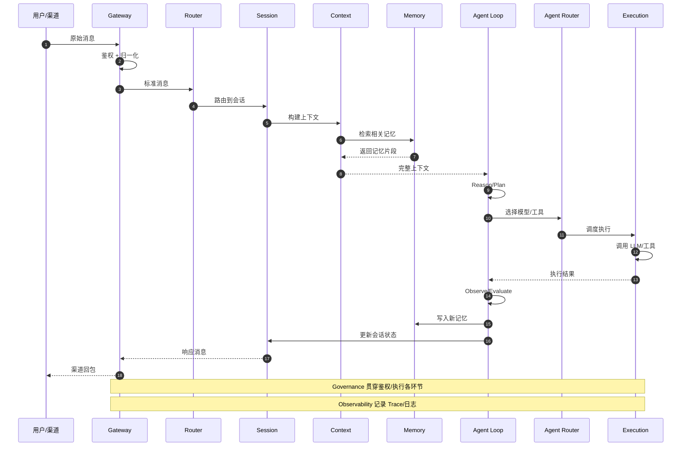

# 会话完整生命周期 —— 分层与时序基线

> 版本：1.0（2026-10-29 定稿）
> 状态：**权威基线**。本文件定义的泳道划分与时序，是会话各层重构方案（Gateway / Router / Session / Context / Memory / Agent Loop / Agent Router / Execution）的共同上游契约。
> 方案集入口：[`README.md`](README.md)
> 上位方案：[`../session-module-refactor-plan.md`](../session-module-refactor-plan.md)（v3.1，19 节点 LangGraph 方案——**已被本基线取代其分层视角**，保留其状态模型与持久化设计）


---

## 1. Mermaid 版（可 diff、可编辑）



---

## 2. 泳道职责

| 泳道 | 职责 | 图中的交互 | 方案文档 | 状态 |
|---|---|---|---|---|
| **用户/渠道** | 消息来源与结果接收 | → 原始消息；← 渠道回包 | — | 现状 |
| **Gateway** | 协议边界：鉴权、归一化、幂等去重、协议编解码、渠道回包 | 收原始消息 → 出标准消息 → 回包 | [`gateway-refactor-plan.md`](gateway-refactor-plan.md) | **已定稿** |
| **Router** | 把标准消息路由到目标会话；决定目标 agent / 模型策略 / 深度任务 | 标准消息 → 路由到会话 | 待写 | 待办 |
| **Session** | 会话身份与生命周期、轮次状态机、并发控制、消息与事件落库 | 路由到会话 → 构建上下文 → 更新会话状态 | 待写 | 待办 |
| **Context** | 组装模型输入：提示词、租户上下文、历史与摘要、记忆与知识片段；token 预算与压缩 | ← Session；→ Memory 检索；→ Agent Loop 完整上下文 | 待写 | 待办 |
| **Memory** | 记忆的召回与写入（L1 会话 / L2 事实 / L3 知识） | ← Context 检索；← Agent Loop 写入 | 待写 | 待办 |
| **Agent Loop** | 推理循环：Reason/Plan → Observe/Evaluate；决定下一步 | ← Context 完整上下文；→ Agent Router；← Execution 结果；→ Memory 写入；→ Session 更新状态 | 待写 | 待办 |
| **Agent Router** | 在一步推理之后决定「用哪个模型 / 调哪个工具」 | ← Agent Loop；→ Execution 调度执行 | 待写 | 待办 |
| **Execution** | 实际调用 LLM / 工具 / 沙箱 | ← Agent Router；→ Agent Loop 执行结果 | 待写 | 待办 |

**横切（不属于任何单层，作用于所有泳道）**：

| 横切 | 范围 | 说明 |
|---|---|---|
| **Governance** | 贯穿鉴权与执行各环节 | 租户/工作区/用户权限、工具白名单、风险等级、预算、审批中断、数据范围 |
| **Observability** | 贯穿所有环节 | Trace span、结构化日志、指标、成本归属、质量评估 |

---

## 3. 与早期「六层」提法的差异（已按本基线为准）

本基线把 Agent 拆成三段，比早期讨论中的「六层」更细。差异如下，**以本基线为准**：

| # | 早期提法 | 本基线 | 影响 |
|---|---|---|---|
| 1 | gateway → router → session → context → memory → **agent**（六层） | **Agent Loop / Agent Router / Execution** 三段 | 各层方案文档的命名与边界；Agent 相关的工作量要按三段拆 |
| 2 | 会话 key（`build_session_key`）由 Session 派生 | **Router** 负责「路由到会话」，即外部会话标识 → 目标会话的解析归 Router | Gateway 只负责规范化 `external_chat_id`，**不做会话 key 派生** |
| 3 | 记忆写入由 Session 在收尾触发 | **Agent Loop** 在 Observe/Evaluate 后写入 | Memory 方案的写入时机；Agent Loop 需要持 `MemoryPort` |
| 4 | Gateway 含「鉴权 + 归一化 + 幂等」 | 同上（幂等未在图中画出，见 §4） | Gateway 方案的 Idempotency Guard 需在图中补位 |

---

## 4. 本基线与 Gateway 方案的对应（Gateway 内部展开）

图上 Gateway 的「鉴权 + 归一化」在方案里展开为四部分：

```
用户/渠道
   │ 原始消息
   ▼
① Channel Gateway ──── 传输绑定 · 渠道注册表 · 能力声明 · 渠道回包
   │ RawIngress（含 trace_id —— 最早建立，鉴权失败也有 trace）
   ▼
② Auth Identity ────── 验签 / JWT / 租户归属 / 服务账号物化
   │ AuthenticatedIngress
   ▼
③ Message Normalizer ── 协议字段 → 标准字段 · 附件抽取 · 幂等键计算
   │ InboundMessage
   ▼
④ Idempotency Guard ── 原子 claim · 重复短路 · 重放决策
   │
   ▼
Router（标准消息）
```

> **图上未画出的第 ④ 步**：去重/幂等已定稿属于 Gateway（见 `gateway-refactor-plan.md` 决策 #4/#5），建议在本基线图中补上「幂等去重」一步，或在 Gateway 自循环上标注。

---

## 5. 各层方案文档索引

| 层 | 文档 | 状态 | 台账条目 |
|---|---|---|---|
| 方案集入口 | [`README.md`](README.md) | 生效中 | — |
| 全局基线（本文） | `session-lifecycle-sequence.md` | **已定稿** | — |
| 旧实现清理台账 | `cleanup-ledger.md` | **生效中**（全局收敛机制） | 全部 |
| Gateway | `gateway-refactor-plan.md` | **已定稿**（附录 A 8 条决策已确认） | G1–G9 |
| Router | `router-refactor-plan.md` | 待评审（附录 A 6 条决策待确认） | R1–R4 |
| Session | 待写 | — | X2、X3、X4 |
| Context | 待写 | — | — |
| Memory | 待写 | — | — |
| Agent Loop / Agent Router / Execution | 待写 | — | X5 |

### 全局规则：实现收敛

**最终态只有一个实现**；**先上新、后清旧**。旧实现的弃用、观测与清理由 [`cleanup-ledger.md`](cleanup-ledger.md) 统一管理：

```
未开始 →（新实现接管 + @deprecated + 调用打点）→ 已弃用
       →（调用指标归零 + 稳定运行 ≥1 发布周期）→ 待清理 →（删除）→ 已清理
```

**某层的台账未清零，该层不得进入下一层的「切换」阶段；未完成项不允许滚到下个迭代。**

> **写作要求**（完整版见 [`README.md`](README.md) §5）：每份层方案必须明确标出自己在本基线图上的位置与相邻层的接口数据形状；**不得引入与本基线冲突的层次**，也不得在同一层内并存两套实现；每个阶段验收必须包含「旧代码减少了什么」。
