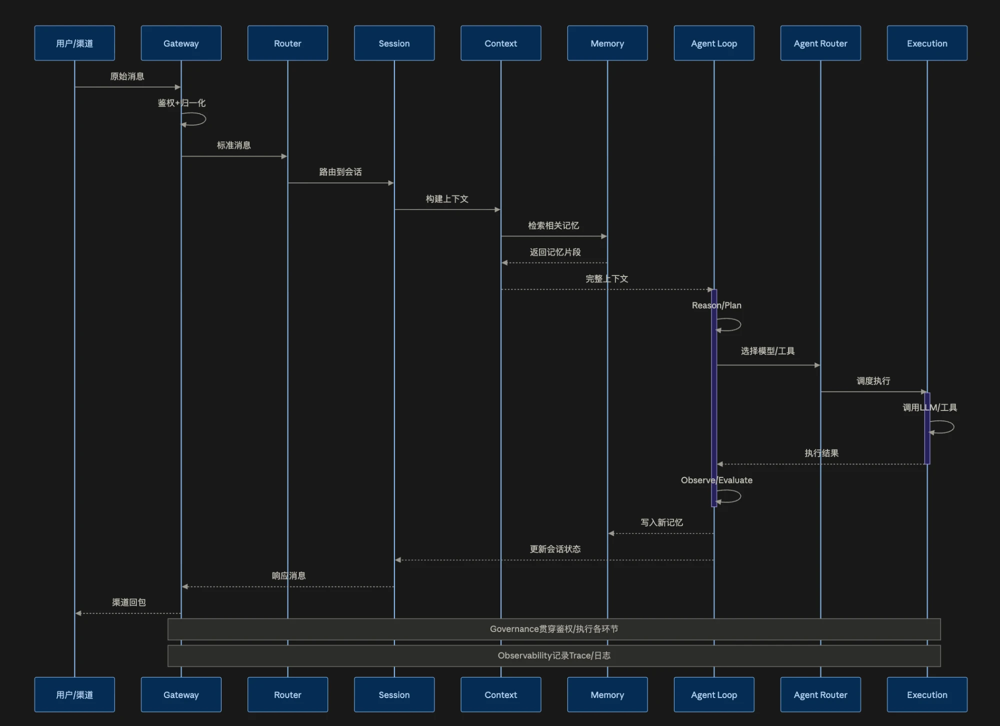
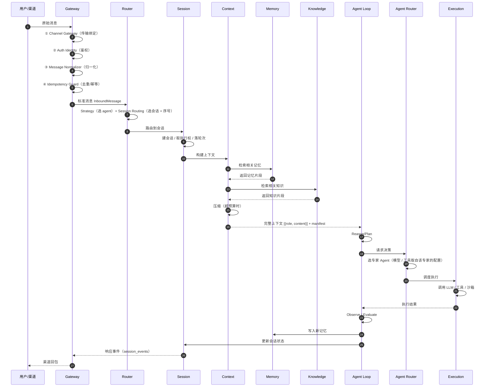

# 会话完整生命周期 —— 分层与时序基线

> 版本：1.1（2026-10-29：时序图补幂等去重与 Knowledge 泳道；补 §2.1 选 agent 的两处边界、§4.1 数据形状演进链、§6 跨层不变量）
> 状态：**权威基线**。本文件定义的泳道划分与时序，是会话各层重构方案（Gateway / Router / Session / Context / Memory / Agent Loop / Agent Router / Execution）的共同上游契约。
> 方案集入口：[`README.md`](README.md)
> 上位方案：[`../session-module-refactor-plan.md`](../session-module-refactor-plan.md)（v3.1，19 节点 LangGraph 方案——**已被本基线取代其分层视角**，保留其状态模型与持久化设计）



---

## 1. Mermaid 版（可 diff、可编辑）



> **相对原始时序图的三处补充**（2026-10-29）：① Gateway 内部四步展开（对齐 `gateway-refactor-plan.md` §2）；② 补上**幂等去重**这一步（原本只在正文提过、图上没有）；③ 补 **Knowledge** 泳道（Memory 决策 #1 定 L3 退役后，知识检索不再经 Memory）。
>
> **Knowledge 不是本方案集的一层** —— 它是既有的 `modules/knowledge` 模块，出现在图上是为了说明「知识检索**不经过 Memory**」。

---

## 2. 泳道职责

| 泳道 | 职责 | 图中的交互 | 方案文档 | 状态 |
|---|---|---|---|---|
| **用户/渠道** | 消息来源与结果接收 | → 原始消息；← 渠道回包 | — | 现状 |
| **Gateway** | 协议边界：鉴权、归一化、幂等去重、协议编解码、渠道回包 | 收原始消息 → 出标准消息 → 回包 | [`gateway-refactor-plan.md`](gateway-refactor-plan.md) | **已定稿** |
| **Router** | 把标准消息路由到目标会话；决定目标 agent | 标准消息 → 路由到会话 | [`router-refactor-plan.md`](router-refactor-plan.md) | **已定稿** |
| **Session** | 会话身份与生命周期、轮次状态机、并发控制、消息与事件落库 | 路由到会话 → 构建上下文 → 更新会话状态 | [`session-refactor-plan.md`](session-refactor-plan.md) | **已定稿** |
| **Context** | 组装模型输入：提示词、租户上下文、历史与摘要、记忆与知识片段；token 预算与压缩 | ← Session；→ Memory 检索；→ Knowledge 检索；→ Agent Loop 完整上下文 | [`context-refactor-plan.md`](context-refactor-plan.md) | **已定稿** |
| **Memory** | 记忆的召回与写入（STM 会话 / L2 事实；**L3 已定退役**，知识归 `modules/knowledge`） | ← Context 检索；← Agent Loop 写入 | [`memory-refactor-plan.md`](memory-refactor-plan.md) | **已定稿** |
| **Agent Loop** | 推理循环：Reason/Plan → Observe/Evaluate；决定下一步 | ← Context 完整上下文；→ Agent Router；← Execution 结果；→ Memory 写入；→ Session 更新状态 | [`agent-refactor-plan.md`](agent-refactor-plan.md) | **已定稿** |
| **Agent Router** | 在一步推理之后**选专家 Agent**（客服 / 销售 / 订单…）。⚠️ **不选模型、不选工具** —— 那两样由管理员在 agent 配置里绑定，运行时**取值**（Agent 决策 #4） | ← Agent Loop；→ Execution 调度执行 | [`agent-refactor-plan.md`](agent-refactor-plan.md) | **已定稿** |
| **Execution** | 实际调用 LLM / SLM / 工具 / 沙箱 | ← Agent Router；→ Agent Loop 执行结果 | [`agent-refactor-plan.md`](agent-refactor-plan.md) | **已定稿** |
| **Knowledge**（非本方案集的一层） | 工作区知识的存储与检索 | ← Context 检索 | `modules/knowledge`（既有模块） | 现状 |

### 2.1 「选 agent」有两处，边界必须分清

| | **Router 层** | **Agent Router** |
|---|---|---|
| 时机 | **会话入口**（收到第一条消息时） | **每一步推理**（循环内） |
| 选什么 | 目标 **agent**（按业务线 / 用户标签 / 显式指定） | 目标**专家 Agent**（客服 / 销售 / 订单…）；⚠️ **只选专家** —— 模型 / 工具来自该专家的配置 |
| 结果 | **会话绑定**（冻结到 agent 版本，会话内不变） | **本步的专家**（每步可变）；**模型 / 工具随之换成该专家配置里的那些** |
| 无命中时 | 走 fallback 规则链 | **落回会话绑定的 agent**（不报错） |

> **举例**：一个「售后」会话（Router 层绑定的售后 Agent），其中一步要查订单 → Agent Router 把**这一步**路由给「订单专家」；下一步要写工单 → 路由给「工单专家」。**会话绑定没变，但每步的执行者变了。**

**横切（不属于任何单层，作用于所有泳道）**：

| 横切 | 范围 | 说明 |
|---|---|---|
| **Governance** | 贯穿鉴权与执行各环节 | 租户/工作区/用户权限、工具白名单、风险等级、预算、审批中断、数据范围 |
| **Observability** | 贯穿所有环节 | Trace span、结构化日志、指标、成本归属、质量评估 |

---

## 3. 与早期「六层」提法的差异（已按本基线为准）

本基线把 Agent 拆成三段，比早期讨论中的「六层」更细。差异如下，**以本基线为准**：

| # | 早期提法 | 本基线 | 影响 |
|---|---|---|---|
| 1 | gateway → router → session → context → memory → **agent**（六层） | **Agent Loop / Agent Router / Execution** 三段 | 各层方案文档的命名与边界；Agent 相关的工作量要按三段拆 |
| 2 | 会话 key（`build_session_key`）由 Session 派生 | **Router** 负责「路由到会话」，即外部会话标识 → 目标会话的解析归 Router | Gateway 只负责规范化 `external_chat_id`，**不做会话 key 派生** |
| 3 | 记忆写入由 Session 在收尾触发 | **Agent Loop** 在 Observe/Evaluate 后写入 | Memory 方案的写入时机；Agent Loop 需要持 `MemoryPort` |
| 4 | Gateway 含「鉴权 + 归一化 + 幂等」 | 同上，**四步已在 §1 的时序图中展开**（含幂等去重） | Gateway 方案 §2 的四部分与基线图一一对应 |
| 5 | 知识与记忆混为一谈（L3 当知识用） | **拆开**：L3 退役，知识归 `modules/knowledge`；知识检索**不经过 Memory** | Memory 决策 #1；基线图补 **Knowledge** 泳道 |

---

## 4. 本基线与 Gateway 方案的对应（Gateway 内部展开）

图上 Gateway 的「鉴权 + 归一化」在方案里展开为四部分：

```
用户/渠道
   │ 原始消息
   ▼
① Channel Gateway ──── 传输绑定 · 渠道注册表 · 能力声明 · 渠道回包
   │ RawIngress（含 trace_id —— 最早建立，鉴权失败也有 trace）
   ▼
② Auth Identity ────── 验签 / JWT / 租户归属 / 服务账号物化
   │ AuthenticatedIngress
   ▼
③ Message Normalizer ── 协议字段 → 标准字段 · 附件抽取 · 幂等键计算
   │ InboundMessage
   ▼
④ Idempotency Guard ── 原子 claim · 重复短路 · 重放决策
   │
   ▼
Router（标准消息）
```

> **2026-10-29 已补**：去重 / 幂等（④ Idempotency Guard）原先只在本基线的正文里提及、时序图上没有，现已补入 §1 的 Mermaid 图（见该图的说明块）。

### 4.1 一条消息在各层的形态（数据形状演进链）

> 这是各层之间**接口契约**的总览。每层的详细定义见对应方案；本表用于对齐「谁产出什么、谁消费什么」。

| 序 | 位置 | 形态 | 关键字段 | 生产者 → 消费者 |
|---|---|---|---|---|
| 1 | 入站 | `RawIngress` | `trace_id`（最早建立）、`channel_type`、原始 body | 渠道 → Gateway ① |
| 2 | 鉴权后 | `AuthenticatedIngress` | `actor`（租户/工作区/用户/信任级别）、`trust`、`auth_method` | Gateway ② → ③ |
| 3 | 归一化后 | `InboundMessage` | `text`、`attachments`、`idempotency`、`explicit_agent_id`、`payload_hash` | Gateway ③ → ④ → Router |
| 4 | 路由后 | `SessionAssignment` | `session_ref`、`agent_id`、`agent_version`、`ingress_seq`、`route_decision`（**Router 写**）、`agent_decision`（**Agent 写**）| Router → Session |
| 5 | 轮次建立 | `session_turns` 行 | `idempotency_key`、`status`（`queued`→`running`）、`pending_approval`、`cost_usd` | Session → （各层） |
| 6 | 上下文 | `AssembledContext` | `messages: list[{role, content}]`、`manifest`、`degraded_flags`、`tokens_estimated` | Context → Agent Loop |
| 7 | 召回结果 | `list[RecallHit]` | `layer`、`content`、`score`、`ref_id`、`version`、`scope` | Memory / Knowledge → Context |
| 8 | 模型输入 | `ChatRequest` + 工具 schema | `messages`、`tools`、`model_id` / `route_id`、`actor` | **按选中专家的配置取值** → Execution |
| 9 | 工具执行 | `ToolResult` | `result`、`is_error`、`error_code`、`retry_after_ms`、`latency_ms`、`attempts` | Execution → Agent Loop |
| 10 | 上下文回灌 | `ToolMessage` | `tool_call_id`、`content`、`status`（success / error） | Agent Loop（Observe） |
| 11 | 轮次终态 | `session_events` 行 | `seq`、`event_type`、`payload`、`delivery_status` | Session → Gateway（重放 + 回包） |

> **形状不变式**：① `InboundMessage.messages` 之外的层**不得看到 HTTP / SSE / 渠道字段**；② `trace_id` 从第 1 步贯穿到第 11 步；③ 幂等键沿 **消息 → 轮次 → 工具调用** 三级传递（`InboundMessage.idempotency` → `session_turns.idempotency_key` → `tool_executions.idempotency_key`）。

---

## 5. 各层方案文档索引

| 层 | 文档 | 状态 | 台账条目 |
|---|---|---|---|
| 方案集入口 | [`README.md`](README.md) | 生效中 | — |
| 全局基线（本文） | `session-lifecycle-sequence.md` | **已定稿** | — |
| 旧实现清理台账 | `cleanup-ledger.md` | **生效中**（全局收敛机制） | 全部 |
| Gateway | `gateway-refactor-plan.md` | **已定稿**（附录 A 9 条决策已确认 + 1 条补充条目 #2b） | G1–G9 |
| Router | `router-refactor-plan.md` | **已定稿**（附录 A 10 条决策于 2026-10-29 确认） | R1–R4 |
| Session | `session-refactor-plan.md` | **已定稿**（附录 A 7 条决策于 2026-10-29 确认） | X2、X3、X4、X6、X7 |
| Context | `context-refactor-plan.md` | **已定稿**（附录 A 7 条决策于 2026-10-29 确认） | X8、X9、X10 |
| Memory | `memory-refactor-plan.md` | **已定稿**（附录 A 12 条决策于 2026-10-29 确认） | X11、X12、X13、X14、X15、X16 |
| Agent Loop / Agent Router / Execution | [`agent-refactor-plan.md`](agent-refactor-plan.md) | **已评审（v1.2）**（附录 A **8** 条决策，其中 **#4 已定**） | X5、X1（Agent 部分） |
| **实施方案** | [`implementation-plan.md`](implementation-plan.md) | **已定稿**（**按层组织**：六层各一节 + 跨层编排） | 全部（编排层） |

## 6. 跨层不变量（违反即为 bug，不是风格问题）

| # | 不变量 | 涉及层 | 怎么保证 |
|---|---|---|---|
| 1 | **`trace_id` 全程贯穿**，鉴权失败也有 trace | 全部 | Gateway ① 建立，span 逐层传递 |
| 2 | **幂等键三级传递**：消息 → 轮次 → 工具调用 | Gateway → Session → Agent | 同一把钥匙，三处同源；`unprotected` 时工具级禁用副作用 |
| 3 | **每层只读上游的公开接口**，不直接读上游的表 | 全部 | 端口 + 架构测试（import 扫描） |
| 4 | **runtime 层零框架依赖**（HTTP / DB / 队列都不认识） | 全部 runtime 层 | `tests/architecture/` 的 import 禁令 |
| 5 | **一个概念只有一个权威落点**（表 / 指标 / 状态机都是） | 全部 | 表归属唯一（README §3.3.2）+ 指标命名唯一 |
| 6 | **失败必须显式**：不静默丢弃、不静默降级、不静默覆盖 | 全部 | 每层有明确的错误码与降级标记（如 `degraded_flags`） |
| 7 | **成本与用量逐层归属**，最终落到 `session_turns.cost_usd` | Agent → Session | Agent 结算，Session 落库 |
| 8 | **旧实现的调用可观测**（`qzdap_legacy_calls_total`） | 全部 | 接管即打点；无打点不得进入清理阶段 |

## 7. 全局规则：实现收敛

**最终态只有一个实现**；**先上新、后清旧**。旧实现的弃用、观测与清理由 [`cleanup-ledger.md`](cleanup-ledger.md) 统一管理：

```
未开始 →（新实现接管 + @deprecated + 调用打点）→ 已弃用
       →（连续运行 **≥ 7 天** + 新路径流量占比 **≥ 95%** + `qzdap_legacy_calls_total{entry="…"}` 窗口内**累计为 0** + 窗口内无相关生产事故）→ 待清理 →（删除）→ 已清理
```

**某层的台账未清零，该层不得进入下一层的「切换」阶段；未完成项不允许滚到下个 Stage。**

> **写作要求**（完整版见 [`README.md`](README.md) §5）：每份层方案必须明确标出自己在本基线图上的位置与相邻层的接口数据形状；**不得引入与本基线冲突的层次**，也不得在同一层内并存两套实现；每个阶段验收必须包含「旧代码减少了什么」。
