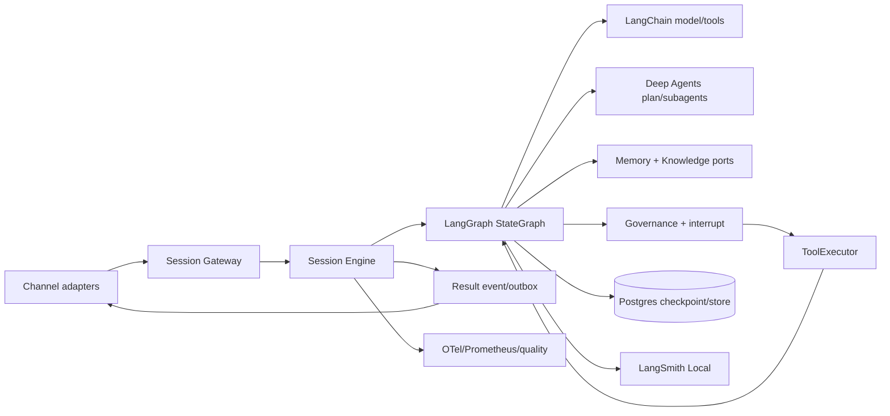

# 会话功能模块整合重构方案

> 版本：3.1
> 适用项目：`QiZhiDaAgentPlatform`
> 状态：整合版 v3.1（在 v3.0 基础上修正 6 项启动阻塞点），待评审
> 目标技术：LangChain 1.x + LangGraph 1.x + Deep Agents + LangSmith Local
> v3.1 修正要点：**新增 §2.5 启动前置条件（6 项阻塞点逐一收敛）**；§3.1 / §3.2 / §13.2 节点数权威定版为 **19**（§13.2 表为唯一权威源，§3.1 注同步更新，废弃"17 节点"早期估算口径）；§7.2 / §15 新 runtime library 落位 `backend/runtimes/agent_runtime/`（不再是 `libs/agent_runtime/`）；§5.5 Deep Agents 触发拆为 Stage 4 启发式 + Stage 6b 分类器 spec 两段；§5.9 / §13.1 新增 Stage 1 前置：`qzdap_schema/dtos/errors.py` 从零建枚举（当前文件仅 re-export `ErrorEnvelope`，枚举不存在）；§8 / §13.1 新增 Stage 0 前置：LangChain 1.x lock-file 升级预演 PR + `deepagents` import 探针 PR。

本文整合了两份独立模型产出的会话重构方案，统一了架构边界、状态模型、容错策略、实施任务和验收标准。本文是唯一有效方案；旧方案文件已移除。

---

## 1. 目标与边界

会话模块负责一次用户交互从入口到结果的完整生命周期，并通过稳定的端口联动其他能力域。十项能力的拓扑如下：

**外层线性段（顺序执行）**：
1. **Channel & Gateway**：Web、API、Webhook、飞书、企微、钉钉等入口与回传，承载认证与协议标准化。
2. **Session**：会话身份、租户隔离、并发控制、历史与恢复。
3. **Context**：系统提示词、租户/工作区/用户上下文、对话摘要、附件和工具结果。
4. **Memory Runtime 按需补充**：在 Context 拼接时按需召回，与 Context 共同构成模型输入。

**Agent Loop 内循环（步骤 5、7、8 在循环内，步骤 6 Routing 只在进入时跑一次）**：
5. **Agent**：LangChain 模型与工具原语，Deep Agents 的计划和子代理能力。推理并产生下一步意图。
6. **Routing**：模型意图路由到具体执行者（工具 / Skill / sub-agent / sandbox / finalize）；在内循环入口处跑一次。
7. **Governance & Security**：权限、风险策略、人工审批、预算闸门。审批时中断退出内循环等待用户响应。
8. **Tool & Execution**：实际执行工具调用、技能、沙箱、重试、超时、幂等和补偿；结果回流更新上下文，回到步骤 5。

**收尾段**：
9. **Result**：统一结果事件、SSE 续传、多渠道分发和错误语义；任务完成后由 Channel & Gateway 返回用户。实现层拆为 `persist_result`（写 `session_events` / outbox / turn state）与 `emit_result`（从 outbox 投递到 SSE / Channel / Webhook），详见 §3.2 与 §13.2。

**横切关注点（与上述所有段并行）**：
10. **Observability**：LangSmith trace、日志、指标、成本、质量评估和回放，作用于外层段、Agent Loop 内层和收尾段的所有节点。

**关键拓扑约定**：
- 步骤 1-4 是外层线性段，每个节点幂等或可重试，失败时返回明确错误码不进入内循环。
- 步骤 5、7、8 是 Agent Loop 内循环，6 Routing 在每次进入主路径时跑一次；循环直到 agent 产出 final answer 或被 interrupt 退出。
- 步骤 9 在 final answer 之后执行；interrupt 时 9 处于待发状态，恢复后继续。
- 步骤 10 横切于所有节点，不在主路径中。

本阶段只产出重构设计和实施边界，不直接修改业务代码，不删除现有运行时，不改变现有会话 REST/SSE 的外部协议。

---

## 2. 当前代码基线

以下结论来自当前工作区的静态检查，未把它们当作已经通过启动或端到端测试的事实：

| 领域 | 当前入口 | 需要解决的问题 |
|---|---|---|
| Session API | `backend/modules/agent_runtime/src/qzdap/modules/agent_runtime/adapter/http/session_router.py` | 路由层直接依赖 `CopilotSessionService`，流式首 chunk、事务和恢复逻辑耦合在请求生命周期内。 |
| Session 应用服务 | `.../application/copilot.py` | 以 `SessionGraphRunner` 为核心，`SessionORM.graph_state` 仍承担运行时续传；审批恢复和身份校验需要收敛。 |
| Agent loop | `.../adapter/graph/runner.py`、`loop.py`、`compact.py` | 存在手写循环、占位图、字符级压缩和局部工具执行策略，状态无法被图级别重放。 |
| Channel | `backend/modules/channel/.../dispatch/dispatch_subscriber.py` | 已有 webhook 验签、加密和事件派发订阅者，但消息键不含稳定的外部消息 ID，且渠道会创建临时会话。 |
| Memory | `backend/modules/memory/.../application/services.py` | 已有 L1/L2/L3 目录和向量适配器，但会话运行时尚未统一召回、排序、阈值和 provenance。 |
| Knowledge | `backend/modules/knowledge` | 已有知识目录和向量检索，需要作为独立的 L3 召回端口接入会话图。 |
| Governance | `backend/modules/governance` | 已有策略、审批和审计能力，需要通过统一 middleware/interrupt 端口进入工具执行前。 |
| Observability | `backend/libs/observability`、`backend/modules/observability_module` | 已有 OTel、Prometheus 和业务记录器；LangSmith 只作为可插拔 trace sink，不能成为响应成功的前置条件。 |
| Composition | `backend/composition/qzdap_app/src/qzdap/composition/lifespan.py` | 现有模块通过 composition root 装配，重构不能让新 runtime 反向 import 具体 HTTP 或 ORM 实现。 |

当前 `backend/modules/agent_runtime/pyproject.toml` 已有 `langgraph` 和 `langchain-core`，尚未形成完整的 LangChain/Deep Agents 运行时依赖闭环。新依赖必须通过 `uv lock` 解析并在 CI 中固定，不能直接依赖 `latest`。

### 2.1 与代码基线的偏差（已核对）

| 文档声称 | 当前实际 | 偏差处理 |
|---|---|---|
| LangGraph / LangChain 已在依赖中并可作为 runtime library | `langgraph>=0.2.28` / `langchain-core>=0.3.0`；独立 runtime library 未建 | §2.5 阻塞 1：先做 1.x lock-file 升级预演；§2.5 阻塞 2：新建 `backend/runtimes/agent_runtime/` |
| `qzdap_schema.dtos.errors.ErrorCode` 枚举存在 | 不存在；`errors.py` 仅 re-export `ErrorEnvelope` | §2.5 阻塞 5：Stage 1 第一个 PR 建枚举 |
| `agent_sessions.graph_state` 仍承担续传 | 属实（`models.py:56`） | 符合方案，Stage 2 双写路径成立 |
| `runner.py` 手写 `while True` 循环 | 属实（`runner.py:161`） | 符合方案，Stage 4 graph 化目标成立 |
| `memory/application/services.py` 单层 recall | 属实（有 `services.py` + `ports.py`） | 符合方案，Stage 3 改造目标成立 |
| `channel/dispatch/dispatch_subscriber.py` | 属实 | 符合方案，Stage 5 改造目标成立 |
| `session_turns` / `session_events` / `session_inbox` / `tool_executions` / `outbox_dead_letters` 等新表 | 全部不存在（当前迁移最高版本 0027） | 符合方案，Stage 1/2/3/5/7a/8 从零建 |

## 2.5 启动前置条件（6 项阻塞点收敛方案）

**本节是 v3.1 的核心新增。** v3.0 评审识别出 6 项必须在 Stage 1 之前解决的阻塞点。每项给出"问题 → 决议 → 具体动作 → 验证"，作为实施组的开工清单。

---

### 阻塞 1：LangChain / LangGraph 主版本断代

**问题**：当前 `langgraph>=0.2.28` / `langchain-core>=0.3.0`，方案要求 `>=1.0,<2.0`。LangGraph 1.x 的 checkpoint schema、`interrupt` 协议、`add_messages` reducer 签名均有破坏性变更。

**决议**：**先做 lock-file 升级预演，在独立 worktree 中验证，不进 Stage 1**。

**具体动作**：

1. 切到独立 worktree：`git worktree add ../upgrade-langgraph-1x -b chore/langgraph-1x-upgrade main`。
2. 在 `backend/modules/agent_runtime/pyproject.toml` 临时改为：
   ```toml
   langgraph = { version = ">=1.0,<2.0", extras = ["postgres"] }
   langchain-core = ">=1.0,<2.0"
   ```
3. 跑 `uv lock` + `uv sync`，记录 lock 解析结果与依赖冲突。
4. 写最小 `graph_compile_smoke.py` 验证 1.x API：`StateGraph.add_node` / `add_edge` / `add_conditional_edges` 签名、`PostgresSaver` 替换 `MemorySaver`、`astream_events(version="v2")` 仍能产出 `on_chat_model_stream` / `on_tool_start`、`Command(resume=...)` 与 `interrupt_before` 的 1.x 协议。
5. 把不兼容点写到 `docs/refactor/langgraph-1x-migration-notes.md`，作为 Stage 4 graph 化输入。

**验证**：
- `graph_compile_smoke.py` 在 1.x 下通过
- `runner.py:161` 的 `while True` 替换为 graph 节点后，既有 `session_events` fixture 能重放
- 内存 checkpointer 迁移到 Postgres 后，进程重启可恢复

---

### 阻塞 2：新 runtime library 落位（`libs/` 还是 `runtimes/`？）

**问题**：方案写 `backend/libs/agent_runtime/`，但 workspace 已声明 `runtimes/*` 为成员且目录存在，与现状不符。

**决议**：**新 runtime 落在 `backend/runtimes/agent_runtime/`，与 `composition/` 平行**。

**理由**：

- `libs/*` 当前内容是 kernel / schema / persistence / auth 等可复用基础库，无状态、可被多模块依赖。
- `runtimes/*` 语义是"独立运行时进程/库"，与 `composition/qzdap_app` 装配层平行。
- 现有 `modules/agent_runtime` 业务薄壳继续保留，新 runtime 通过 workspace dependency 引用。

**备选**：若评审会认为新库应保持"可复用库"定位，可改为 `backend/libs/agent_runtime/`，但需：

1. 删除 `backend/runtimes/` 目录（如未使用），避免 workspace 成员冗余。
3. 在 `backend/pyproject.toml` 显式声明 `libs/agent_runtime` 为 workspace 成员（实际已是 `libs/*` 通配）。
3. 接受"`runtimes/` 成员目前无内容"的事实，作为后续预留扩展位。

**依赖边界（无论选哪条路都适用）**：

- 新 runtime 不得 import `FastAPI Request`、具体 SQLAlchemy model、渠道 adapter（见 §3.1）。
- 新 runtime 可被 `modules/agent_runtime`、`composition/qzdap_app` 依赖。
- 新 runtime 不得反向依赖任何 `modules/*`（避免循环）。

**具体动作**：

1. 确认 `backend/pyproject.toml` 中 `[tool.uv.workspace]` 成员已含 `runtimes/*`（已存在，无需改动）。
2. 新建目录骨架：
   ```text
   backend/runtimes/agent_runtime/
   ├── pyproject.toml
   └── src/qzdap_agent_runtime/
       ├── engine.py
       ├── graph/{state.py, builder.py, nodes.py, routing.py, checkpoint.py}
       ├── channels/{gateway.py, dispatcher.py}
       ├── tools/registry.py
       ├── context/
       ├── memory/
       ├── governance/
       ├── execution/
       ├── result/
       ├── observability/
       └── outbox/
   ```
3. `pyproject.toml` 框架锁定（依赖见 §13.1）：
   ```toml
   [project]
   name = "qzdap-agent-runtime-runtime"
   version = "0.1.0"
   requires-python = ">=3.12"
   dependencies = [
       "qzdap-kernel", "qzdap-schema", "qzdap-persistence",
       "qzdap-auth", "qzdap-messaging", "qzdap-llm", "qzdap-observability",
       "langchain>=1.0,<2.0", "langchain-core>=1.0,<2.0",
       "langgraph>=1.0,<2.0", "langgraph-prebuilt>=1.0,<2.0",
       "langsmith>=0.4,<1.0", "tenacity>=9.0,<10.0",
       "tiktoken>=0.7,<1.0", "pgvector>=0.3,<1.0", "psycopg[bpool]>=3.2",
   ]
   ```
4. 文档 §3.1 / §7.2 / §15 的所有 `backend/libs/agent_runtime` 同步替换为 `backend/runtimes/agent_runtime`，包名 `qzdap_agent_runtime` 不变。

**验证**：
- `uv lock` 解析无冲突
- `from qzdap_agent_runtime.engine import SessionEngine` 可导入
- 现有 `modules/agent_runtime` 不需立即删依赖，只在 Stage 4 后薄壳化

---

### 阻塞 3：节点数自相矛盾（17 vs 19）

**问题**：§3.1 注说 "17 节点"，§3.2 图绘出 18 个，§13.2 表实际列 19 行；v3.0 末尾虽自更正"§13.2 权威"，但正文描述、评审清单、Stage 验收都没明确以哪个为准。

**决议**：**权威节点数 = 19，文档全部章节、state 字段、验收清单、TypeScript 类型以此为准**。编号与执行顺序一一对应（这是 v3.1 对 v3.0 编号反直觉的修正）。

**备选**：若评审会认为 v3.0 编号（保留原顺序号、仅追加 16 号 `compact_tool_result`）更稳妥，可保留旧编号，但需在文档加"编号 ≠ 执行顺序"显式说明。本 v3.1 默认采用"编号 = 执行顺序"。

**节点编号约定**：

- `1–9`：外层线性段（顺序执行）。
- `10–14`：Agent Loop 内循环节点（其中 `11 / 12` 是 `governance` / `execute` 主链，`13 / 14` 是 `deep_agent_plan` / `subagent` 条件分支）。
- `15–19`：收尾段（顺序执行）。

**权威节点命名（编号 = 执行顺序）**：

```
 1.  normalize_input               # 外层线性
 2.  acquire_turn_lock             # 外层线性
 3.  load_checkpoint               # 外层线性
 4.  write_turn_record             # 外层线性
 5.  load_agent_context            # 外层线性
 6.  recall_memory_and_knowledge   # 外层线性
 7.  assemble_context              # 外层线性
 8.  compact_if_needed             # 外层线性
 9.  route                         # 外层线性（= Routing 步骤 6）
10.  agent                         # Agent Loop 入口
11.  governance                    # Agent Loop 内（tool call 必经）
12.  execute                       # Agent Loop 内（tool call 必经）
13.  deep_agent_plan               # 仅 route.deep_task=true 时进入
14.  subagent                      # 仅 route.deep_task=true 时进入
15.  remember                      # 收尾段
16.  persist_result                # 收尾段
17.  emit_result                   # 收尾段
18.  compact_tool_result           # 收尾段（tool_results > 64 KB 切片）
19.  release_turn_lock             # 收尾段
```

**具体动作**：

1. §3.1 注改为："§3.2 控制流图与 §13.2 表的节点集合**完全一致（19 节点）**，节点 ID 与执行顺序一一对应；早期提到的'17 节点'为估算口径，不再使用。"
2. §12 评审清单第 6 项改为："19 个图节点命名与拆分（见 §2.5 阻塞 3 权威命名表，编号 = 执行顺序）已确认。"
3. `state.py` 的 TypedDict 字段名必须与上述 19 个节点名一一对应，禁止 `load_agent` / `write_turn` 等简称漂移。
4. `builder.py` 中 `add_node` 调用次数：**主路径固定 17 次**（1–10, 11, 12, 15–19），**条件挂载 2 次**（13, 14，仅 `route.deep_task=true` 时执行 `add_node` 并连接到 10 后）。
5. §3.2 流程图末尾的收尾段顺序与编号一致：`remember`(15) → `persist_result`(16) → `emit_result`(17) → `compact_tool_result`(18) → `release_turn_lock`(19)。

**验证**：

- 全文 grep "17 节点" / "17个节点" 应为 0 命中（除引用历史位置）。
- `state.py` 字段数 ≥ 19 个核心 section。
- `builder.py` 中 `add_node` 调用 17 次固定 + 2 次条件挂载（合计 19 个节点定义）。
- 执行顺序与节点 ID 一一对应（无逆序、无跳号）。

---

### 阻塞 4：`deepagents` 包未验证可用

**问题**：方案要求 Stage 4 做 import 验证、Stage 6b 启用，但 PyPI 包名/版本/API 都没验证；当前 venv 没有 `deepagents`。

**决议**：**Stage 1 之前先做 import 探针 PR，确定实际包名、版本范围、最小可用 API**。

**具体动作**：

1. 独立 worktree：`git worktree add ../deepagents-probe -b chore/deepagents-probe main`。
2. 探针脚本 `scripts/probes/deepagents_import.py`：
   ```python
   import importlib
   for name in ("deepagents", "langchain_deepagents", "deep_agents"):
       try:
           m = importlib.import_module(name)
           print(f"OK {name} {getattr(m, '__version__', '?')}")
           for attr in ("create_deep_agent", "DeepAgent", "SubAgent"):
               if hasattr(m, attr):
                   print(f"  has {attr}")
       except ImportError as e:
           print(f"MISSING {name}: {e}")
   ```
3. `uv run --with deepagents --with langchain_deepagents python scripts/probes/deepagents_import.py` 试装并记录：哪个包名存在 / 当前 PyPI 版本 / 最小可用 API 名字 / 与 `langgraph>=1.0` 的兼容情况。
4. 写 `docs/refactor/deepagents-probe-result.md` 作为 Stage 6b 实施组的输入。

**回退方案**（若 `deepagents` 不存在或 API 不稳定）：

- Stage 4 仅做 LangGraph 标准 `StateGraph` + `langgraph-prebuilt` 的 `create_react_agent` smoke。
- Stage 6b 改为"自研 `deep_agent_plan` 节点"（用普通 LangGraph 子图实现），不依赖 `deepagents` 第三方包。
- 文档 §5.5 / §13.1 把 `deepagents` 标为 "Optional, deferred"，不阻塞主路径。

**验证**：
- 探针脚本在干净 venv 中输出存在性 + 版本
- 探针结果写入 `docs/refactor/deepagents-probe-result.md` 后，Stage 4 才允许启动
- 若包不可用，Stage 4 仅 `create_react_agent` smoke 通过即满足退出条件

---

### 阻塞 5：Schema 错误码模块不存在

**问题**：`qzdap_schema.dtos.errors.ErrorCode` 枚举当前不存在；`errors.py` 只 re-export `ErrorEnvelope`。Stage 1 要一次性补齐 9 个错误码。

**决议**：**Stage 1 第一个 PR 提交 schema 错误码补齐，不阻塞 Stage 0 启动**。

**与既有 `qzdap_kernel.errors.AppError` 的关系**：

kernel 已有 `AppError` 层级（含 `ValidationError` / `ConflictError` / `RateLimitError` 等子类，`code` 字段是字符串）。本次新增的 `ErrorCode` 枚举是**对外 wire-level 契约**（稳定机器码 + HTTP status + i18n key），与 `AppError` 子类的 `code` 字符串共享同一字符串值。映射规则：

| `ErrorCode`（新增枚举） | `AppError` 既有子类 | 说明 |
|---|---|---|
| `SESSION_BUSY` | `ConflictError`（继承自 `AppError`，code="CONFLICT"，status=409） | 共享 status=409；新枚举 `SESSION_BUSY` 是会话专属细粒度码，HTTP status 仍为 409。 |
| `REVISION_CONFLICT` | `ConflictError` | 同上，状态 409。 |
| `TOOL_RATE_LIMITED` | `RateLimitError`（code="RATE_LIMITED"，status=429） | 共享 status=429；新枚举用于工具调用层细粒度区分。 |
| `APPROVAL_EXPIRED` | （无既有） | 新增，status=410。 |
| `APPROVAL_NOT_MATCH` | （无既有） | 新增，status=409。 |
| `TOOL_ARGUMENT_INVALID` | `ValidationError`（code="VALIDATION_ERROR"，status=400） | 共享 status=400；新枚举用于工具层。 |
| `TOOL_TIMEOUT` | （无既有） | 新增，status=504。 |
| `CONTEXT_TOO_LARGE` | （无既有） | 新增，status=413。 |
| `AGENT_NOT_AVAILABLE` | `ExternalServiceError`（code="EXTERNAL_SERVICE_ERROR"，status=502） | 共享 status=502；新枚举用于 agent catalog 缺失。 |

**约定**：`AppError.code` 仍是字符串，`ErrorCode` 是 `str` 子类枚举（`class ErrorCode(str, Enum)`），可直接赋值给 `AppError.code` 而无需转换。运行时不允许抛出未登记错误码（不在 `ErrorCode` 中的字符串）。

**具体动作**：

1. 新建 `backend/libs/schema/src/qzdap_schema/dtos/errors.py`：
   ```python
   from __future__ import annotations
   from enum import Enum

   class ErrorCode(str, Enum):
       # 既有错误码保留（与 kernel AppError.code 对齐）
       VALIDATION_ERROR = "VALIDATION_ERROR"
       AUTHENTICATION_FAILED = "AUTHENTICATION_FAILED"
       FORBIDDEN = "FORBIDDEN"
       ACTION_DENIED = "ACTION_DENIED"
       APPROVAL_REQUIRED = "APPROVAL_REQUIRED"
       NOT_FOUND = "NOT_FOUND"
       CONFLICT = "CONFLICT"
       BUSINESS_RULE_VIOLATED = "BUSINESS_RULE_VIOLATED"
       RATE_LIMITED = "RATE_LIMITED"
       EXTERNAL_SERVICE_ERROR = "EXTERNAL_SERVICE_ERROR"
       INTERNAL_ERROR = "INTERNAL_ERROR"

       # 新增：会话模块（Stage 1）
       SESSION_BUSY = "SESSION_BUSY"
       AGENT_NOT_AVAILABLE = "AGENT_NOT_AVAILABLE"
       CONTEXT_TOO_LARGE = "CONTEXT_TOO_LARGE"
       REVISION_CONFLICT = "REVISION_CONFLICT"
       APPROVAL_EXPIRED = "APPROVAL_EXPIRED"
       APPROVAL_NOT_MATCH = "APPROVAL_NOT_MATCH"
       TOOL_ARGUMENT_INVALID = "TOOL_ARGUMENT_INVALID"
       TOOL_TIMEOUT = "TOOL_TIMEOUT"
       TOOL_RATE_LIMITED = "TOOL_RATE_LIMITED"

       @property
       def http_status(self) -> int: return _HTTP_STATUS[self]
       @property
       def retriable(self) -> bool: return self in _RETRIABLE
       @property
       def i18n_key(self) -> str: return f"errors.{self.value.lower()}"
   ```
2. 在 `qzdap_schema/dtos/__init__.py` 注册导出 `ErrorCode`。
3. i18n 资源目录 `backend/libs/i18n/locales/zh-CN/errors.yaml` 加 9 条新错误码消息键（若项目有 i18n；否则先 hardcode 英文，后期补；既有 11 条错误码消息键应已存在）。
4. 单测 `backend/libs/schema/tests/test_errors.py`：9 个新错误码字段稳定 / 序列化往返 / 与 kernel `AppError.code` 字符串值一致 / 重复定义抛 `ValueError`。
5. 让 `qzdap_kernel.errors.ErrorEnvelope` 透传 `ErrorCode`（确认 `type` 字段用枚举 `.value` 而非枚举本身）。

**验证**：

- `from qzdap_schema.dtos.errors import ErrorCode, SESSION_BUSY` 可用。
- 单测覆盖所有 9 个新错误码字段 + 既有 11 个错误码字段。
- 既有 `AppError(code=ErrorCode.SESSION_BUSY.value)` 可正常构造。
- 现有 REST 路由 `ErrorEnvelope.code` 字段与新枚举对齐（grep 验证）。

---

### 阻塞 6：Deep Agents 触发分类器未指定

**问题**：§5.5 三条启用规则中"小模型分类器判定 `task_kind`"未指定模型/provider/SLA。这是 Stage 6b 最大的隐藏成本。

**决议**：**Stage 4–6b 期间先用规则替代（关键词 + 消息数），分类器模型选型推迟到 Stage 6b 子任务**。

**Stage 4 与 Stage 6b 的边界**：

- **Stage 4 范围**：仅实现 `classify_task_kind_heuristic`（纯规则，不依赖任何模型）；触发三条规则时 `route.deep_task=true`，否则 `false`。Stage 4 退出条件不包含分类器模型。
- **Stage 6b 范围**：用小模型分类器替代启发式；spec 评审与回退策略完整给出。

**fallback 路径含义澄清**：所谓 "fallback 路径非 `return None`" 是指：

- `classify_task_kind_heuristic` 必须返回 `TaskKind` 枚举值之一（`SIMPLE_QA` / `DEEP_RESEARCH` / `MULTI_STEP_CODE` / `DATA_INVESTIGATION`），**不允许返回 `None` 或抛异常**。
- 分类超时（Stage 6b）必须回落回 `SIMPLE_QA`，**不允许回落模型响应**（避免 timeout → 模型响应 → 误判 deep 任务导致成本激增）。
- `route.deep_task` 必须是 bool，**不允许出现 `Optional[bool]` 三态**。

**具体动作**：

1. 在 `runtimes/agent_runtime/graph/routing.py` 中，Stage 4 实现**纯规则 fallback**（不依赖模型）：
   ```python
   def classify_task_kind_heuristic(
       message_count: int, tools_count: int,
       message_text: str, agent_config: AgentConfig,
   ) -> TaskKind:
       """返回 TaskKind 枚举之一，不允许 None。"""
       if agent_config.deep_research:
           return TaskKind.DEEP_RESEARCH
       if message_count > 20 and tools_count > 5:
           return TaskKind.MULTI_STEP_CODE
       keywords_deep = ["研究", "调研", "对比", "分析", "research", "compare"]
       keywords_code = ["写代码", "实现", "重构", "refactor", "implement"]
       text_lower = message_text.lower()
       if any(k in text_lower for k in keywords_deep):
           return TaskKind.DEEP_RESEARCH
       if any(k in text_lower for k in keywords_code):
           return TaskKind.MULTI_STEP_CODE
       return TaskKind.SIMPLE_QA  # 默认 fallback，不允许 None
   ```
2. 在 `route` 节点接入，`route.deep_task = (kind in {TaskKind.DEEP_RESEARCH, TaskKind.MULTI_STEP_CODE, TaskKind.DATA_INVESTIGATION})`。
3. Stage 6b 子任务独立文档 `docs/refactor/deepagents-classifier-spec.md`：
   - 模型候选：GPT-4o-mini / Claude Haiku / 自训小模型。
   - SLA：p99 ≤ 800ms（分类超时即回退 `SIMPLE_QA`，不返回模型响应）。
   - 训练数据：从 Stage 0 fixture + 现有 v0 turn 数据集采集（标注 1000 条）。
   - 评估指标：precision ≥ 0.85，recall ≥ 0.80（允许误判为简单任务，不允许误判为深度任务）。
4. Stage 6b 实施前，先在 dev 环境用启发式跑一轮，记录 `deep_path_ratio` 与 `cost_per_turn` 基线。

**验证**：

- Stage 4 退出：`classify_task_kind_heuristic` 单测覆盖 5 类输入（deep_research=true / 长上下文 / 关键词 deep / 关键词 code / 默认 fallback），返回值均为合法 `TaskKind`。
- Stage 4 退出：`route.deep_task=true` 时进入 `deep_agent_plan`，否则进入 `agent` 单 ReAct 循环。
- Stage 6b 子任务 PR：分类器 spec 通过评审 + 评估集就绪 + fallback 路径必须 `return SIMPLE_QA`（不允许 `return None` 或 `return await model.classify(...)`）。

---

### 阻塞点推进顺序

按依赖与风险倒序。**可并行启动的任务用同一阶段标记**，避免读者误解为强串行。

| 阶段 | 任务 | 工作量 | 阻塞后续 |
|---|---|---|---|
| **A. 可立即并行启动（无依赖、无需决策）** | 阻塞 5（schema 错误码 PR） | 半天 | 阻塞 Stage 1 启动 |
| **A. 可立即并行启动（无依赖、无需决策）** | 阻塞 4（`deepagents` 探针 PR） | 半天 | 阻塞 Stage 4 启动 |
| **B. 同步串行** | 阻塞 1（LangChain 1.x 升级预演） | 1–2 天 | 阻塞 Stage 4 启动 |
| **C. 需评审决议（决策类，不阻塞并行代码任务）** | 阻塞 3（节点数 19 评审决议 + 文档修订） | 1 小时评审 | 评审未通过则需返工代码 |
| **C. 需评审决议（决策类，不阻塞并行代码任务）** | 阻塞 2（`runtimes/` 评审决议 + 新 library 骨架） | 1 小时评审 + 半天骨架 | 评审未通过则需返工代码 |
| **D. Stage 4 内完成** | 阻塞 6（Deep Agents 启发式 + Stage 6b 分类器 spec） | 半天启发式 + Stage 6b 子任务文档 | 不阻塞 Stage 4（只决定触发质量） |

**执行建议**：

1. **第 1 周**：并行启动 A 阶段两个 PR（独立 worktree，各半天），同时阻塞 1 的 lock-file 升级预演开工。
2. **第 1 周末 / 第 2 周初**：召开评审会决议 B / C 两类决策；C 类决议不影响 A 阶段代码合入。
3. **第 2 周**：A 阶段 PR 合入 → 阻塞 1 PR 合入 → Stage 1 可启动；C 决议落地 → Stage 1 第一个 PR 启动。
4. **Stage 4 启动前**：A 阶段 + 阻塞 1 + 阻塞 6（启发式部分）必须全部合入；C 决议全部落地。

---

---

## 3. 目标架构

### 3.1 分层职责



> **注**：图示为简化视图；完整 **19 个节点**的输入/输出/失败语义见 §13.2（权威源，节点 ID = 执行顺序）。节点命名以 §2.5 阻塞 3 权威命名表为准。

**编号约定（避免 §1 阶段编号与 §13.2 节点编号混淆）**：

- **§1 阶段编号 1–10**：十项能力域（Channel、Session、Context、Memory Runtime、Agent、Routing、Governance、Tool & Execution、Result、Observability），是宏观能力分类。
- **§13.2 节点编号 1–19**：单次 turn 的具体实现节点，是 LangGraph StateGraph 上的 `add_node` 单位。
- **映射**：阶段 6 Routing = 节点 9 `route`；阶段 5 Agent = 节点 10 `agent`（含 11 governance、12 execute 内循环）；阶段 8 Tool & Execution 跨节点 12 execute 与 `tools/registry.py`；阶段 9 Result = 节点 16 persist_result + 17 emit_result。

`qzdap_agent_runtime` 作为独立 runtime library，**位于 `backend/runtimes/agent_runtime/`**（落位决议见 §2.5 阻塞 2），向上只暴露 `SessionEngine`、`ChannelGateway` 和端口协议；`modules/agent_runtime` 保留 HTTP、ORM、权限和 composition 适配。新 runtime 不得 import `FastAPI Request`、具体 SQLAlchemy model 或渠道 adapter。

### 3.2 单次 turn 的图

```text
START
  -> normalize_input
  -> acquire_turn_lock
  -> load_checkpoint
  -> write_turn_record                    # 写 session_turns / session_messages / session_inbox（同一事务）
  -> load_agent_context                   # 读 agent catalog，写 system prompt / tool policy / agent_version
  -> recall_memory_and_knowledge
  -> assemble_context
  -> compact_if_needed
  -> route                                # Routing(步骤6)，进入主路径时跑一次

  ┌─▶ agent                              # ┐
  │     │                                # │
  │     ├─ tool_calls? ─yes─► governance │ │
  │     │                  ├─ allow ──► execute ─► result 回流 ──► agent   # │ Agent Loop
  │     │                  ├─ approve_required ─► interrupt (持久化)        # │ 步骤 5/7/8
  │     │                  └─ deny ─► tool_error ─► agent                   # │ 循环
  │     │                                                                      # │
  │     └─ plan=deep_task? ─yes─► deep_agent_plan ─► subagent ─► agent      # ┘
  │
  └─ final ─► remember
  -> persist_result
  -> emit_result
  -> compact_tool_result                  # tool_results > 64 KB 切片
  -> release_turn_lock
END
```

**控制流分组**（节点编号 = 执行顺序，见 §2.5 阻塞 3 权威命名表，共 **19 节点**）：

- **外层线性段**（顺序执行）：`normalize_input`(1) → `acquire_turn_lock`(2) → `load_checkpoint`(3) → `write_turn_record`(4) → `load_agent_context`(5) → `recall_memory_and_knowledge`(6) → `assemble_context`(7) → `compact_if_needed`(8) → `route`(9)。每个节点幂等或可重试，失败时返回明确错误码不进入内层循环。
- **Agent Loop 内循环**：`agent`(10) 为入口；tool_calls 触发 `governance`(11) → `execute`(12) → 结果回流至 `agent`(10)，循环直到 final answer 或 interrupt。若 `route.deep_task=true`，主循环分支到 `deep_agent_plan`(13) → `subagent`(14) → 结果摘要回 `agent`(10)。plan/todos 通过 `on_custom_event` emit 到 SSE，sub-agent 完成后摘要回主图。
- **收尾段**（顺序执行）：`remember`(15) → `persist_result`(16) → `emit_result`(17) → `compact_tool_result`(18，tool_results > 64 KB 切片)→ `release_turn_lock`(19)。

**编号约定**：节点 ID 与执行顺序一一对应，避免 §13.2 表与 §3.2 流程图错位。`deep_agent_plan`(13) / `subagent`(14) 是条件节点，`builder.py` 在 `route.deep_task=true` 时才挂载到图上；非 deep 路径下这两个节点不存在。

图的每一个节点必须是幂等的或带有明确的重试语义。节点输出先进入 checkpoint/事件存储，再推送到 SSE 或外部渠道，避免网络断开导致内容丢失。完整节点列表与各自失败语义见 §13.2（**19 节点权威表**，节点 ID = 执行顺序）。

**Observability 为横切关注点**：上述所有节点（含外层段、Agent Loop 内层、收尾段）并行采集 trace / metrics / log；任何节点抛错都会被观测层捕获，但观测层失败不能让 turn 失败。详细见 §5.10。

**Observability 为横切关注点**：上述所有节点（含外层段、Agent Loop 内层、收尾段）并行采集 trace / metrics / log；任何节点抛错都会被观测层捕获，但观测层失败不能让 turn 失败。详细见 §5.10。

---

## 4. 核心状态与持久化

### 4.1 `SessionState` 契约

建议在 `backend/runtimes/agent_runtime/src/qzdap_agent_runtime/graph/state.py` 定义 TypedDict（落位见 §2.5 阻塞 2），并使用 `add_messages` reducer：

```python
class SessionState(TypedDict, total=False):
    schema_version: int
    tenant_id: str
    workspace_id: str
    session_id: str
    turn_id: str
    thread_id: str                 # 与 session_id 一致
    idempotency_key: str
    revision: int                  # state-level checkpoint revision，与 agent_sessions.current_revision 在 load_checkpoint 时同步；expected_revision 与 current_revision 不匹配返回 REVISION_CONFLICT
    trace_id: str
    agent_id: str
    agent_version: str             # 冻结到 turn 开始时的版本
    model_version: str             # 冻结到 turn 开始时的版本

    messages: Annotated[list[BaseMessage], add_messages]
    rolling_summary: str
    context_manifest: dict[str, Any]
    memory_hits: list[MemoryHit]   # L1+L2 合并结果（L1 通过 messages 列表访问，此字段为 L2 主）
    knowledge_hits: list[KnowledgeHit]   # L3 知识召回

    route: dict[str, Any]
    pending_approval: dict[str, Any] | None
    tool_calls: list[ToolCallState]
    tool_results: list[ToolResultState]
    todos: list[Todo]

    result: ResultState | None
    usage: UsageState
    emitted_seq: int
    errors: list[RuntimeErrorState]

    degraded: dict[str, bool]      # recall_degraded / compaction_degraded / langsmith_degraded / cost_attribution_degraded
```

消息列表只追加，不用字符串拼接覆盖历史。`context_manifest` 记录每次模型调用实际注入的片段、来源、token 数、过滤原因和版本，使召回与回答可以被审计和回放。

### 4.2 存储模型

| 存储 | 作用 | 关键约束 |
|---|---|---|
| `agent_sessions` | 会话元数据、状态、版本、绑定关系 | 新增 `status` 字段：`OPEN` / `WAITING_APPROVAL` / `RUNNING` / `CLOSED` / `CANCELLED`；新增 `current_revision`、`current_turn_id`、`agent_version_pinned`、`channel_session_key`；保留 `graph_state` 读路径一个发布周期，之后降级为只读兼容字段。 |
| `session_turns` | 每次用户输入和最终状态 | `(session_id, idempotency_key)` 唯一；`status` 可为 `running` / `waiting` / `succeeded` / `failed` / `cancelled`；新增 `agent_version`、`model_version`、`cost_usd`、`trace_id`、`expected_revision`、`error_code`。 |
| `session_messages` | 用户、助手、工具和系统消息 | `(turn_id, seq)` 唯一；写入后不可修改，只能追加纠正事件。 |
| `session_events` | 对外结果事件和 SSE 重放 | `(turn_id, seq)` 唯一；含 `event_type`、`payload`、`delivery_status` (`PENDING` / `DELIVERED` / `FAILED` / `DEAD_LETTER`)、`delivery_attempts`、`delivered_at`。 |
| `session_inbox` | Channel 入站去重 | `(tenant_id, channel_id, external_message_id)` 唯一，处理前先落库；保留原始 payload hash 用于审计。 |
| `tool_executions` | 工具执行记录与幂等状态 | `tool_call_id` 主键；`idempotency_key` 唯一；`status` 为 `pending` / `running` / `succeeded` / `failed` / `timeout`；`request_hash`、`result_ref`、`reconcile_endpoint`、`turn_id`、`tenant_id`、`workspace_id`；为新增表，Stage 2 创建。 |
| `memory_l2_embeddings` | L2 长期事实向量 | tenant/workspace/user scope、content hash、embedding、confidence、source turn、expiry、policy_version；相同 `content_hash` 写入幂等。 |
| `outbox_dead_letters` | 死信事件 | `(turn_id, seq, attempt)` 主键；超 `MAX_DELIVERY_ATTEMPTS=8` 进死信，人工干预。 |
| LangGraph checkpointer | 图状态、interrupt、checkpoint | `thread_id=session_id`，用 Postgres saver；禁止只放进进程内内存。 |
| LangGraph store | 跨会话 key/value 记忆 | namespace 至少包含 tenant、workspace、user；写入必须带来源和置信度；L2 固定 namespace `("facts", tenant, workspace, user)`。 |

同一 session 默认只允许一个活动 turn。并发输入返回 `SESSION_BUSY` 或进入显式队列，不能让两个请求同时覆盖 checkpoint。使用数据库行锁或 advisory lock（`pg_advisory_xact_lock(hashtext('session:' || session_id::text))`），并通过 `revision` 做乐观并发校验：`start_turn(expected_revision=N)` 与当前 `current_revision` 不匹配时返回 `REVISION_CONFLICT`。

### 4.3 不丢失内容的写入顺序

1. 生成 `turn_id` 和 `idempotency_key`。
2. `acquire_turn_lock`：advisory lock + 乐观并发校验；冲突返回 `SESSION_BUSY` / `REVISION_CONFLICT`，不进入下游。
3. `load_checkpoint`：从 Postgres checkpointer 读取 `thread_id=session_id` 的最新 state；若不存在则从 canonical transcript（`session_messages` / `session_turns`）重建。
4. `write_turn_record`：在同一事务中写入 `session_turns`（status=running, expected_revision, agent_version, model_version, trace_id, error_code）、`session_messages` 的用户消息，以及 `session_inbox`。
5. `load_agent_context`：读取 agent catalog，写入 system prompt / tool policy / agent_version。
6. 运行图其余节点：`recall_memory_and_knowledge` → `assemble_context` → `compact_if_needed` → `route`；Agent Loop 内循环每次迭代（agent → governance → execute → result 回流）也提交一次 checkpoint。
7. `compact_tool_result`：tool_results > 64 KB 时切片到对象存储，checkpoint 仅保留摘要。
8. `persist_result`：`session_events` / outbox / turn state 写入；事务失败时 turn 不得标记 succeeded。
9. `emit_result`：从 outbox 投递到 SSE / Channel / Webhook；发送失败按 §4.4 重试。
10. 最终结果、摘要和记忆写入成功后才把 turn 标记为 `succeeded`。

进程崩溃时，从最后一个 checkpoint 继续；网络断开时，从 `Last-Event-ID` 或 `after_seq` 继续。任何重试都必须复用原 `turn_id` 和工具调用 ID。

### 4.4 Outbox 设计

`session_events` 表兼任 outbox；事件投递由独立 worker 循环处理，不在 turn 主路径中同步发送。

- **投递状态机**：`PENDING → DELIVERED → FAILED → DEAD_LETTER`。状态字段写入 `session_events.delivery_status`。
- **顺序保证**：`(turn_id, seq)` 严格有序；同一 turn 内的事件由 worker 按 seq 升序推送，跨 turn 之间无序（允许不同 turn 并发投递）。
- **重试策略**：指数退避 + jitter，初始 1 秒，上限 5 分钟；总重试次数 `MAX_DELIVERY_ATTEMPTS=8`，超过后写入 `outbox_dead_letters`。
- **断线重放**：客户端连接 `Last-Event-ID=N` 时，worker 先从 `session_events` 取 `seq > N` 的全部未投递事件，再继续监听新事件。`emitted_seq` 记录本连接已发送的最后 seq，避免重复。
- **副作用写入顺序**：模型结果、工具结果、记忆写入必须在 outbox 入队**之前**提交；outbox 投递失败不影响 turn 成功状态，仅标记 degraded。
- **checkpoint 大小管控**：tool_results > 64 KB 的只存摘要 + 对象存储 pointer，不进入 checkpoint 序列化；`compact_tool_result` 节点（§13.2 节点 16）在写入前完成切片。
- **SSE 与 outbox 关系**：SSE 不是 outbox 的复制层；SSE 连接从 outbox 实时消费，不缓存事件本体，断线后所有重放都来自 `session_events` 表。
- **死信处理**：`outbox_dead_letters` 事件通过 `QZDAP_TRACE_TARGET=stdout` 时落入日志，运维通过 `bin/qzdap-outbox-replay.py` 手动重投或丢弃。

---

## 5. 十项能力的重构设计

### 5.1 Channel

新增 `ChannelMessage` 规范化 DTO，至少包含 `tenant_id`、`workspace_id`、`channel_id`、`channel_type`、`external_chat_id`、`external_user_id`、`external_message_id`、`trace_id`（从 webhook header 透传，无则生成 `UUIDv5`）、`original_event_id`（IM 平台原始事件 ID，用于跨系统去重）、文本、附件和原始 metadata。

- 入站 webhook 先验签、限流、落 `session_inbox`，再发布 `ChannelMessageReceived`。
- 用稳定的 `external_message_id` 去重；没有该字段的渠道必须由 adapter 生成确定性 hash，并记录碰撞风险。
- Session key 由租户、工作区、渠道、外部会话和外部用户组成，不能每条消息创建临时 session。
- 出站统一走 `ResultDispatcher`，支持文本、审批卡片、错误和完成信号；发送失败进入 outbox 重试。
- Channel adapter 不直接调用 LLM，只调用 `SessionEngine.stream()`。
- `trace_id` 必须从 IM 平台 webhook header 提取：飞书 `X-Trace-Id`、企微 `ReqParam.Trace-Id`、钉钉 `eventId`；无则生成 `UUIDv5(trace_namespace, channel_id + original_event_id)`。

### 5.2 Session

`SessionEngine` 提供六个稳定入口（四个核心 turn 操作 + 两个生命周期管理）：

```python
async def ensure_session(self, identity: SessionIdentity) -> SessionRef: ...
async def start_turn(
    self,
    request: TurnRequest,
    *,
    expected_revision: int | None = None,
) -> AsyncIterator[ResultEvent]: ...
async def resume_turn(
    self,
    request: ResumeRequest,
    *,
    expected_revision: int | None = None,
) -> AsyncIterator[ResultEvent]: ...
async def replay(
    self,
    turn_id: UUID,
    after_seq: int = -1,
    *,
    expected_revision: int | None = None,
) -> AsyncIterator[ResultEvent]: ...
async def cancel_turn(self, session_id: UUID, turn_id: UUID, reason: str) -> None: ...
async def close_session(self, session_id: UUID) -> None: ...
```

`resume_turn` 必须用原 `thread_id` 调用 `Command(resume=...)`，禁止重新拼装历史后"伪恢复"。审批人来自认证主体，不能使用固定 UUID 或 owner 魔数；`expected_revision` 与 `current_revision` 不一致时返回 `REVISION_CONFLICT`，调用方可重读状态后重试。`cancel_turn` 将 turn 标记为 `CANCELLED`，outbox 停止投递未发送事件，但 `session_events` 表中已写记录保留用于审计。

`SessionStatus` 状态机：`OPEN → RUNNING ↔ WAITING_APPROVAL → RUNNING → CLOSED`，任意非终止状态可被 `CANCELLED`。迁移事件（`SessionCancelledEvent` / `SessionClosedEvent`）由 `EventPublisher` 发出。

### 5.3 Context

上下文按固定优先级构造：

1. 安全系统提示词和治理约束。
2. agent 版本、模型能力和工具白名单。
3. 租户、工作区、用户、渠道和附件上下文。
4. 已确认的会话摘要与最近消息。
5. L1+L2 记忆与 L3 知识召回结果（详见 §13.4 `recall_memory` / `recall_knowledge` 拆分）。
6. 当前 turn 的用户输入和工具结果。

`ContextAssembler` 负责 token 预算、来源标记、敏感字段脱敏和冲突处理。上下文超出预算时按"旧消息摘要 → 低分召回淘汰 → 附件摘要 → 明确错误"顺序降级；摘要模型不可用时使用确定性截断并保留消息 ID。

### 5.4 Memory

采用三层记忆，但三层拥有不同的生命周期和置信度：

| 层 | 内容 | 读取 | 写入 |
|---|---|---|---|
| L1 | 当前 session 消息、摘要、工具结果 | checkpoint 直接读取（messages 列表） | 每个节点 checkpoint；不做向量化。 |
| L2 | 用户偏好、稳定事实、任务状态 | metadata filter + lexical/vector + rerank | 仅写入显式事实或高置信度抽取，带 source turn 和 TTL；同 `content_hash` 幂等；`auto_summarize` 触发的批量写入必须先去重/提升，避免每轮重复写同一条 `final[:80]`。 |
| L3 | 工作区/团队知识 | hybrid retrieval + rerank | 由 knowledge 模块摄取、切块、嵌入和版本管理。 |

召回流水线：

```text
query normalization
  -> tenant/workspace/ACL filter
  -> lexical + vector candidate merge
  -> duplicate removal
  -> optional reranker
  -> score threshold and top-k
  -> provenance/citation manifest
```

召回失败时回答可以继续，但必须在 state 中记录 `recall_degraded=true`，禁止把"未召回"伪装成"没有相关知识"。低于阈值时返回 abstain 信号，让 agent 请求澄清或明确说明依据不足。

质量评估使用独立的检索数据集，至少记录 Recall@k、MRR/nDCG、去重率、权限误召回率、引用覆盖率和 groundedness。初始门槛建议：Recall@5 ≥ 0.85、权限误召回率 = 0、引用覆盖率 ≥ 0.90；上线前用真实数据校准，不把建议值当作已达成事实。

### 5.5 Agent

- LangChain 负责 `BaseMessage`、`ChatModel`、`Runnable`、结构化输出和 `@tool`。
- LangGraph 负责状态图、条件路由、checkpoint、interrupt、stream 和 resume。
- Deep Agents 只用于需要计划、文件工作区或子代理的长任务；普通问答走轻量 agent graph，避免无条件增加 token 和延迟。**Deep Agents 通过 `deep_agent_plan` 与 `subagent` 两个独立节点介入主图**（见 §3.2 与 §13.2），不是 `agent` 节点内部展开。
- 每个 agent 版本固定 system prompt、模型、工具集和治理策略，checkpoint 中保存 `agent_version`，升级后不会改变历史 turn 的解释方式；同 session 内 turn 之间允许 agent 升级生效（粘性绑定到 turn 边界）。
- **Deep Agents 启用规则**（任一满足即启用，否则走轻量 ReAct）：`agent.deep_research == true`；或 query 经分类器判定为 `task_kind ∈ {deep_research, multi_step_code, data_investigation}`；或 `(message_count > 20) ∧ (tools_count > 5)`。普通短问答禁止启用。
  - **Stage 4 实施**：先用 §2.5 阻塞 6 的 `classify_task_kind_heuristic` 纯规则版（关键词 + 消息数 + agent.deep_research 标志），不引入小模型分类器。
  - **Stage 6b 实施**：用小模型分类器替代启发式，spec 见 `docs/refactor/deepagents-classifier-spec.md`（p99 ≤ 800ms，precision ≥ 0.85，recall ≥ 0.80；超时即回退 SIMPLE_QA）。
- **Plan/Todos 表面化**：Deep Agents 的 todos 通过 `on_custom_event` emit 到 SSE（前端在 `CopilotPage.tsx` 新增 `todos` 块）；不暴露内部文件系统路径。
- **子代理预算**：每个 sub-agent 必须声明 `max_steps` 与 `max_cost_usd`，由 orchestrator 在 `route` 节点注入并由 `deep_agent_plan` 强制收敛；超 budget 自动切回主 agent 给用户报告。

Deep Agents 的具体包名与创建 API 在 Stage 6b 由实施组在 `uv lock` 中验证后固定；本方案不假设未验证的 import 路径，`deepagents` 在 §13.1 中标为"Stage 6b 验证后定版"，验证通过前业务代码不直接 import。

### 5.6 Routing

路由顺序为"确定性规则优先，模型分类兜底"：

1. 会话状态、权限、预算和渠道能力检查。
2. agent 配置的显式 route（普通、深度研究、代码、知识问答）。
3. 规则匹配工具意图和附件类型。
4. 低置信度时调用小模型分类器，并设置超时。
5. 无法确定时回到安全的普通 agent，不自动执行高风险工具。
6. 与 §5.5 Deep Agents 启用规则联动：`deep_research=true` / 分类器判定 / 长上下文长工具数 三条任一满足即在 `route` 决策中标记 `route.deep_task=true`，主图由此进入 `deep_agent_plan` 节点。

路由决策保存到 `state.route`，包含规则版本、模型、置信度、候选和最终原因，以便回放和评估。

### 5.7 Governance

工具执行前统一经过 `PolicyGuard`：租户/工作区/用户权限、工具白名单、风险等级、数据范围、预算、速率和审批策略全部在一个端口完成。

- 低风险只读工具可自动放行。
- 写入、外发、删除、代码执行和跨租户访问必须 `interrupt`。
- interrupt 前先持久化 pending approval、工具参数摘要、策略版本和 requester。
- 审批恢复必须校验 approval ID、session/turn/tool_call 绑定、审批人权限和过期时间。
- 所有 allow/deny/timeout/override 都发布治理事件，交由审计模块落库。
- **审批 TTL**：默认 `APPROVAL_TTL_SECONDS=900`（15 分钟），可由 `QZDAP_APPROVAL_TTL_SECONDS` 覆盖；超时未响应自动 `deny`，发布 `ApprovalExpiredEvent`，审计模块记录 `decision=timeout`。
- **同 hash 幂等**：同一 `(session_id, tool_call_id, request_hash)` 重复 approval 请求直接复用既有 approval ID；不同 `tool_call_id` 或不同 `request_hash` 必须拒绝并返回 `APPROVAL_NOT_MATCH`。

### 5.8 Execution

所有工具用 Pydantic `args_schema` 注册为 LangChain tool，并通过统一 `ToolExecutor` 执行：

| 场景 | 行为 |
|---|---|
| 参数不合法 | 不调用下游，返回结构化 `TOOL_ARGUMENT_INVALID`。 |
| 网络/连接瞬态错误 | 指数退避重试，次数和总 deadline 由策略决定。 |
| 超时 | 取消当前 await，记录 `TOOL_TIMEOUT`；只有明确幂等的工具才自动重试。 |
| 限流/配额 | 读取 Retry-After；超过 deadline 返回 `TOOL_RATE_LIMITED`。 |
| 下游结果不可解析 | 保留原始摘要和 schema 错误，让 agent 决定修正或结束。 |
| 进程在副作用后崩溃 | 依靠 `tool_call_id` + idempotency key 查询 `tool_executions` 执行记录并 reconcile，禁止盲目重放。 |
| 沙箱/技能失败 | 结果标记 `is_error=true`，仍写入 message/checkpoint，确保多轮上下文完整。 |

重试、超时、熔断和降级都在 `ToolExecutor` 实现，不能由每个 adapter 自行定义一套。

### 5.9 Result

内部统一为 `ResultEvent`，再映射到现有 `TurnChunk`。至少支持 `message`、`tool_call`、`tool_result`、`skill_invocation`、`memory_write`、`knowledge_search`、`approval_required`、`context_compacted`、`usage`、`done`、`error`。

- 每个事件有 `turn_id`、单调递增 `seq`、`event_id`、`trace_id` 和 `retriable`。
- SSE 使用 `id: seq`，服务端支持 `Last-Event-ID`/`after_seq` 重放。
- 事件先写 outbox 再发送；发送失败不回滚模型或工具结果。
- Web、IM、Webhook 只实现不同的 `ResultSink`，不复制 agent 编排。
- 错误向用户展示安全摘要，详细异常只进入日志和 trace。
- **错误码对齐**：所有用户可见错误码必须出现在 `qzdap_schema.dtos.errors.ErrorCode` 枚举中，**该枚举当前不存在，需按 §2.5 阻塞 5 在 Stage 1 第一个 PR 中从零建枚举**；新错误码（`SESSION_BUSY` / `AGENT_NOT_AVAILABLE` / `CONTEXT_TOO_LARGE` / `REVISION_CONFLICT` / `APPROVAL_EXPIRED` / `APPROVAL_NOT_MATCH` / `TOOL_ARGUMENT_INVALID` / `TOOL_TIMEOUT` / `TOOL_RATE_LIMITED`）随枚举一并提交；运行时不允许抛出未登记错误码。
- **degraded 字段**：`recall_degraded` / `compaction_degraded` / `langsmith_degraded` / `cost_attribution_degraded` 通过 `ResultEvent.flags` 推送到前端；前端按策略折叠或显式提示（如"知识召回暂时不可用"），但绝不能把未召回伪装成"无相关知识"。

### 5.10 Observability（横切关注点）

Observability 不属于线性 10 步中的某一步，而是**横切**于所有节点：外层线性段（normalize / lock / load_checkpoint / write_turn_record / load_agent_context / recall / assemble / compact / route）、Agent Loop 内循环（agent ↔ governance ↔ execute ↔ result 回流）、Deep Agents 子代理、以及收尾段（remember / compact_tool_result / persist / emit / release_lock），每一步都并行产出 trace / metric / log / cost 记录。

一次 turn 至少形成以下 trace 层级：`session.turn` → `context`/`recall` → `route` → `agent` → `tool`/`subagent` → `governance`/`execute` → `remember` → `result`。

统一 metadata：`tenant_id`、`workspace_id`、`session_id`、`turn_id`、`agent_id`、`agent_version`、`model_version`、`route`、`channel_type`、`trace_id`。提示词、工具参数和附件默认脱敏或只记录 hash。

`UsageChunk` 必须携带 `tenant_id` / `workspace_id` / `user_id` / `agent_id` / `agent_version` / `model_version`，用于成本归属与按租户/工作区预算闸门；`session_turns.cost_usd` 在 `done` 节点汇总，由 `UsageTracker` 通过 `on_custom_event(name='usage')` emit 到 SSE。`cost_attribution` 服务不可用时 `UsageChunk` 仍可生成，仅 `attribution` 字段缺失并记入独立的 **`cost_attribution_degraded`** 计数（与 `langsmith_degraded` 分开）。

LangSmith 不可用时，turn 仍必须完成；本地 OTel/Prometheus 和结构化日志作为降级路径。观测失败不能被 catch 后静默吞掉，至少要有计数器和 warning；新增 `qzdap_observability_degraded_total{degraded=recall|compaction|langsmith|cost_attribution}` counter 用于监控告警。

成本/质量评估为新增能力：`UsageTracker` 与 `OnlineEvaluator` 在 Stage 7a/7b 引入并配合 `modules/evaluation` 上线；评估数据回写不阻塞主路径。

---

## 6. LangSmith Local 方案

### 6.1 部署原则

采用可固定版本的本地 LangSmith 部署包（backend、Postgres、Redis 和持久化 volume）。**候选镜像锚点**：`langchain/langsmith-backend:latest`（若 license 不限）或锁定 tag `langchain/langsmith-backend:v0.10.x`（具体 tag 在 Stage 7a 前由实施组确认并写入 `infra/docker/docker-compose.langsmith.local.yml`）。healthcheck 路径 `/health`，API port 默认 1985，UI port 默认 1984。授权使用本地 dev key，**不提交 SaaS API key**；不允许把 `latest` 镜像写进 compose。

应用侧只依赖标准 LangChain 环境变量：

```bash
LANGCHAIN_TRACING_V2=true
LANGCHAIN_ENDPOINT=http://127.0.0.1:<local-backend-port>
LANGCHAIN_API_KEY=<local-dev-key>
LANGCHAIN_PROJECT=qzdap-local
LANGCHAIN_TRACING_SAMPLING_RATE=1.0
```

`QZDAP_TRACE_TARGET=langsmith|otel|stdout` 控制目标；LangSmith 配置封装在 `qzdap_agent_runtime.observability`，业务节点不直接读取环境变量。

### 6.2 本地验证清单

```bash
docker compose -f infra/docker/docker-compose.langsmith.local.yml config
docker compose -f infra/docker/docker-compose.langsmith.local.yml up -d
docker compose -f infra/docker/docker-compose.langsmith.local.yml ps
docker compose -f infra/docker/docker-compose.langsmith.local.yml logs --tail=100 langsmith
```

验证项：UI 可访问、backend 能接收一条最小 trace、Postgres/Redis 重启后数据仍在、停止 LangSmith 后业务 turn 仍能完成、敏感字段脱敏生效。若当前发行包不能在本地运行，保留相同 callback contract，先切到仓库已有的 OTel exporter；不得为了追求 trace 阻塞会话。

### 6.3 成本和质量字段

`UsageTracker` 从模型回调读取 input/output/cache token、延迟、重试次数和 provider；按模型价格表计算 cost，未知价格标记 `cost_unknown=true`，不再写死 `0`。质量评估异步执行，至少回写检索命中、引用覆盖、工具成功率、人工重试率和最终满意度。

---

## 7. 依赖与模块改造清单

### 7.1 依赖

在新建的 `backend/runtimes/agent_runtime/pyproject.toml`（即 §3.1 / §7.2 中的 `qzdap_agent_runtime` runtime library，落位见 §2.5 阻塞 2）统一声明 LangChain family、LangGraph checkpoint/store、LangSmith SDK、重试库和 token 计数器。原 `modules/agent_runtime` 不直接声明框架依赖，仅作为 workspace consumer 通过 `qzdap_agent_runtime` 引用业务接口。所有包必须：

- 通过 Python 3.12 和当前 `uv` workspace 解析；
- 锁定兼容的 minor 版本，禁止 `latest`；
- 在无 LangSmith、无 reranker 时仍可启动；
- 在 CI 运行 import smoke、graph compile 和最小 `astream`。

### 7.2 文件边界

```text
backend/runtimes/agent_runtime/
├── engine.py                 # SessionEngine 门面
├── graph/
│   ├── state.py              # SessionState（字段与 §2.5 阻塞 3 权威命名表的 19 节点一一对应）
│   ├── builder.py            # build_session_graph：add_node 17 次固定 + 2 次条件挂载（deep_agent_plan / subagent）
│   ├── nodes.py              # 19 节点的实现：normalize/lock/checkpoint/write_turn/load_agent/recall/assemble/compact/route/agent/governance/execute/deep_agent_plan/subagent/remember/persist/emit/compact_tool_result/release_lock
│   ├── routing.py            # 确定性规则 + 启发式 task_kind 分类（Stage 4）；小模型分类器（Stage 6b）
│   └── checkpoint.py         # Postgres saver/store
├── channels/
│   ├── gateway.py            # ChannelMessage -> TurnRequest
│   └── dispatcher.py         # ResultEvent -> ResultSink
├── tools/
│   └── registry.py           # ToolRegistry + ToolMeta + @tool wrappers（search_kb / run_skill / sandbox_exec / custom）
├── context/                  # budget、compaction、manifest、redaction
├── memory/                   # layered recall/write、rerank、provenance
├── governance/               # policy、approval、audit、data_subject ports
├── execution/                # ToolExecutor、retry、timeout、idempotency
├── result/                   # ResultEvent、outbox、SSE adapter
├── observability/            # LangSmith、usage、cost_attribution、metrics、evaluators
└── outbox/                   # outbox worker 循环、retry、dead-letter replay
```

> **路径决议**：runtime library 位于 `backend/runtimes/agent_runtime/`（落位理由见 §2.5 阻塞 2）。**`builder.py` 中 `add_node` 调用规则**：17 次无条件挂载（节点 1–12, 15–19）+ 2 次条件挂载（节点 13 `deep_agent_plan`、14 `subagent`，仅在 `route.deep_task=true` 时挂载）。`ToolRegistry` 与 `ToolExecutor` 分工：`tools/registry.py` 负责注册表元数据（risk / timeout / retries / idempotent / args_schema），`execution/` 负责统一执行（含重试/超时/熔断/降级），两者通过 §13.3 Protocol 解耦。

原 `modules/agent_runtime` 改为薄壳：HTTP router 负责认证、解析和响应；application service 负责 DTO/ORM 适配；真正的 graph 和 execution 只在新 library 中实现。`composition/lifespan.py` 负责注入真实 port。

---

## 8. 迁移阶段

| 阶段 | 交付 | 退出条件 |
|---|---|---|
| 0. 前置 | **§2.5 阻塞 5** schema 错误码 PR（`qzdap_schema/dtos/errors.py` + 单测）；**§2.5 阻塞 4** `deepagents` 探针 PR（`scripts/probes/deepagents_import.py` + `deepagents-probe-result.md`）；**§2.5 阻塞 1** LangChain 1.x lock-file 升级预演 PR（`graph_compile_smoke.py` + `langgraph-1x-migration-notes.md`）；**§2.5 阻塞 3** 节点数 19 评审决议；**§2.5 阻塞 2** runtime library 落位 `runtimes/` 评审决议与目录骨架 | 5 项阻塞点的 PR 全部合入或决议落定；Stage 1 启动条件达成。 |
| 0. 基线 | 固化当前 API、SSE、消息和工具回放样本 | 同一输入可在 v0 重放；记录当前延迟、失败率和召回指标。 |
| 1. 合同 | 新增 `SessionState`、`ResultEvent`、Channel DTO、port 协议；登记 §5.9 9 个新错误码到 schema | 纯内存 fake 可编译图并通过单元测试。 |
| 2. 持久化 | Postgres checkpointer/store、turn/event/inbox、并发锁；§4.4 outbox worker、tool_executions 表、reconcile API | 进程重启和网络断开后可恢复，`seq` 无重复；outbox worker 崩溃恢复后从未投递 seq 继续。 |
| 3. Context/Memory | 预算、摘要、L1/L2/L3 hybrid recall（§13.4 `recall_memory` + `recall_knowledge`）、provenance、degraded 标志 | 召回评测达到门槛，低置信度不会强注入。 |
| 4. Agent/Execution | LangChain tools、统一 executor、route；**Deep Agents import 仅做验证脚本，不启用** | 工具错误、超时、重试、幂等和审批均可回放；Deep Agents import 验证通过。 |
| 5. Channel/Result | 事件 inbox、持久 session key、outbox sink、SSE cursor、degraded 推送、`outbox_dead_letters` 表 | Web 与至少一个 IM 渠道端到端通过。 |
| 6a. Governance | PolicyGuard + interrupt/resume + audit + approval TTL | 审批人、策略版本、TTL 和 deny/timeout 全部可追踪。 |
| 6b. Deep Agents | 启用深度路径、`deep_agent_plan` / `subagent` 节点接入、sub-agent budget、todos SSE 事件 | 普通 agent 不创建子代理；深度 agent 可看到 plan/todos/sub-agent trace；达到 budget 自动收敛。 |
| 7a. Observability 基础 | LangSmith Local、usage/cost/cost_attribution、Prometheus counter（含 `cost_attribution_degraded`）、degraded 计数器 | trace 可关联到 turn；LangSmith 停止不影响业务；UsageChunk 携带 tenant/workspace/user/agent 维度。 |
| 7b. 评测与灰度 | 异步 evaluator、`QZDAP_AGENT_ENGINE=v0|v1`、agent/tenant 维度对比 | v1 运行一个完整观察周期后，才停写旧 `graph_state`；灰度回退即时生效。 |
| 8. 数据治理与下线 | `data_subject` 接口、`cost_attribution` 表、双写停止、旧字段删除 | 用户删除请求可一键清理 4 处存储；v1 稳定后旧 `graph_state` 删除并保留只读审计快照一个发布周期。 |

每阶段单独提交和回退；每个 Stage 退出条件都包含对应的"回退验证"子项（恢复 v0 后核心链路仍通过）。迁移期间新旧运行时共享 ResultEvent→TurnChunk 适配层，避免前端同时适配两套协议。

---

## 9. 容错与恢复验收

| 故障注入 | 期望行为 |
|---|---|
| checkpointer 暂时不可用 | turn 不标记成功；返回可重试错误，恢复后从最后 checkpoint 继续。 |
| 摘要模型超时 | 保留原消息，使用确定性窗口压缩，标记 `compaction_degraded`。 |
| Memory/Knowledge 不可用 | 主回答可继续，trace 记录 degraded，不能生成伪造引用。 |
| 模型流中断 | 已落库 chunk 可重放；未完成 turn 保持 running/failed，不丢用户输入。 |
| 工具超时或返回坏 schema | 记录 tool result error，agent 可改参数或结束，不能死循环。 |
| approval 请求重复 | 旧 approval ID 幂等返回；不同 turn/工具的 ID 必须拒绝。 |
| webhook 重复投递 | inbox 唯一约束命中，不能产生第二个 turn。 |
| SSE 客户端断开 | 后台 outbox 继续；客户端用 cursor 接着读。 |
| LangSmith/OTel 不可用 | 业务成功，metrics/log 保留，观测降级计数递增。 |
| 同一 session 并发输入 | 一个执行，另一个得到 `SESSION_BUSY` 或排队，禁止状态覆盖。 |
| outbox worker 崩溃 | 重启后从 `session_events.delivery_status` 未投递的最后 seq 继续；已标记 `FAILED` 的事件按指数退避重试；超 `MAX_DELIVERY_ATTEMPTS=8` 进死信。 |
| 审批 TTL 超时 | 自动 `deny`，发布 `ApprovalExpiredEvent`，原 tool call 收到 `SKILL_DENIED` 回到 agent；agent 据此继续或结束。 |
| `expected_revision` 不匹配 | 返回 `REVISION_CONFLICT`，调用方重读状态后重试，不允许盲覆盖。 |
| data_subject 删除请求 | 同步清理 `langgraph_checkpoints` / `langgraph_store` / `session_messages` / `session_events` / `memory_l2_embeddings` / LangSmith trace；写入 `data_subject_deletion_log` 留痕。 |

---

## 10. 测试与质量门槛

1. **单元测试**：state reducer、context budget、compaction fallback、rerank threshold、route、policy、retry、idempotency、event mapping、approval TTL 过期。
2. **集成测试**：真实 Postgres checkpoint/store、事务回滚、outbox、pgvector、governance approval、channel inbox、advisory lock 并发。
3. **契约测试**：现有 REST/SSE 字段、chunk `kind/seq`、错误码（`SESSION_BUSY` / `REVISION_CONFLICT` / `APPROVAL_EXPIRED` 等）和前端 replay 行为。
4. **故障注入**：LLM、tool、memory、knowledge、checkpoint、LangSmith、outbound adapter 分别注入超时、断连、重复和半成功；每个故障都必须有"主链路仍可通过"的兜底断言。
5. **多轮回放**：至少覆盖 20 轮对话、摘要前后引用、工具调用后继续追问、进程重启、审批恢复和 SSE 断线续传；L2 写入必须经过去重/摘要/提升，不得每轮重复写同一条 final[:80]。
6. **检索评测**：固定 query/gold evidence 数据集，记录 Recall@k、MRR/nDCG、去重率、ACL false positive、引用覆盖率和 groundedness。
7. **跨租户隔离测试（独立类别）**：用户 A 不可召回用户 B 的 L2 事实；用户 A 不可见 workspace X 的 L3 知识；LangSmith trace 必须带 `tenant_id` / `workspace_id` 并与 event 关联；任何隔离违反 = 测试失败。
8. **数据删除/导出测试**：用户行使删除权后，checkpoint / store / messages / LangSmith trace 同步清除；导出接口返回完整可携数据。
9. **性能门槛**：普通 turn 的图内开销 P95、approval resume P95、outbox 延迟、checkpoint 体积（tool_result > 64 KB 切片后）、并发锁等待分别建基线；数值在 Stage 0 测量后冻结。

合并 v1 前必须满足：跨进程恢复通过、用户消息和工具结果可完整重放、同一 idempotency key 不产生重复副作用、审批身份真实、召回权限无误、LangSmith 关闭时主链路仍通过。

---

## 11. 风险、回退与未决项

按严重度排序：高 = 数据/隐私/状态正确性受损；中 = 架构完整性与运维成本；低 = 工程实现风险。

- **【高】状态迁移风险**：旧 `graph_state` 保留只读兼容和双写观察期；v1 连续稳定后再做 Alembic 清理；删除前必须导出审计快照并确认无活动 approval / running turn。
- **【高】记忆污染风险**：L2 写入需要置信度、来源、TTL 和人工/策略门槛；低置信度只作为候选，不进入长期事实；同 content_hash 必须幂等。
- **【高】副作用重试风险**：所有写操作必须带 idempotency key 和 reconcile API；不能用通用 retry 包包住任意工具；`tool_executions` 表保存执行状态以供 reconcile。
- **【高】隐私风险**：trace、日志、memory provenance 和 SSE error 都执行统一脱敏；租户、workspace、ACL 过滤在召回前完成；不记录原始 API key、PII；用户删除请求必须同步清理 4 处存储。
- **【中】本地 LangSmith 发行方式**：镜像和授权依赖当前可用发行包；在实施阶段记录确切 tag、端口和健康检查，不把未验证的 compose 当作完成证据；候选 tag `langchain/langsmith-backend:v0.10.x`（具体由实施组确认）。
- **【中】Agent 版本绑定**：升级 agent 后旧 session 在 turn 边界冻结到原版本；新 turn 才生效；同 session 内 turn 之间允许切换（粘性到 turn）。
- **【中】Deep Agents 触发误判**：分类器误判导致普通问答走 deep path 会显著增加 token；必须保留 fallback 路径并监控 `deep_path_ratio` 与 `cost_per_turn`。
- **【中】Checkpoint 膨胀**：大型 tool_result 会让 checkpoint 体积爆炸；`compact_tool_result` 节点（§13.2 节点 16）必须在写入前切片到 ≤ 64 KB，否则禁用 `tool_call_id` 维度的内容。
- **【低】框架版本风险**：LangChain、LangGraph、Deep Agents 必须由同一 lock 文件验证；升级只通过兼容性矩阵，不直接改大版本范围。`deepagents` 在 Stage 6b 验证后定版。
- **【低】LangSmith 厂商绑定**：观测通过 OpenTelemetry callback 抽象；LangSmith 不可用时降级到 OTel exporter + Prometheus，不阻塞业务。

回退开关：`QZDAP_AGENT_ENGINE=v0`、`QZDAP_TRACE_TARGET=otel|stdout`、`QZDAP_RERANK_PROVIDER=none`、`QZDAP_APPROVAL_TTL_SECONDS=0`（禁用过期自动 deny）。回退只切换 engine/trace/retriever，不删除 v1 checkpoint 和事件数据。

---

## 12. 评审清单

- [ ] 十项能力均有唯一 owner、port、状态字段和验收用例。
- [ ] Channel session key、外部消息 ID、`trace_id` 透传规则和 inbox 去重已确认。
- [ ] `SessionState`、`ResultEvent`、`SessionStatus`、`expected_revision` 语义、checkpoint、event/outbox 的字段和唯一约束已确认；`session_events.delivery_status` / `delivery_attempts` / `delivered_at` 字段齐全。
- [ ] context budget、摘要降级、memory/knowledge 阈值、provenance、L2 去重/提升、degraded 标志已确认；`recall_memory` / `recall_knowledge` 拆分已确认。
- [ ] tool schema、重试、超时、幂等、reconcile、审批 TTL 和补偿已确认；`ToolRegistry` 与 `ToolExecutor` 边界已确认。
- [ ] **19 个**图节点命名与拆分（特别是 `persist_result` + `emit_result` 拆分、`compact_tool_result` 节点、`deep_agent_plan` / `subagent` 与 `agent` 并列）已确认（见 §2.5 阻塞 3 权威命名表）。
- [ ] 现有 SSE/REST 契约不变，断线可重放，多轮不丢内容；`done` 节点在图末尾显式产出 `DoneChunk` 并 emit `usage`。
- [ ] LangSmith Local 的发行包、tag（候选 `v0.10.x`）、端口、密钥和脱敏策略已在本地验证；degraded 计数器接入（含 `cost_attribution_degraded`）。
- [ ] v0/v1 灰度、回退和 `graph_state` 下线条件已确认；data_subject 删除路径已确认。
- [ ] 单元、集成、故障注入、检索评测、跨租户隔离、20 轮回放、审批 TTL、E2E 用例已排入实施计划。
- [ ] §13.6 前端 file:line 引用清单已与 [`CopilotPage.tsx`](../../frontend/web/src/features/user/copilot/CopilotPage.tsx) 当前代码对齐。

本方案通过评审后，再按阶段拆分实现计划和代码任务；当前不把任何"建议配置"或"待验证本地部署"表述为已经应用或已经运行。

---

## 13. 实施规格

### 13.1 依赖与兼容矩阵

依赖放在 `backend/runtimes/agent_runtime/pyproject.toml`（落位见 §2.5 阻塞 2），业务模块只通过 workspace dependency 引用。不要把框架依赖散落在多个模块中。

> **前置（§2.5 阻塞 1）**：当前 `backend/modules/agent_runtime/pyproject.toml` 是 `langgraph>=0.2.28` / `langchain-core>=0.3.0`，与下表要求的 `>=1.0,<2.0` 存在**主版本断代**。Stage 0 前置 PR 必须先做 lock-file 升级预演，验证 1.x API 与现有 `runner.py:161` 的 `while True` 循环可替换为 graph 节点，再允许本节依赖版本正式生效。

| 组件 | 方案约束 | 验证方式 |
|---|---|---|
| `langchain` / `langchain-core` | 使用同一 minor line；`core` 不得高于 `langchain` 支持范围；锁 `>=1.0,<2.0` | `uv lock` + import smoke + 阻塞 1 升级预演 |
| `langgraph` | 通过 `langgraph[postgres]` 一并安装 Postgres checkpointer/store；不单独引入 `langgraph-checkpoint-postgres`（LangGraph 1.x 已合并） | graph compile + restart recovery |
| `langgraph-prebuilt` | 仅用于轻量 ReAct 路径 | `create_react_agent` smoke |
| `deepagents` | 仅用于 deep task；Stage 6b 由实施组在 `uv lock` 中验证具体包名与 import 后定版；**§2.5 阻塞 4 探针 PR 已先于 Stage 4 给出 `docs/refactor/deepagents-probe-result.md`**；若包不可用按 §2.5 阻塞 4 回退方案改用自研 LangGraph 子图 | plan/subagent E2E + import smoke |
| `langchain-community` | 提供 LangSmith callback 与 Cohere/Jina rerank 适配 | import smoke + Cohere smoke |
| `pgvector` / `psycopg` | 沿用现有 Postgres/pgvector 能力 | migration + vector query |
| `langsmith` | 只作为 callback/trace sink | local backend trace smoke |
| `tenacity` 或等价库 | 只包裹明确可重试的瞬态错误 | retry/timeout fault test |
| `tiktoken` 或 provider tokenizer | 用于预算估计，不作为绝对 token 真值 | provider usage 对账 |
| `cohere` | rerank provider；可换 jina，缺失时降级到无 rerank | import smoke + rerank smoke |

建议的依赖声明如下，具体小版本必须在当前仓库的 Python 3.12、uv lock 和 provider adapter 上验证后提交：

```toml
langchain = ">=1.0,<2.0"
langchain-core = ">=1.0,<2.0"
langchain-community = ">=0.3,<1.0"
langgraph = { version = ">=1.0,<2.0", extras = ["postgres"] }
langgraph-prebuilt = ">=1.0,<2.0"
deepagents = ">=0.2,<1.0"        # Stage 6b 验证后定版
langsmith = ">=0.4,<1.0"
pgvector = ">=0.3,<1.0"
psycopg = { version = ">=3.2", extras = ["pool"] }
cohere = ">=5.0,<6.0"
tiktoken = ">=0.7,<1.0"
tenacity = ">=9.0,<10.0"
```

依赖解析后必须补充一个 `graph_compile` CI job，验证 `StateGraph`、Postgres checkpointer、`@tool(args_schema=...)`、普通 agent 和 deep agent 的导入与最小调用。LangSmith 和 reranker 均为可选运行时依赖，缺失时应用仍应能启动。

### 13.2 图节点输入、输出和故障语义

> **权威节点数 = 19**。本表为唯一权威源，与 §2.5 阻塞 3 权威命名表、§3.1 注、§3.2 控制流图、§12 评审清单第 6 项**完全一致**。早期文档提到 "17 节点" 为估算口径，已废弃。

| # | 节点 | 读取 | 写入 | 失败处理 |
|---|---|---|---|---|
| 1 | `normalize_input` | `TurnRequest` | 标准化消息、附件、idempotency key | 参数错误直接 `error`，不创建下游副作用。 |
| 2 | `acquire_turn_lock` | session ID、revision | lock token、turn 状态 | 已有活动 turn 返回 `SESSION_BUSY`；revision 不匹配返回 `REVISION_CONFLICT`。 |
| 3 | `load_checkpoint` | thread ID | 最新 state、schema version | 缺 checkpoint 时从 canonical transcript 重建，重建失败停止 turn。 |
| 4 | `write_turn_record` | turn_id、idempotency_key | `session_turns`、用户消息、`session_inbox` | 事务失败直接 `error`，不进入下游。 |
| 5 | `load_agent_context` | agent catalog、tenant/workspace | system prompt、tool policy、agent_version | 配置缺失返回 `AGENT_NOT_AVAILABLE`。 |
| 6 | `recall_memory_and_knowledge` | query、ACL、memory policy | memory_hits (L1+L2) 与 knowledge_hits (L3) | 依赖不可用时降级并标记 `recall_degraded`。 |
| 7 | `assemble_context` | state 全部上下文 | 注入的 messages、budget report | 超限按固定降级顺序处理；仍超限返回 `CONTEXT_TOO_LARGE`。 |
| 8 | `compact_if_needed` | messages、summary | rolling summary、被移除消息 ID | 摘要模型失败时确定性压缩并标记 `compaction_degraded`。 |
| 9 | `route` | agent config、query、budget、channel capability | route decision（含 `deep_task` 标记） | 低置信度回到安全普通 agent；Deep Agents 走 §5.5 三条规则。 |
| 10 | `agent` | messages、tools、route | AI message、tool calls、usage | LLM stream 中断保留已输出 delta，turn 可恢复。 |
| 11 | `governance` | tool call、actor、policy | decision 或 interrupt payload | deny 变为结构化 ToolMessage；审批写 checkpoint 后暂停；TTL 超时自动 deny。 |
| 12 | `execute` | approved tool call | tool result、latency、retry count | 超时/坏 schema 不抛穿图，写 `is_error=true` 后回 agent。 |
| 13 | `deep_agent_plan` | route=deep_task、agent.deep_research | plan、todos、子代理委派 | budget 超限自动切回主 agent；plan 失败降级到轻量 ReAct。 |
| 14 | `subagent` | deep_agent_plan 派发 | 结果摘要、trace parent | 失败时 bubble 到 deep_agent_plan 处理。 |
| 15 | `remember` | final answer、显式事实、provenance | L1/L2 writes、memory events | 记忆写失败不回滚答案，进入 outbox 重试。 |
| 16 | `persist_result` | result、usage、errors | session_events、outbox、turn state | 事务失败时 turn 不得标记 succeeded。 |
| 17 | `emit_result` | outbox | SSE/Channel/Webhook delivery | 发送失败重试，客户端按 seq 重放。 |
| 18 | `compact_tool_result` | tool_results | 切片后的 tool_results（> 64 KB 仅存摘要 + 对象存储 pointer） | 切片失败记 `compaction_degraded`。 |
| 19 | `release_turn_lock` | session ID、turn_id | lock token 释放 | 释放失败仅记日志，不影响已成功的 turn 状态。 |

> 计数说明：上表实际列出 **19 行**（权威节点数）。**节点 ID = 执行顺序**：1–9 外层线性段，10 agent 入口，11 governance / 12 execute 内循环主链，13 deep_agent_plan / 14 subagent 条件分支，15–19 收尾段。`builder.py` 中 `add_node` 调用 17 次固定 + 2 次条件挂载（13/14 仅 `route.deep_task=true` 时挂载）。与 §2.5 阻塞 3 权威命名表、§3.2 控制流图、§12 评审清单第 6 项**完全一致**。早期"17 节点"为估算口径，已废弃。

### 13.3 ToolRegistry 与执行协议

`ToolRegistry` 的元数据是治理、路由、观测和执行的唯一来源，不允许在不同 adapter 中重复维护风险、超时和重试配置。

```python
@dataclass(frozen=True, slots=True)
class ToolMeta:
    name: str
    description: str
    args_schema: type[BaseModel]
    risk: Literal["low", "medium", "high"]
    requires_approval: bool
    timeout_ms: int
    max_retries: int
    backoff_ms: int
    idempotent: bool
    side_effect: bool
    policy_id: str | None = None
    max_cost_usd: float | None = None


class ToolRegistry(Protocol):
    def register(self, meta: ToolMeta, fn_or_tool: Callable | BaseTool) -> None: ...
    def get(self, name: str) -> tuple[ToolMeta, BaseTool]: ...
    def schemas_for(self, actor: ActorContext) -> list[dict[str, Any]]: ...
    def list_by_risk(self, risk: str) -> list[str]: ...
```

`ToolRegistry` 实现位于 `qzdap_agent_runtime/tools/registry.py`；`ToolExecutor` 位于 `qzdap_agent_runtime/execution/`，通过 §13.3 Protocol 引用 `ToolMeta`。

工具调用的持久化顺序必须是：`tool_call_started` → PolicyGuard →（必要时 interrupt）→ executor → `tool_call_finished`，写入 `tool_executions` 表供 reconcile。副作用工具必须把 `turn_id`、`tool_call_id` 和 `idempotency_key` 传给下游，并提供查询或 reconcile 端点；声明 `idempotent=true` 但下游实际不幂等的工具需在测试中显式标注并由 reviewer 把关。

### 13.4 LayeredMemory 与 Store 适配

```python
class LayeredMemory(Protocol):
    async def recall_memory(
        self,
        *,
        query: str,
        tenant_id: UUID,
        workspace_id: UUID,
        user_id: UUID,
        session_id: UUID,
        policy: MemoryPolicy,
    ) -> list[RecallHit]: ...   # 返回 L1+L2 hits，L1 来源于 messages 列表与 rolling_summary，L2 来自 PGVector + rerank

    async def recall_knowledge(
        self,
        *,
        query: str,
        tenant_id: UUID,
        workspace_id: UUID,
        package_ids: tuple[UUID, ...] | None = None,
    ) -> list[RecallHit]: ...   # 返回 L3 hits，必须携带 knowledge_asset_id / chunk_id / version / ACL 命中原因

    async def write_l1(self, event: MemoryWriteRequest) -> None: ...
    async def write_l2(self, fact: FactWriteRequest) -> None: ...
```

`recall_memory` 与 `recall_knowledge` 拆分：前者进入 `SessionState.memory_hits`，后者进入 `knowledge_hits`，互不污染；`RecallHit.layer` 字段区分 `l1` / `l2` / `l3` 三类来源。

L2 长期事实映射到 LangGraph Store 时，namespace 固定为 `("facts", tenant, workspace, user)`；每个 value 附带 `source_turn_id`、`confidence`、`expires_at`、`policy_version` 和 `content_hash`。同一 hash 的写入必须幂等。

召回结果统一为：

```python
@dataclass(frozen=True, slots=True)
class RecallHit:
    layer: Literal["l1", "l2", "l3"]
    content: str
    score: float
    source_id: str
    citation: str | None
    metadata: dict[str, Any]
```

L3 知识结果必须携带 `knowledge_asset_id`、`chunk_id`、版本和 ACL 命中原因。只有通过 ACL 过滤、阈值和去重的结果才能进入 `context_manifest`。

### 13.5 ResultEvent 与 SSE 映射

`ResultEvent` 是 runtime 内部协议，现有 `qzdap_schema.dtos.turn.TurnChunk` 是对外兼容协议。两者之间只允许存在一个适配器。

| LangGraph/Runtime 事件 | 对外 chunk | 必填信息 | 触发节点 |
|---|---|---|---|
| `on_chat_model_stream` | `message` | `turn_id`、`seq`、delta、role | `agent` |
| `on_tool_start` | `tool_call` | tool name、validated arguments、tool_call_id | `execute` |
| `on_tool_end` | `tool_result` | output、is_error、latency、tool_call_id | `execute` |
| `skill_invocation` custom event | `skill_invocation` | invocation ID、skill、status | `execute` |
| `memory_write` custom event | `memory_write` | layer、source turn、preview | `remember` |
| `knowledge_search` custom event | `knowledge_search` | query hash、hits、citations、degraded | `recall_memory_and_knowledge` |
| `context_compacted` custom event | `context_compacted` | before/after tokens、removed IDs | `compact_if_needed` / `compact_tool_result` |
| `interrupt` | `approval_required` | approval ID、tool、args、reason、expires_at | `governance` |
| `usage` custom event | `usage` | input/output/cache tokens、cost、retry count、`tenant_id`、`workspace_id`、`user_id`、`agent_id` | `done` 节点内由 `UsageTracker` emit |
| `done` 节点 finish | `done` | final message、turn status、agent_version、model_version | `done` |
| graph error | `error` | stable code、safe message、retriable | 任意节点 |

`build_session_graph()` 必须在末尾追加一个名为 `done` 的节点，显式产出 `DoneChunk` 并触发 `on_chain_end(name='done')`；否则原生 `on_chain_end(name='__end__')` 的 payload 不含 `final_message`，前端拿不到最终回答。`usage` chunk 在 `done` 节点汇总时通过 `on_custom_event(name='usage')` emit，与 SSE `id: seq` 协议一致。每个 chunk 的 `seq` 由持久化事件表分配，不由 SSE 连接本地计数。SSE 断线重连时服务端先重放 `after_seq`，再继续订阅 outbox。

### 13.6 前端和外部契约

现有 [`frontend/packages/api/src/index.ts`](../../frontend/packages/api/src/index.ts) 的 SSE 解析器、[`frontend/web/src/features/user/copilot/CopilotPage.tsx`](../../frontend/web/src/features/user/copilot/CopilotPage.tsx) 的消息流入口和 `/api/sessions/{id}/turns/stream` 路由保持兼容。前端分阶段补充以下展示能力，并标出当前前端 file:line 引用清单：

| chunk | 前端行为 | 当前位置(file:line) | 改动类型 |
|---|---|---|---|
| `tool_call` | 显示工具名和脱敏后的参数摘要 | [`CopilotPage.tsx:147`](../../frontend/web/src/features/user/copilot/CopilotPage.tsx) | 当前只把 `tool_name` 塞进 `tools: string[]`，未渲染参数；新增 case 显示工具名 + 脱敏参数预览 |
| `tool_result` | 折叠展示结果；错误结果显示可重试标记 | 同文件 `:145-158` 缺失 case | 新增 case，渲染折叠结果块 + is_error 时显示重试按钮 |
| `skill_invocation` | 显示技能状态，不泄露内部参数 | 缺失 case | 新增 case，渲染技能名 + 状态徽章 |
| `memory_write` | 显示"已记住"层级和摘要，可被策略关闭 | 同文件 `:156` 推文本通知 | 改为结构化展示：`{layer, preview}` |
| `knowledge_search` | 显示引用来源和召回降级状态 | 缺失 case | 新增 case，渲染引用列表 + degraded 提示 |
| `context_compacted` | 显示上下文已整理，不展示内部 prompt | 同文件 `:155` 推文本通知 | 改为结构化展示：`{tokens_before, tokens_after}` |
| `usage` | 显示 token、延迟和成本；未知成本显示"未计价" | 整个 `copilot/` 目录搜 `usage\|inputTokens\|outputTokens\|cost` 0 命中 | 新增徽章组件（`UsageBadge.tsx`），右上角显示 |
| `error` | 根据 `retriable` 提供继续/重试操作 | 同文件 `:161-164` catch 写固定"本地演示"字符串 | 替换为结构化错误展示 + retriable 时显示重试按钮 |
| `approval_required` | 显示工具名 + 参数 + 原因，提供 Approve/Deny | [`CopilotPage.tsx:148-154`](../../frontend/web/src/features/user/copilot/CopilotPage.tsx) | 当前不显示参数；改为展开式卡片，参数脱敏后展示 |
| `todos` | Deep Agents plan/todos 表面化 | 缺失 | 新增块，渲染 todos 进度（Stage 6b） |

前端不负责拼接历史或决定恢复位置，所有恢复都使用服务端 `turn_id`、`seq` 和 checkpoint；右侧 Workspace 面板（文件树 / 终端 / 浏览器）当前为硬编码装饰（[`CopilotPage.tsx:69-114`](../../frontend/web/src/features/user/copilot/CopilotPage.tsx)），不在本重构范围内，但需在 UI 上明确标注"占位"，避免被误读为已实现能力。

---

## 14. 数据库与迁移细节

### 14.1 新增或调整的表

| 表 | 核心字段/约束 | 创建阶段 |
|---|---|---|
| `agent_sessions` | 现有表，新增 `status` (`OPEN` / `WAITING_APPROVAL` / `RUNNING` / `CLOSED` / `CANCELLED`)；新增 `current_revision`、`current_turn_id`、`agent_version_pinned`、`channel_session_key`；保留 `graph_state` 读路径一个发布周期。 | 既有 |
| `session_turns` | `id`、`session_id`、`idempotency_key`、`status`、`started_at`、`finished_at`、`trace_id`、`agent_version`、`model_version`、`cost_usd`、`expected_revision`、`error_code`；唯一 `(session_id, idempotency_key)`。 | Stage 1 |
| `session_messages` | `turn_id`、`seq`、`role`、`content`、`message_id`、`metadata`；唯一 `(turn_id, seq)`。 | Stage 1 |
| `session_events` | `turn_id`、`seq`、`event_type`、`payload`、`delivery_status` (`PENDING` / `DELIVERED` / `FAILED` / `DEAD_LETTER`)、`delivery_attempts`、`delivered_at`；唯一 `(turn_id, seq)`。 | Stage 1 |
| `session_inbox` | `tenant_id`、`channel_id`、`external_message_id`、`payload_hash`、`turn_id`、`trace_id`；唯一 `(tenant_id, channel_id, external_message_id)`。 | Stage 1 |
| `tool_executions` | `tool_call_id` 主键；`idempotency_key` 唯一；`status` 为 `pending` / `running` / `succeeded` / `failed` / `timeout`；`request_hash`、`result_ref`、`reconcile_endpoint`、`turn_id`、`tenant_id`、`workspace_id`。 | **Stage 2** |
| `memory_l2_embeddings` | tenant/workspace/user scope、content hash、embedding、confidence、source turn、expiry、policy_version；同 `content_hash` 写入幂等。 | Stage 3 |
| `outbox_dead_letters` | `(turn_id, seq, attempt)` 主键；超 `MAX_DELIVERY_ATTEMPTS=8` 进死信。 | **Stage 5** |
| `cost_attribution` | `tenant_id`、`workspace_id`、`user_id`、`agent_id`、`agent_version`、`model_version`、`period`、`input_tokens`、`output_tokens`、`cost_usd`、`attribution_status`；用于预算闸门与按租户计费。 | **Stage 7a** |
| `data_subject_deletion_log` | `user_id`、`requested_at`、`completed_at`、`scope`（`checkpoint` / `store` / `messages` / `trace`）、状态用于 GDPR/PIPL 删除请求的可审计执行。 | **Stage 8** |
| LangGraph tables | 由 `langgraph[postgres]` 的 Postgres saver/store setup 创建（LangGraph 1.x 已合并，无需单独的 `langgraph-checkpoint-postgres` 包）；迁移脚本只负责版本检查和权限。 | Stage 2 |

### 14.2 迁移顺序

1. 先创建新表和索引，不删除 `agent_sessions.graph_state`。
2. 新 runtime 对 canonical message/event 和 LangGraph checkpoint 双写。
3. 读取 session 时优先 checkpoint；没有 checkpoint 才读取旧 `graph_state` 并生成迁移事件。
4. v1 观察周期结束后停止写旧字段，但保留只读和回退脚本一个发布周期。
5. 删除旧字段前导出审计快照，并确认没有活动 approval 或 running turn。

---

## 15. 旧实现到新实现的文件映射

| 旧实现 | 新实现 | 处理方式 |
|---|---|---|
| `adapter/graph/runner.py` 的 `while True` | `qzdap_agent_runtime/graph/builder.py` + `nodes.py`（19 节点实现） | 保留 v0 兼容，v1 只通过 graph 运行。 |
| `compact.py` 字符估算 | `qzdap_agent_runtime/context/budget.py` + `graph/nodes.py::compact_if_needed` | tokenizer 估算、LLM 摘要、确定性 fallback。 |
| `_openai_tools` 空 schema | `qzdap_agent_runtime/tools/registry.py` + Pydantic args schema | 注册表输出真实 JSON Schema；`ToolExecutor` 在 `execution/` 中统一执行。 |
| `copilot.py` 手工 resume | `engine.resume_turn()` + LangGraph `Command(resume=...)` | 审批人和 approval 绑定真实校验；approver_id 真实用户。 |
| `SessionORM.graph_state` | Postgres checkpointer/store + canonical tables | 双写迁移，最后只读下线。 |
| `channel/dispatch_subscriber.py` 临时会话 | `qzdap_agent_runtime/channels/gateway.py` + `session_inbox` | 稳定 session key、外部消息去重、outbox 回传。 |
| `memory/application/services.py` 单层 recall | `qzdap_agent_runtime/memory/layered.py` + knowledge port；`recall_memory` + `recall_knowledge` 拆分 | L1/L2/L3、ACL、rerank、阈值和 provenance。 |
| `qzdap_schema.dtos.turn` | `qzdap_agent_runtime/result/adapter.py` | 对外字段不变，新增内部 event_id/trace metadata。 |
| `qzdap_observability.tracing.py` | LangSmith callback + OTel bridge + `UsageTracker` | LangSmith 是 sink，OTel 是本地降级，UsageTracker 在 `done` 节点汇总。 |
| `composition/lifespan.py` | `make_session_engine()` composition factory | 只在 composition root 连接具体服务。 |

---

## 16. 分阶段实施任务与验证

> **阶段编号与 §8 完全对齐**；每个阶段必须先完成"回退验证"子项（恢复 v0 后核心链路仍通过）才视为退出。

### Stage 0：基线与回放样本

- 固化普通问答、工具调用、审批、长上下文、知识召回、Channel webhook 六类样本。
- 记录 v0 的 turn 成功率、工具失败率、P95、token、成本、召回 Recall@k 和 SSE 丢失率。
- 建立 replay fixture：给定输入、agent version、provider、tool result 和历史，必须可重放。

验证：同一输入在同一 provider 上可重放；现有 REST/SSE 契约快照通过。

### Stage 1：契约和基础设施

- 新建 `backend/runtimes/agent_runtime` workspace package（即 `qzdap_agent_runtime`，落位见 §2.5 阻塞 2）。
- 落 `SessionState`、`TurnRequest`、`ResultEvent`、port 协议和错误码（含 §5.9 列举的 9 个新错误码登记到 `qzdap_schema.dtos.errors.ErrorCode`）。
- 提交锁定后的依赖、环境变量和 LangSmith Local compose。
- 创建 `session_turns` / `session_messages` / `session_events` / `session_inbox` 表。

验证：无模型、无 LangSmith 时 graph compile 和 fake engine 测试通过；migration 可在空库和已有库执行。

### Stage 2：持久化与 outbox

- 实现 Postgres checkpointer/store、advisory lock、revision 乐观并发。
- 实现 §4.4 outbox worker 循环、`session_events.delivery_status` 状态机。
- 创建 `tool_executions` 表；reconcile API 设计。
- 创建 `outbox_dead_letters` 表（实际写入发生在 Stage 5，本阶段建表）。
- 双写 `graph_state` 与新表，向后兼容 1 个发布周期。

验证：进程重启和网络断开后可恢复，`seq` 无重复；outbox worker 崩溃恢复后从未投递 seq 继续。

### Stage 3：Context / Memory / Knowledge

- 实现 §13.4 `LayeredMemory`（`recall_memory` + `recall_knowledge` 拆分）、hybrid retrieval、rerank、threshold、ACL、provenance。
- 实现 context budget、compaction、摘要 fallback、`context_manifest`、`degraded` 标志。
- 将 memory/knowledge recall 作为独立图节点（`recall_memory_and_knowledge`，§13.2 节点 6），emit `knowledge_search` chunk。
- 创建 `memory_l2_embeddings` 表。

验证：召回评测达到门槛；知识不可用时主回答可继续但带 degraded；摘要失败不丢消息；L2 写入经过去重/提升。

### Stage 4：Agent / Execution / Routing

- 迁移 `search_kb`、`run_skill`、`sandbox_exec` 和 custom tool 到 `tools/registry.py`，统一 timeout/retry/idempotency。
- 接入 `ToolExecutor`（§13.3 Protocol），处理 §5.8 全部错误场景。
- 实现 `route` 节点（确定性规则 + 模型分类兜底）；**Deep Agents 的 import 在本阶段仅做验证脚本，不直接使用**——Stage 6b 才启用。
- LangChain `@tool(args_schema=...)` 全部上真 schema。

验证：参数错误、超时、重试、拒绝、幂等、reconcile 全部可回放；Deep Agents import 验证脚本通过但未启用。

### Stage 5：Channel / Result / outbox sink

- Channel 入站增加 `external_message_id`、`session_inbox` 唯一约束、稳定 session key、`trace_id` 透传（飞书/企微/钉钉 header）。
- `ChannelGateway` 调 engine，`ResultDispatcher` 调 adapter；Web/IM/Webhook 共用同一结果事件。
- SSE 支持 `Last-Event-ID`；outbox 负责重试、投递状态和死信；`outbox_dead_letters` 表首次写入。
- §5.9 degraded 标志推到前端。

验证：Webhook 重复、外部发送失败、客户端重连、IM 审批卡片和最终消息均不重复、不丢失。

### Stage 6a：Governance

- `PolicyGuard` 接入 graph，在高风险工具前执行 `interrupt`。
- 审批 endpoint 改为 `engine.resume_turn`，删除固定 UUID 和吞异常路径。
- `APPROVAL_TTL_SECONDS=900` 默认值 + `QZDAP_APPROVAL_TTL_SECONDS` 覆盖；同 `(session_id, tool_call_id, request_hash)` 幂等。
- 审计事件全部 publish 到 `governance` topic。

验证：审批人、策略版本、TTL 和 deny/timeout 全部可追踪；同 hash 复用，不同 ID 拒绝。

### Stage 6b：Deep Agents

- `agent_factory` 加 `deep_research: bool` 字段；`load_agent_context` 读出后传给 `route`。
- 在 `route` 节点按 §5.5 三条规则启用 Deep Agents（`deep_research==true` / 分类器判定 / `(msg>20 ∧ tools>5)`），置 `route.deep_task=true`。
- 接入 `deep_agent_plan`（§13.2 节点 11）与 `subagent`（§13.2 节点 12）两个新节点；sub-agent 声明 `max_steps` 与 `max_cost_usd`，由 `deep_agent_plan` 强制收敛。
- Plan / Todos 通过 `on_custom_event` emit 到 SSE（前端在 `CopilotPage.tsx` 加 `todos` 块）。
- `deepagents` 包名与 import 在本阶段固定。

验证：普通 agent 不创建子代理；深度 agent 可看到 plan/todos/sub-agent trace；达到 budget 自动收敛；分类器误判通过 fallback 切回主 agent。

### Stage 7a：Observability 基础

- LangSmith Local 跑通（候选 tag `v0.10.x`）；`QZDAP_TRACE_TARGET=langsmith|otel|stdout` 切换。
- `UsageTracker` 上线：`UsageChunk` 携带 `tenant_id` / `workspace_id` / `user_id` / `agent_id` / `agent_version` / `model_version`，在 `done` 节点汇总并通过 `on_custom_event(name='usage')` emit。
- 创建 `cost_attribution` 表。
- Prometheus counter `qzdap_observability_degraded_total{degraded=recall|compaction|langsmith|cost_attribution}`。
- degraded 计数器缺失场景：observability 失败不能 catch 后静默吞掉。

验证：trace 可关联到 turn；LangSmith 停止不影响业务；UsageChunk 携带完整维度；degraded 计数递增告警。

### Stage 7b：评测与灰度

- `OnlineEvaluator` 异步执行（不阻塞主路径），回写 Recall@k / MRR / nDCG / groundedness / citation coverage。
- `QZDAP_AGENT_ENGINE=v0|v1` 切流；按 agent_id / tenant_id 灰度。
- v0 与 v1 并行运行 1 个完整观察周期，比较答案、召回、成本、延迟。

验证：v1 运行一个完整观察周期后，才停写旧 `graph_state`；灰度回退即时生效。

### Stage 8：数据治理与下线

- 实现 `data_subject` 接口（GDPR / PIPL 删除请求）；同步清理 `langgraph_checkpoints` / `langgraph_store` / `session_messages` / `session_events` / `memory_l2_embeddings` / LangSmith trace，写 `data_subject_deletion_log` 留痕。
- 双写停止，旧 `graph_state` 字段标 deprecated 但保留只读一个发布周期。
- 导出接口返回用户可携数据（messages / memory / knowledge 引用）。

验证：用户删除请求一键清理 4 处存储；v1 稳定后旧 `graph_state` 删除并保留只读审计快照一个发布周期。

---

## 17. 最终验收门槛

- [ ] 十项能力均通过端到端链路，且每项都有独立 port、state 字段、trace span 和测试。
- [ ] 同一 session 不会并发覆盖 checkpoint；重复 webhook、重复 turn、重复工具调用均幂等；`expected_revision` 不匹配返回 `REVISION_CONFLICT`。
- [ ] 进程重启、provider stream 中断、SSE 断开、审批暂停/恢复、outbox worker 崩溃和数据删除请求均可恢复，不丢用户消息、工具结果或最终答案。
- [ ] 上下文压缩保留决策、数字、承诺、未完成事项和来源 ID；摘要失败有确定性 fallback 并打 `compaction_degraded`。
- [ ] Memory/Knowledge 召回经过 tenant/workspace/ACL 过滤，低置信度不强注入，引用可追溯；L2 写入经过去重/提升，不每轮重复。
- [ ] 工具 schema 真实、风险可审计、超时/重试/幂等/reconcile 策略统一；`tool_executions` 表可查询每次执行状态。
- [ ] `approver_id` 使用认证主体，审批 TTL 超时自动 deny 并审计；同 `(session_id, tool_call_id, request_hash)` 复用 approval ID。
- [ ] SSE `seq` 可重放，ResultEvent 与现有 TurnChunk 契约兼容；`done` 节点显式产出 `DoneChunk` 并汇总 emit `usage`；degraded 标志（4 类）推送到前端。
- [ ] LangSmith Local trace 可看到 session/turn/context/recall/agent/tool/subagent/result；LangSmith 不可用时业务仍可完成，degraded 计数递增。
- [ ] v0 回退、v1 灰度、双写迁移、旧字段删除、data_subject 删除均有明确开关和回退脚本。
